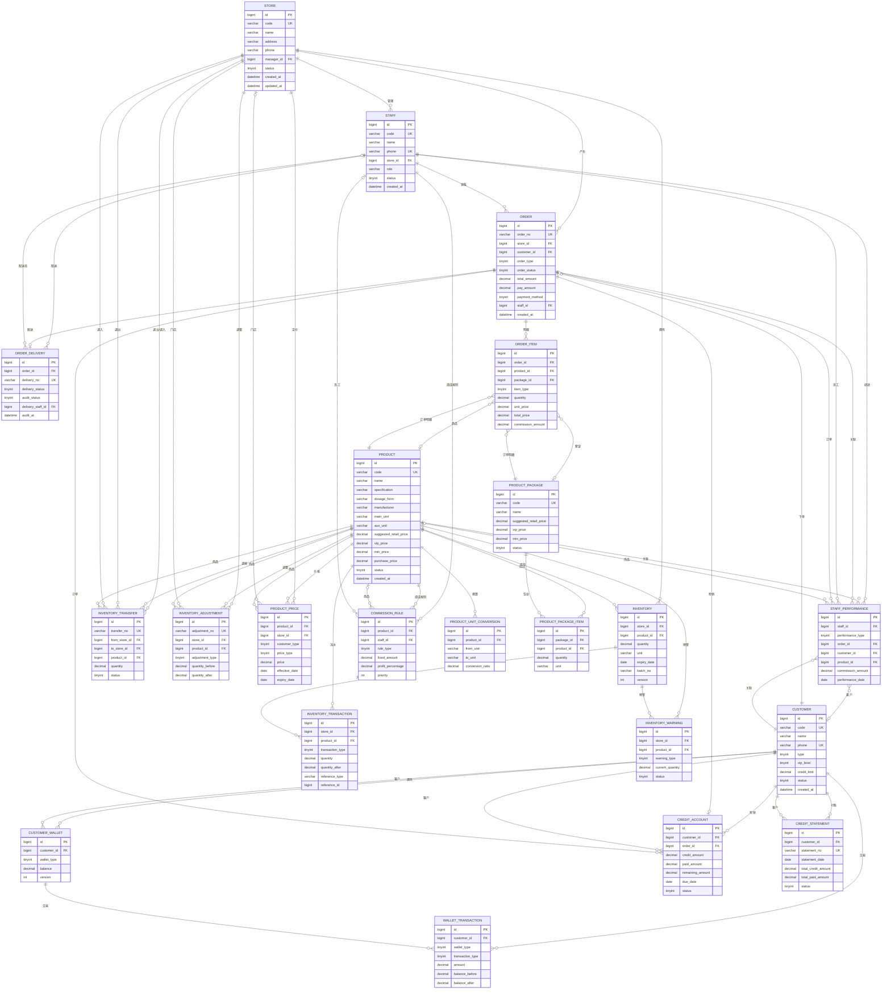

# 农资行业进销存系统 - 数据库 ER 图

## Mermaid ER 图

## 表关系说明

### 核心实体关系

1. **门店 (STORE)** - 系统的基础组织单位
   - 管理员工 (STAFF)
   - 拥有库存 (INVENTORY)
   - 产生订单 (ORDER)

2. **商品 (PRODUCT)** - 核心业务实体
   - 支持多级单位换算 (PRODUCT_UNIT_CONVERSION)
   - 可组成套餐 (PRODUCT_PACKAGE_ITEM)
   - 在各门店有独立库存 (INVENTORY)
   - 支持差异化定价 (PRODUCT_PRICE)

3. **订单 (ORDER)** - 业务交易核心
   - 支持线下POS、小程序自提、小程序配送三种类型
   - 可包含商品或套餐 (ORDER_ITEM)
   - 支持配送审核 (ORDER_DELIVERY)
   - 可关联赊销 (CREDIT_ACCOUNT)

4. **客户 (CUSTOMER)** - 客户管理
   - 支持普通客户和VIP客户
   - 拥有三钱包 (CUSTOMER_WALLET)
   - 支持赊销 (CREDIT_ACCOUNT)

5. **库存 (INVENTORY)** - 多门店独立库存
   - 按门店+商品+批次唯一
   - 支持调拨 (INVENTORY_TRANSFER)
   - 支持调整 (INVENTORY_ADJUSTMENT)
   - 记录流水 (INVENTORY_TRANSACTION)
   - 支持预警 (INVENTORY_WARNING)

## 枚举值说明

### 门店状态 (store.status)
- 1: 正常
- 2: 停用

### 员工角色 (staff.role)
- ADMIN: 管理员
- MANAGER: 店长
- STAFF: 员工

### 员工状态 (staff.status)
- 1: 在职
- 2: 离职

### 客户类型 (customer.type)
- 1: 普通客户
- 2: VIP客户

### 客户状态 (customer.status)
- 1: 正常
- 2: 停用

### VIP等级 (customer.vip_level)
- 1: 普通VIP
- 2: 银卡VIP
- 3: 金卡VIP
- 4: 钻石VIP

### 商品状态 (product.status)
- 1: 正常
- 2: 停用

### 库存调拨状态 (inventory_transfer.status)
- 1: 待调出
- 2: 已调出
- 3: 已入库
- 4: 已取消

### 库存调整类型 (inventory_adjustment.adjustment_type)
- 1: 盘盈
- 2: 盘亏
- 3: 报损
- 4: 其他

### 库存流水类型 (inventory_transaction.transaction_type)
- 1: 入库
- 2: 出库
- 3: 调拨出
- 4: 调拨入
- 5: 调整
- 6: 销售
- 7: 退货

### 库存预警类型 (inventory_warning.warning_type)
- 1: 库存不足
- 2: 库存积压
- 3: 即将过期
- 4: 已过期

### 订单类型 (order.order_type)
- 1: 线下POS
- 2: 小程序自提
- 3: 小程序配送

### 订单状态 (order.order_status)
- 1: 待支付
- 2: 已支付
- 3: 待配送
- 4: 配送中
- 5: 已完成
- 6: 已取消
- 7: 已退款

### 支付方式 (order.payment_method)
- 1: 现金
- 2: 微信
- 3: 支付宝
- 4: 钱包
- 5: 赊销

### 配送状态 (order_delivery.delivery_status)
- 1: 待审核
- 2: 已审核
- 3: 配送中
- 4: 已送达
- 5: 已拒收

### 审核状态 (order_delivery.audit_status)
- 1: 待审核
- 2: 已通过
- 3: 已拒绝

### 价格类型 (product_price.price_type)
- 1: 建议零售价
- 2: VIP价
- 3: 最低限价
- 4: 进价

### 提成规则类型 (commission_rule.rule_type)
- 1: 固定金额
- 2: 毛利百分比

### 钱包类型 (customer_wallet.wallet_type)
- 1: 本金
- 2: 专用金
- 3: 积分

### 钱包交易类型 (wallet_transaction.transaction_type)
- 1: 充值
- 2: 消费
- 3: 退款
- 4: 赠送
- 5: 扣除

### 赊销状态 (credit_account.status)
- 1: 未还清
- 2: 已还清
- 3: 已逾期

### 对账状态 (credit_statement.status)
- 1: 待确认
- 2: 已确认
- 3: 已争议

### 绩效类型 (staff_performance.performance_type)
- 1: 推荐行为
- 2: 服务行为

