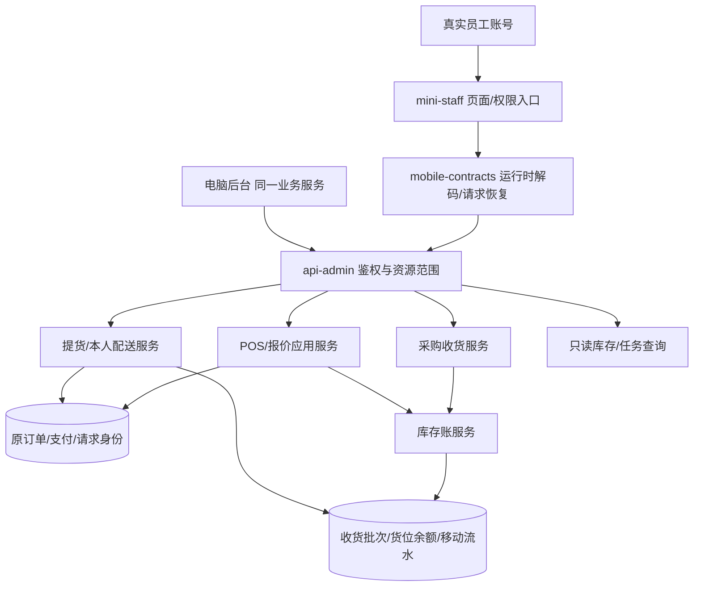
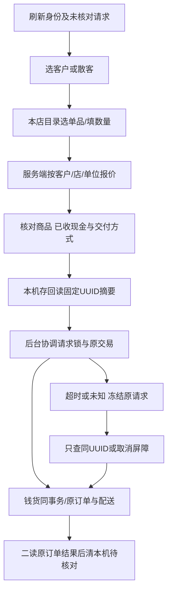

> **2026-11-09规则覆盖**：用户明确日期资料仅供参考，普通销售/调拨不因过期字段硬拦；库存展示、零量和新权限按[13最新决策](13-库存可售与权限决策.md)。正文此前“排除过期”属于旧设计；f327c0b/a20ee14/700006f已完成对应源码及自动验证，原运行环境与手机验收仍须另核。

> **当前状态补记（2026-11-08，5c50477）**：ab3f8ea已提交手机套餐/单品混单源码；5c50477已提交提货按原单聚合源码。因此正文97040d6及V2.1所说“套餐/聚合待实施”是此前基线，现已推进到源码阶段。本次整理未独立复审这些提交，不确认其可售量口径/恢复/真机全部通过。当时员工页注册13条；本轮本人订单增至15条。客户工程仍未建。其余多货准备进度/多人认领等不得随聚合一并宣布完成。

# 员工端小程序详细设计与实施手册

版本：V2.2；更新：2026-11-09；原V2.0基线97040d6，当前700006f及本轮本人订单改动。状态：本人订单源码及自动验证已完成，岗位与真实手机验收未完成。适用于 `mini-staff/`；不代表master、已部署后端或微信体验版已同步。历史文档、差异及取代关系见[一致性基线](09-历史设计盘点与差异.md)。

## 1. 产品目标与最终成果

为大庆小规模农资门店提供可交接、低学习成本的岗位工具：销售在手机选客和现金开单；库管按采购收货、按原批次交货；配送员只处理指派给自己的任务；老板仍在电脑维护商品、客户、价格、采购及权限。手机操作与后台看到同一原单、同一库存和资金事实。

### 交付层级

| 层级 | 目标成果 | 完成判定 |
|---|---|---|
| E-MVP 必交 | 独立微信员工工程、岗位工作台、扫码查货、采购收货、库房提货、本人配送、现金移动开单、原收银核对、设备检查、本人订单只读 | 本文A类验收逐项通过，三岗位使用真实接口完成闭环，安卓/iPhone实测；当前尚未满足全部 |
| E-服务扩展 | 分配给本人的农情采集、回访、已审核SOP、受限内部助手 | 客户端服务事实模型及权限落地后另过B类验收；不得以现有页面工程替代这些模块 |
| 不纳入本次交付 | 手机改商品/价格/单位、角色授权、财务审批、采购付款、库存调整/盘点、跨店调拨写入、赊销授信、员工退款、自动用药、离线钱货写入 | 继续由后台及既有权限承接；新增需说明商业价值和更简单方案 |

成功标准是钱货一致和员工能办事，而不是把后台所有菜单搬进手机。本文选用现工程与单列页面；V1“工作台/任务/我的三栏”暂不实施，避免空壳导航。这是本轮设计建议，不冒称用户逐项确认。

## 2. 架构、边界及模块划分



模块与代码责任：

| 模块 | 当前落点 | 职责 |
|---|---|---|
| 认证 | `mini-staff/src/services/auth.ts`、共享`staff-auth.ts`、AuthStaffController/AuthService | token内存、真实员工/店/权限、会话代次；页面不得另建认证 |
| 工作台 | `pages/workbench/index.vue` | 按权限生成入口、个人本机常用；不请求无权统计 |
| 交易与恢复 | `services/sale.ts`、`pos-recovery.ts`，共享`sale.ts/submission.ts` | 报价、固定摘要、安全UUID、查询/取消屏障、成功二读清理 |
| 查货 | `services/scan.ts`、MobileScanQueryService | 识别商品/批次/货位，按实际门店只读 |
| 收货 | `services/receipt.ts`、共享`receipt.ts`、PurchaseController | 原采购行、实际批次、日期、单位成本；提交前持久摘要，未知冻结 |
| 提货 | `services/pickup.ts`、MobilePickupTaskService、PickupFulfillmentService | 原请求、原分配、剩余实出库清单；不重复记钱货 |
| 配送 | `services/fulfillment.ts`、DeliveryTaskService、OrderFulfillmentService | 本人指派、指派版本/余量指纹、签收；不新建移动配送表 |
| 本人订单 | `services/orders.ts`、共享`staff-orders.ts`、MobileOwnOrderController/Service、OrderQueryService | 原staff_id本人本店POS只读，沿原财务与套餐快照白名单 |
| 设备 | `platform.ts/device-recorder.ts` | 相机、存储、随机源、录音、网络/导航能力诊断，不代表业务完成 |
| 样式 | `mini-staff/DESIGN.md`、`styles/app.css/icons.css`、AppIcon | 一套令牌、组件、字号与状态反馈 |

既有Controller主要适配HTTP，业务规则留应用/领域服务。JDBC/MyBatis沿现Flex事务连接，新增只读接口也不得取消租户范围。

## 3. 岗位、权限及资源矩阵

岗位为配置建议，真实权限由后台角色授予；一个人兼岗取当前有效权限组合。管理员也不能在手机无门店时猜全店。离职、停用角色、权限撤回在服务端生效；旧手机缓存不具授权意义。

| 能力 | 最小现有权限 | 收银建议 | 库管建议 | 配送建议 | 资源与禁止项 |
|---|---|---|---|---|---|
| 工作台/设备 | 有效员工会话 | 是 | 是 | 是 | 身份失败去登录；设备检查无配置也可进入 |
| 单品目录/报价/选客户/开单/收银核对 | `pos:order:create` | 是 | 否 | 否 | 当前员工/门店；客户目录为共享正常客户只读投影，不能称本店独占客户 |
| 查货 | `inventory:view` | 按需 | 是 | 否 | 本店；无进价或库存写权限 |
| 采购收货/读原结果 | `purchase:inbound` | 否 | 是 | 否 | 本店采购；该岗位必须看并填写本次采购单位成本，不能同时宣称全员工不见成本 |
| 库房提货 | `order:pickup:verify` | 按需 | 是 | 否 | 本店合法原请求；不是线上自提码核销的同一交互 |
| 本人配送 | `order:delivery:assigned` | 否 | 按需 | 是 | 本店且当前指派本人；不授`order:ship`/`staff:list`/整店订单查询 |
| 本人订单只读 | `order:own:query`（V142，需明确授权） | 是 | 按需 | 否 | `order.staff_id=真实员工`且同店；兼岗/店长看更多须另走已有授权，不依客户端staffId过滤 |
| 农技采集/标准答复/审核 | **拟新增**`agronomy:case:intake/standard-reply/review/manage` | 单独授予 | 默认无 | 默认无 | 本店分配给本人；review与manage范围分别核对 |
| 知识学习/发布 | **拟新增**学习权限、`agronomy:knowledge:publish` | 单独授予 | 单独授予 | 单独授予 | 学习脱敏资料，不带原客户个案 |

常用功能存 `staff-home-v1:{staffId}:{storeId}`，仅保存功能ID/version，可空选。每次显示与最新授权取交集；不同账号/门店不能串配置，失败回到全部授权入口。它不是岗位权限管理界面。

## 4. 页面结构与逐页交互

以下13条路由均已注册于 `mini-staff/src/pages.json`；“已实现”只指源码接线，不表示整合版逐页验收通过。

| 页面 | 信息与进入条件 | 主流程/主动作 | 必须保留的失败与恢复 |
|---|---|---|---|
| `pages/login/index` | 品牌、实际API配置、员工账号密码 | 登录后读真实身份进入工作台 | 未配地址禁止发账号；错误就地；旧登录结果不能覆盖新会话；不存密码 |
| `pages/workbench/index` | 员工/门店、授权业务、常用项、设备、独立收银核对 | 选择工作/自定义常用 | 身份加载不显示旧角色；空权限不复用缓存；不显示虚构待办数 |
| `pages/scan/index` | 扫码/手输/商品关键词，需inventory:view | 解析→单匹配进入；多匹配人工选择 | SKU/批次/货位分型；未知明确提示；拒相机可手输；不按扫码帧数加数量 |
| `pages/inventory/detail/index` | 商品、主单位账面/未预留量、批次货位、日期，30行分页 | 查看下一页/返回查货 | 未知单位/日期明确未知；停用货位显示状态；不可把余额叫可售量 |
| `pages/receipt/list/index` | 本店待收采购、供应商/原单号，20条分页 | 搜索原单→详情 | 加载/失败/真实空分开；未核对原请求存在时优先恢复，不打开别单 |
| `pages/receipt/detail/index` | 原采购行、已收/剩余基准量、单位、实际成本/批次/日期 | 勾商品→展开填实际批次→核对摘要→提交→查同requestKey→核对结果 | 未填成本不造0；超收须原因；旧采购响应不污染新单；底栏错误可见；未知固定原摘要 |
| `pages/pickup/list/index` | 本店PENDING/FULFILLED任务、游标 | 选任务→最新核对 | 变状态/店使旧查询作废；失败不显示空任务 |
| `pages/pickup/detail/index` | 原单/商品、剩余原SALE分配、内部批次/货位/单位数量 | 逐批勾选→明确已交付→确认 | 售后暂停、取消/全退阻断、指纹变化重新确认；未知先读原请求；完成不再扣库 |
| `pages/delivery/list/index` | 本人PENDING/COMPLETED，20条游标 | 选本人任务 | 不列全店，不预取整店员工；改派后旧数据不可用 |
| `pages/delivery/detail/index` | 必要联系人/地址、剩余物料、canConfirm/blockReason | 电话/复制地址→逐项核对→确认实际签收 | 无可信坐标不造导航点；暂停/完成不返回联系人；未知查原单，不自动重POST |
| `pages/sale/index` | 当前客户/散客、商品卡、本店可售、单位、购物车、现金/交付 | 选客→搜索选货→数量/报价→核对清单→确认已按净额收现金→一次提交→原结果 | 失败报价不兜底；换客重报所有行；搜索/刷新旧响应失效；未知进入冻结核对；成功清原请求后才开新单 |
| `pages/recovery/index` | 当前员工/店本机原UUID及摘要、后台原结果 | 查原请求；完成二读；未知可申请原号取消屏障 | UNKNOWN不是未成交；未拿到CANCELLED不能清记录重收；存储读取/写入/删除失败继续冻结 |
| `pages/device-check/index` | 实际扫码、随机源、存储、录音/试听/清除、网络/明确坐标导航 | 用户主动测单项能力 | 录音本地临时不上传；网络类型不是API可用证据；拒权限有替代路径 |

### 本人订单页（源码与自动验证已接，岗位/手机验收待做）

`pages/orders/list/index`、`pages/orders/detail/index`已注册，合计15页。列表仅本人本店POS原staff_id销售，日期/状态筛选、20条游标分页，展示原单号、创建时间、原净应结算与当前欠款；详情先核归属再读原单，展示原开单已收、赊销、累计实还、退货冲欠/退已收、原物料及套餐组/名称/套数/每套成交价快照和真实配送记录。没有配送记录明确待核对，不推断已交付。

无退款、改价、改派或签收按钮；不下发客户电话/地址、自提码、外部流水、写操作确认令牌。失败可重试并保留筛选，未知金额显示“待核对”，不猜零；离页清除旧明细，换会话/筛选的旧响应隔离。不增业务表，复用订单主档及OrderQueryService原计算，移动白名单DTO保持十进制与Long字符串。角色需V142迁移后由管理员授权，工作台按真实权限可配置常用入口；源码及自动测试不等于实际手机验收。

### 服务扩展页（E-服务，不算现有页）

拟 `pages/agronomy/tasks/index`、`case/index`、`learning/index`：按分配读取个案，照片/语音需上传回执与事实确认；先资料采集，再标准答复/老板审核，再回访。学习只读已发布内部SOP和同意脱敏案例。客户端V2第7节定义共同状态，不另建“员工咨询单”。

## 5. 页面与后台接口对照

本表反映当前源码接口；初版97040d6之后的套餐、提货聚合、库存预检和本人订单已按对应实现更新，并不证明运行后端已升级。路径大小写、响应包装与权限都须以源码为准，不能只看HTTP200。

| 用途 | 方法与路径 | 输入/输出要点 | 权限/后端落点 |
|---|---|---|---|
| 登录/刷新/退出 | POST `/auth/staff/login`；GET `/auth/staff/info`；POST `/auth/staff/logout` | login结果含tokenName/tokenValue/userInfo，info刷新真实身份 | AuthStaffController/AuthService |
| 销售目录 | GET `/api/admin/pos/catalog/products?pageNum=&pageSize=&keyword=` | 默认页首200，搜索50；`code:"200",data:Page`，记录含可售字符串/门店 | pos:order:create；PosCatalogApplicationService |
| 选客户 | GET `/api/admin/pos/catalog/customers?keyword=&limit=20` | 白名单`id/code/name/phone/address/type/vipLevel/vipActive`；无钱包/欠款 | 同上；共享正常客户主档，不称按店隔离 |
| 报价 | GET `/api/admin/products/{productId}/price-quote?storeId=&customerId=&saleUnit=` | Quote含quoteId/productId/saleUnit/suggestedUnitPrice；传当前真实门店 | `product:price:query`或`pos:order:create`；ProductPricingService |
| 开单 | POST `/api/admin/orders/pos` | 固定UUID、staff/store/customer、单品数量/单位/quotedUnitPrice、固定现金方式、交付（不传实收金额）；不得传人工单价兜底 | pos:order:create；PosSaleSubmissionService→原POS创建 |
| 整单物料预检（已接入） | POST `/api/admin/pos/catalog/stock-preview` | 裸storeId/sufficient/issues；原单品/整套需求后端合并，无UUID/钱货/预留，提交前核会话与清单 | pos:order:create；PosStockPreviewService |
| 原结果/取消 | GET `/api/admin/orders/pos/submissions/{requestKey}`；POST 同路径`/cancel` | 仅同员工/店；UNKNOWN/COMPLETED/CANCELLED及原orderId | pos:order:create；持久屏障 |
| 查码 | POST `/api/admin/mobile/scan/resolve` | `{code,purpose:"INVENTORY_LOOKUP"}`→type/matches/hasMore/storeId | inventory:view；MobileScanQueryService |
| 查货搜索/货位 | GET `/api/admin/mobile/inventory/products?keyword=&page=`；GET `/api/admin/mobile/locations/{locationId}/products?page=` | 裸DTO，20条matches | 同上 |
| 货品库存 | GET `/api/admin/mobile/inventory/{productId}?batchId=&locationId=&page=` | 裸InventoryView；主单位汇总、30条基准单位批次余额 | 同上 |
| 待收列表/详情 | GET `/api/admin/purchase/receiving/mobile/orders?page=&orderNo=`；GET 同路径`/{orderId}` | 裸ReceivingOrders/Detail；真实原采购行/单位和剩余 | purchase:inbound；PurchaseController |
| 收货/结果 | POST `/api/admin/purchase/receipts`；GET `/api/admin/purchase/receipts/submissions/{requestKey}` | POST旧字符串code:"200"包装；结果裸ReceiptResult | purchase:inbound；原收货服务 |
| 提货列表/预览 | GET `/api/admin/mobile/pickup/orders?state=&after=`；GET `/api/admin/mobile/pickup/tasks/{requestId}` | 裸Tasks/Preview，confirmationKey、分配ID、canConfirm | order:pickup:verify；MobilePickupTaskService |
| 提货确认 | POST `/api/admin/orders/pickup/requests/{requestId}/fulfill` | `{confirmationKey,allocationIds}`；200空体，随后读原事实核对 | order:pickup:verify；原PickupFulfillmentService |
| 本人配送列表/预览 | GET `/api/admin/mobile/delivery/tasks?state=&after=`；GET 同路径`/{orderId}` | 裸Tasks/Preview，剩余items、指纹；暂停联系人为空 | order:delivery:assigned；DeliveryTaskService/OrderFulfillmentService |
| 签收 | POST `/api/admin/mobile/delivery/tasks/{orderId}/confirm` | `{confirmationKey}`→Result；锁下核对指派版本与余量 | order:delivery:assigned；原订单签收 |
| 本人订单 | GET `/api/admin/mobile/orders?after=&from=&to=&state=`、`/{orderId}` | 裸DTO；本人本店POS、20条ID倒序，from/to为含首尾自然日、state为1—9；忽略客户端staffId/storeId | `order:own:query`；MobileOwnOrderController/Service及OrderQueryService，V142只加菜单项 |

员工已接后台套餐目录/报价及混单，不使用旧inventory投影作可售兜底。所有Long在移动层以十进制字符串保存，裸DTO与旧包装分别解码；HTTP成功但结构不合法即视为结果未证实。

## 6. 数据字典与持久事实

| 对象/字段 | 类型/单位 | 来源和校验 |
|---|---|---|
| staffId/storeId/epoch | 字符串ID/会话整数 | 当前身份；不持久化token；epoch只作本机会话隔离，不是服务端授权 |
| CatalogProduct | id/code/name/mainUnit、pricingUnit、baseUnitName、allowFractionalBaseQuantity、suggestedRetailPrice | product/product_unit投影；pricingUnit用于标价口径，最终销售价来自quote |
| availableBaseQuantity/availabilityStoreId | `string|null` / `string|null` | 仅POS目录填；SUM(balance-reserved)，启用货位，expiry为空或>=DB当天；必须核对原batch.base_unit_id。未知不等0 |
| InventoryView.quantity/unreservedQuantity | 主单位十进制字符串或null | 查货账面及未预留汇总，**不是排除过期/停用后的可售承诺** |
| Stock.baseQuantity/unreservedBaseQuantity | 原批次基准单位字符串 | batch/location余额；缺生产日或有效期保留null |
| SaleLine | productId/name/unit/quantity/quoteId/quotedUnitPrice | 购物车草稿；unit为实际选定销售单位；首期按商品主单位，不新增包装切换界面 |
| POS提交 | requestKey/storeId/staffId/customerId/items/paymentType/deliveryType/receiver*/remark | `paymentType=1`，items单品；不传receiveAmount；员工配送receiver三项均null，由锁下客户档案完整带出；散客只当场交货 |
| ReceivingItem | orderedQuantity/orderedUnit；receivedBaseQuantity/remainingBaseQuantity；units/粒度 | 原采购事实；不可比较不同口径数量后猜剩余 |
| ReceiptBatch | originalUnit/Quantity/UnitCost、supplierBatchNo、productionDate/expiryDate、inspectionReference；换算摘要 | 单位成本保留最多8位有效小数，金额显示2位不修改成本；批次数量按现收货契约最多8位及换算基准粒度校验 |
| requestKey/snapshot | 安全UUID、固定员工/店/采购单或POS摘要 | 本地先存回读，再发；本地存储仅恢复线索，后台同key同体重放才是事实 |
| PickupPreview.allocations | id/batchId/internalBatchNo/locationId/locationName/quantity/unit | 原SALE减同分配正RETURN；逐批确认最新正量；不改requestedBaseQuantity |
| AssignedReceipt.items | orderItemId/productName/quantity/unit | 当前剩余交付，不用原订单购买量猜；confirmationKey64位小写hex由后端生成 |
| assignmentVersion | Long，配送单持久字段 | 每次改派递增；即使改回同一员工也不复用旧确认 |
| Order摘要 | totalAmount/discountAmount/couponAmount/payAmount/receivedAmount/remainingCreditAmount/refunded等 | 复用原明细与PaymentDisplayPolicy；payAmount是含赊销净应结算，不能直接称“现金到账” |

金额使用分舍入；数量字符串保留有效精度不强制显示0.0000。整件基准必须整数；公斤/米等是否可小数由后端QuantityGranularityPolicy提供。半箱只在换算为整数最小单位时合法。首期员工主单位输入校验不等于已开放任意包装单位销售。

唯一库存来源：`inventory_receipt_batch`、`inventory_batch_balance`、`inventory_movement`；`inventory`只是投影。订单仍用`order/order_item/order_payment/order_delivery/order_item_batch_allocation/order_pickup_request`。防重用`pos_sale_submission`及既有收货请求身份。不新增员工商品/订单/客户/配送影子表。

### 本人订单移动契约（V142配套，无新增业务表）

| 输入/字段 | 类型与含义 |
|---|---|
| `after` | 可选正Long字符串，按订单ID倒序读取下一页，不是页码；过滤后最多21候选，返回20及尾项游标 |
| `from/to` | 可选YYYY-MM-DD自然日，1900—9998年；to含当天，数据库条件为次日00:00之前；反向/非法日期拒绝 |
| `state` | 可选整数1—9，原订单状态，不与提货PENDING/FULFILLED或配送状态混用 |
| 列表 | 裸`{storeId,orders,nextCursor}`，storeId和cursor为字符串；无更多时cursor为null |
| `orders[]/detail.order` | orderId、orderNo、createdAt（ISO本地时间或null）、state、customerLabel、finance、deliveryType/status |
| customerLabel | 无customerId为散客；有客户只展示首字脱敏，资料缺失明确待核对；无电话号码/地址/客户档案写入口 |
| finance | payAmount原净应结算（含赊销）、receivedAmount开单已收、creditAmount原赊销、creditReductionAmount退货冲欠、cashRefundedAmount累计退已收、remainingCreditAmount当前欠款、repaidAmount累计实还；均为非负十进制字符串或原计算返回null，不因展示猜零或相减重算 |
| 配送字段 | 直接取原OrderQueryService配送记录；类型1自提/2门店配送/3快递，状态1待付款/2待派/3配送中/4已签；无记录保持null，不能推断已交货 |
| 详情 | 裸`{storeId,order,items}`；服务端先后校验原订单归属再输出白名单 |
| items[] | itemId字符串、productName、原quantity/unit/totalPrice、refundedQuantity/refundedAmount；金额/数量保持十进制字符串，缺资料保留null |
| 套餐快照 | packageGroupNo、packageName、packageQuantity、packageUnitPrice；来自原订单行，缺历史快照不从现档案补。逐物料totalPrice是原分摊成交额，不是将单价再乘数量 |
| 明确不返回 | 电话/地址、自提码、外部支付流水、成本、退款/提货/签收确认令牌、任何可写操作能力 |

页面不保存订单明细到本机、不新增收银请求；离页清旧资料，返回页面重新核身份和原单。服务失败、未知字段和真正0值区分。日期/状态查询不改变历史订单、钱货或原员工归属。

## 7. 状态定义与业务流程

### 7.1 不混用状态命名空间

| 对象 | 当前状态 | 解释 |
|---|---|---|
| order.order_type | 1 POS /2线上自提 /3线上配送 | 来源/履约类型，不是门店类型 |
| order.order_status | 1待支付、2已支付、3待自提、4待发货、5已发货、6已完成、7取消、8退款、9部分退款 | 数值状态不足以判可交；还需真实配送、售后、实出库余量 |
| order_delivery.delivery_status | 1待审核、2已审核/待派、3配送中、4已送达、5拒收 | 存在实体旧命名；页面按服务canShip/canConfirmReceipt呈现动作，不自行造“拒收退款”链 |
| after_sales.status | 10/40处理中，50完成（本处仅列交付守卫相关值） | 是售后状态，绝非订单10/40；处理中暂停交付，完成后仍核剩余 |
| order_pickup_request.status | PENDING/FULFILLED | 库房履约请求；与线上订单自提码不同 |
| mobile配送状态 | PENDING/COMPLETED | 本人任务DTO状态，不写回订单枚举 |
| pos_sale_submission | PENDING/COMPLETED/CANCELLED | 持久请求状态；查询UNKNOWN不证明原请求未执行 |
| ReceiptResult | UNKNOWN/COMPLETED | 原请求事实查询；不存在可随意清掉的“失败后新开”按钮 |
| 页面状态 | loading/empty/error/ready/submitting/pending/reconciling/completed/blocked | UI状态不是新DB状态；新会话/页面隐藏使旧响应失效 |

### 7.2 销售闭环



- 换客户后整单重报价；报价未完成、移除物料、失败再加新物料不能掩盖指纹错误。
- 后端报价变更拒绝成交，不由前端使用档案零售价补单。未完成结果不得换UUID重收。
- 当场交货不建配送；选择门店配送必须客户档案三项齐全，复用order_delivery，收款/出库一次。员工端不创建库房取货任务选项。
- 当前员工页无现金实收金额输入、无找零交互，命令不传receiveAmount/discountAmount/payments/人工成交金额，按后端重新报价净额登记现金；操作员必须先确认实际收齐该金额。电脑POS的实收/找零能力不能说成手机已有。若后续确需现金面额与找零辅助，先独立设计并验证，不在本轮暗中扩范围。测试收款只在隔离环境，不调用真实支付平台。

### 7.3 收货闭环

原采购剩余→按行勾选实际到货→单位与数量/成本/日期→多批次核对→安全请求摘要持久化→原POST→GET原结果→核对receiptId/批次→结束。

数量不足可分次收货；超收必须原因并由后端规则校验。未提交草稿可进程内保留，不保证杀进程保留全部编辑；已提交摘要恢复必须可靠。未知后同体重试，不修改采购、成本或日期；未知重试后的业务拒绝也不能证明第一次未提交。

### 7.4 提货与配送闭环

出库在原销售完成；提货确认只登记交付事实。配送先由后台派单，员工只读本人任务。最新preview→逐项核对→提交原指纹→原订单锁下重算SALE-RETURN/售后/当前指派→完成。部分退货可交剩余；全退、取消、无出库证据拒交；售后10/40暂停。重复确认返回原结果，钱货/积分/提成事件不重复。

库房提货扫描SKU只能定位，不能证明批次已核对；需要确认内部批次、货位和实际剩余量。指纹过时必须重新展示并由人确认。改派后旧员工不能靠缓存地址或原指纹继续操作。

## 8. 交互与一致性标准

- 沿用当前青绿/中性面板令牌，员工正文15px、辅助最小12px，核心操作可读；V1默认16px与当前规范冲突时，以现规范为基线，经真机可再调大。客户大字模式另定义，不强迫PC同字号。
- 主按钮目标高≥48逻辑像素，数量步进热区≥44；关键页不出现业务操作横向滚动。底栏含安全区与键盘避让，不遮最后一行。
- 长码折行/复制，原值不截断提交；数量单位紧邻，金额两位与高精度进价/数量分开格式化。
- 收货单商品折叠、已勾选始终可见；进入核对定位页首，错误留在主操作附近；加载失败与真正空记录分开。
- 不预申请所有权限；拒相机能手输、拒录音能键入。电话/地图由用户主动触发，不因打开页拨打电话。
- 所有异步响应绑定员工、门店、epoch、页面读取代次及当前对象；隐藏/切换后旧成功或401不能污染新会话。
- 离线允许看已明确标旧的非敏感资料/未提交草稿，不允许离线收款、扣库、签收。待核对摘要不得被退出登录、升级或个人常用设置清掉。

## 9. 实施手册与里程碑

以下为单主力开发的工作量估计，不是日期承诺；从实际开工日起计，不并行推进多套钱货改造。每阶段以门禁完成为准。

### M0 基线与整合验收（3—5工作日）

- [ ] 固定当前提交，记录现有后端实际版本；整合UI必须连含客户目录和新可售字段的后端，旧JAR不能冒称联调成功。
- [ ] 建本轮独立库/Redis/端口，仅虚构数据；保留原开发库。新库迁移到当时最新版本（核查目前V141），不硬编码未来版本号。
- [ ] 建收银、库管、配送、无权限、别店、停用六类账号，后台最小授权，留环境和角色证据，不输出密码/token。
- [ ] 按A01—A12走15页，截图核对键盘/底栏/长码/错误和真实API/SQL。修复每一失败先补复现测试，再改最小代码，再回归。
- [ ] Android+iPhone各一完成相机、存储、前后台和杀进程；无设备的行保留未测，不挡自动工程推进但不准发布。

### M1 本人订单最小只读（2—4工作日）

**拟改文件：** 新移动订单查询Controller/应用查询服务/白名单VO；复用OrderQueryService及repository；新增`mini-staff/src/services/orders.ts`、两页、共享`staff-orders.ts`及对应测试、注册路由。

2026-11-09实施计划（基线700006f，执行中）：

1. 后端先补真实仓储游标/日期/状态过滤和本人本店越权用例，再增加`OrderRepository.findOwnSales`、`MobileOwnOrderService`及`MobileOwnOrderVO`。列表固定20条、ID倒序，日期按门店服务端自然日含首尾，状态仅1—9；只认POS原`staff_id`，缺失不按`created_by`猜。列表复用`OrderQueryService`原金额装配，详情先核归属再复用原详情，输出白名单，不下发电话、地址、自提码、支付流水号或任何写操作令牌。
2. 增加GET `/api/admin/mobile/orders?after=&from=&to=&state=`与`/{orderId}`，无缓存；V142仅向既有`sys_menu`增加`order:own:query`，不增业务表、不自动授权。测试真实安全拦截/迁移可见、管理员独立授权、撤权即时拒绝；原整店订单权限不变。
3. 共享`staff-orders.ts`使用字符串Long/金额/数量与严格裸响应校验；员工`services/orders.ts`绑定真实会话、门店和对象。列表/详情沿现有全局界面令牌，日期/状态查询、20条加载更多、失败重试和只读原物料/套餐快照；工作台按权限增加可配置常用入口。测试筛选变化/离页/换员工后的旧响应不得覆盖新页。
4. 逐项验证定向红绿、完整后端MySQL/权限门禁、共享及员工测试/类型/微信构建；独立审查后中文提交推GitHub当前分支，更新本手册/02/12/13及证据。岗位浏览器与安卓/iPhone无实操证据时保留未验，不以自动测试替代。

复用现有订单表和金额计算比新建手机订单或资金投影更简单，也能让电脑与手机核对同一笔事实。无退款、改价、改派或整店经营报表入口。

- [x] 先写别人/别店订单ID、无权限、离职、缺门店、空列表/分页和Long精度用例并执行；明确`staff_id`原事实缺失的历史单不猜本人。
- [x] 实现上述接口与最小权限迁移（只增权限项，不自动给全部员工）；现订单表可解决，不增表。
- [ ] 页面只展示真实结果，不加退款/改派写入口。后台打开同单号，核金额/物料/交付；手机改URL拒绝越权。
- [ ] 类型、构建、自动及岗位验收过，中文独立提交。

### M2 联动恢复与发布候选（3—5工作日）

- [ ] 两岗位并发：收货与销售，销售与售后/提货，配送与退款/改派；验证旧指纹失败且不二次记账。
- [ ] 对四类写操作分别注入“未到服务端”“已提交但丢响应”“查询失败”“本机存储失败”；断网/重登/杀进程后核同请求，0次重复钱货。
- [ ] 执行发布检查、岗位任务测试与A类全部验收；保留1个可回退后端版本/前端包，写环境地址/构建摘要。

### M3 服务扩展（客户服务C1—C3模型就绪后，5—10工作日估计）

- [ ] 复用客户端V2的case/entry/knowledge、同一后台审核队列；先采集/标准知识/人工回访，不先建聊天窗。
- [ ] 学习读已发布内部SOP；助理不能发布专业结论；每条采集/回访可追溯操作者与时间。
- [ ] AI仅解释允许知识，不写订单/库存/支付。B类验收通过才单独启用。

每任务循环：确认影响→写失败用例→最小实现→定向验证→适当完整回归→独立审查→文档/证据→中文提交。UI可逆文案不强行写镜像测试；钱货/权限/恢复用例必须有真实断言。

## 10. 构建、联调与发布操作

在仓库根执行，先确认Java17和锁文件依赖；首次安装用既有锁文件，失败不擅自升级框架。

```bash
npm --prefix packages/mobile-contracts ci --ignore-scripts
npm --prefix mini-staff ci --ignore-scripts
npm --prefix packages/mobile-contracts test
npm --prefix mini-staff test
npm --prefix mini-staff run type-check
npm --prefix mini-staff run build:mp-weixin
JAVA_HOME=/opt/homebrew/opt/openjdk@17 ./mvnw -B -Dmysql.it=true -Dauthority.mysql.it=true clean verify
python3 scripts/verify-backend-reports.py
```

Java路径为当前开发Mac示例，其他机器使用实际Java17路径。完整测试只连接测试配置，不把示例命令当生产启动。已知97040d6记录为后端983/150报告、员工111、契约59全过；**本轮文档核查没有重跑这些测试，不把历史通过数当今日新增验证**。

1. `mini-staff/.env.local`设置实际API源站，不含凭据/路径；生产HTTPS，dev允许本机/内网HTTP；配置不进Git。
2. 本机联调用 `npm --prefix mini-staff run dev:mp-weixin`，导入`mini-staff/dist/dev/mp-weixin`；发布用`dist/build/mp-weixin`。
3. AppID只填工程配置；AppSecret仅服务端秘密配置，不写小程序、文档或日志。员工首期账号登录，不调用客户微信登录绑定角色。
4. 正式发布使用独立员工AppID及可达HTTPS，核对证书、域名与基础库。游客模式/测试号只作开发证据。若本机临时放宽域名检查须限该测试工程、记录并恢复，不能提交为正式默认值。
5. 安装体验版由实际岗位验证；每次后端、前端和迁移版本写入验收清单，版本不符先停止用旧UI结论。
6. 回退先停止新写入口/新销售，保留原请求核对与原事实；保留批次、流水、请求屏障和旧单。不能删表或清本机记录来“解冻”。

## 11. 可量化验收矩阵

证据模板：编号、提交/构建、后端/DB环境、角色/店、设备/微信基础库、原请求/订单/批次ID、输入、预期/实际、API+只读SQL核对、截图、结论、复测时间。虚构测试名称可入报告，token/密码不可。

| ID | 场景与数量 | 通过标准 | 核对方式 |
|---|---|---|---|
| A01 身份 | 六类账号，各进所有已授权/未授权入口；A登录中切B至少10次 | 未授权和跨店0次读取/写入；旧响应0次覆盖/退出新会话；角色撤回下一次请求生效 | HTTP权限与真实staff/role/menu关联，不只看隐藏按钮 |
| A02 可售量 | 未过期、当天、昨天、未知日期、停用货位、预留、别店、单位不一致、无余额各至少1例 | 目录等于合法批次SUM；未知≠0；零/未知0次发报价；不混别店 | 原batch/balance/location只读SQL与目录字符串逐项比 |
| A03 数量/价格 | 整袋0.5、公斤0.125、包装换算到整数/非整数、5位小数、换客、报价失败/变更 | 整件不拆最小单位；前后端都拒非法；报价失败0次成交；所有金额分准确 | quote、提交原文、订单行/支付金额；包装例可在后台验证，手机首期不冒称有切换 |
| A04 销售 | 散客当场、档案客户当场、完整档案配送、缺档案配送各1；有效单再重复10次同号 | 每有效请求只1原单/1组SALE/1组收款；缺档案拒绝且0钱货；配送只有原order_delivery | pos_sale_submission、order、payment、allocation/movement计数及余额 |
| A05 收货 | 部分/分次、多批次、超收、仅有效期、未知日期、8位进价、存储失败 | 数量/成本精确；同UUID重试10次只1收货事实；缺成本/非法粒度0写入 | receipt/line/batch/movement与采购剩余，实际Flex事务 |
| A06 提货 | 正常、部分退货、0元物料、售后处理中、全退、无SALE、完成重放各1 | 只交合法剩余；确认前后库存/资金不变；重复10次无追加出库 | request.status、原分配/RETURN、流水/支付计数 |
| A07 配送 | 本人/他人、部分退、暂停、全退、改派再改回、重复签收 | 仅当前本人可交；旧指纹拒绝；完成事实/事件只1次，0重复钱货 | assignment_version、order_delivery、事件对应事实、请求日志 |
| A08 未知恢复 | POS/收货/提货/配送 × 丢响应/查询断网/重登/杀进程 | 原请求可核；UNKNOWN不重收；本机异常冻结；0次因恢复重复单/移动/退款 | 请求身份、前后计数和设备录像；四类分别留证 |
| A09 扫码 | 每台设备20张商品码+10内部批次+5货位、未知/重码各5 | 正确分类≥95%，错误分类触发写入0；连续同码不自动重复数量；拒相机手输完成100% | 预先标注码集和实际结果；无法识别可人工兜底 |
| A10 交互 | 320/375/430逻辑宽度、系统大字、软键盘；15页全测 | 无横向滚动操作、关键截断或底栏遮挡；1主动作；错误在操作附近；无未处理异常 | 真机/工具截图及页面清单，不拿静态8屏替代 |
| A11 本人订单 | A/B同店及C别店、历史缺staffId、20+分页 | 返回/详情100%满足真实本人本店；字段与后台同单一致；0写钱货 | 同orderId逐字段核对、跨对象HTTP拒绝 |
| A12 使用/性能 | 收银/库管/配送各2人（不足人数用实际使用者两轮，标样本限制）；50次核心只读 | 无帮助完成核心任务≥90%；每类关键错误0；稳定测试网络下接口p95≤1秒、页可操作p95≤2秒；50次0未处理异常 | 固定网络/设备/数据量/后端版本，记录实测，不含拍照时间 |
| B01 服务权限 | 同一case跨客户/员工/店/学习页 | 越权0、私有资料进入公开/学习0 | API/附件授权与数据库归属 |
| B02 服务闭环 | 10个资料采集→答复→回访；高风险、无回应各至少2 | 过程全部追加可追溯；无回应不算解决；普通员工专业审核越权0 | case/entry版本及原作者、知识引用 |
| B03 AI助手 | 至少50条版本化题库 | 自动危险处方0；真实可见引用100%；超时有知识/人工替代；不能写钱货 | 老板审核题库、请求状态/成本与输出记录 |

阈值是本轮拟定发布门槛，未达时记录原因与修复，不回填“通过”。硬件成功率目标是技术可用性，不保证识别破损条码。

## 12. 依赖、风险与停止条件

| 依赖/风险 | 影响 | 处置/停止条件 |
|---|---|---|
| 员工/客户端测试AppID共用、多个工程切换 | 预览、缓存和身份环境混淆 | 开发标明工程；正式双AppID独立构建；员工不复用客户OpenID身份 |
| 本机可连但手机不可达 | 工具通过而真机失败 | 手机实际访问HTTPS测试服务；未过A08/A09不发布 |
| 原库存单位事实缺失 | 可售未知、业务阻断 | 后台核对事实修正；不猜成本/单位、不降规则；保留阻断 |
| 标价、客户会员/档案并发变化 | 旧价/旧地址成交 | 后端锁下校验/档案快照；前端重报价或重新确认 |
| 客户目录为共享主档 | 员工查到共享正常客户 | 明确授权及最少字段；若经营要按店客户归属先设计现有关系规则，不加假store过滤 |
| 收货岗位可见进价 | 越权敏感信息 | 仅purchase:inbound；普通查货/配送DTO无成本；跨角色专项检查 |
| 小程序存储/被清理 | 原请求线索丢失 | 存回读失败不发；恢复失败冻结；不得承诺卸载后本地摘要仍在，必要人工后台核账 |
| 员工本人订单已接，岗位/真实手机证据尚缺 | 源码支持本人本店历史查询，尚未验收真实手机与目标部署 | 按A11及10号手册核对，不给整店order:query充数 |
| 服务资料/老板时间不足 | AI界面增加工作量 | 先SOP/资料完整性/有限人工队列，再AI；无知识先不启用自动答复 |
| 测试过但版本不一致 | 错误宣称交付 | 提交+后端+产物绑定；整合版重新逐页验收 |

终态成果应包含：可复现构建、岗位权限配置表、上述A类完整证据、体验版与设备清单、部署/回退/异常核对操作手册、待办及未测项目。不满足时只能称“工程阶段完成”。

## 13. 平台依据与维护

查询日2026-11-08：[DCloud扫码API](https://en.uniapp.dcloud.io/api/system/barcode.html)确认微信平台支持扫码调用；这不证明本项目机型实测。微信账号、合法域名、类目与隐私等具体平台要求在体验/发布阶段由账号持有人对照实际官方后台复核，不按旧文档收费/周期作承诺。

变更记录：V2.0建立97040d6基线、修正旧13页/现金/可售量/权限及恢复描述；后续每一接口或状态变更须同步本文件和验收用例。产品代码优先，出现冲突先核事实再更正文档，不能为了符合文档放松库存/资金守卫。

## 附录A：源码、迁移与测试追溯

以下为仓库相对路径。实施者必须先读当前文件再改，不把本文复制为新规则实现。

| 契约 | 权威源码/迁移 | 可复用现有测试 |
|---|---|---|
| 实际员工身份 | `core-application/src/main/java/com/agri_system/application/auth/service/AuthService.java`、`auth/util/CurrentUser.java` | `mini-staff/tests/page-lifecycle.test.cjs`及现权限MySQL集 |
| 目录可售/报价 | 同模块`order/service/PosCatalogApplicationService.java`、`product/service/ProductPricingService.java`；infrastructure的`inventory/mapper/InventoryBatchBalanceMapper.java` | PosCatalogApplicationServiceTest、SaleableStockQueryTest、`sale-pages.test.cjs` |
| 单位与库存 | 同模块`inventory/service/InventoryLedgerService.java`、`product/service/ProductUnitService.java`；domain的QuantityGranularityPolicy | MobileScanQueryServiceTest及批次账/粒度现有用例 |
| 现金开单/请求 | 同模块`order/service/PosSaleSubmissionService.java`、`PosOrderCreationService.java`、`PosOrderInputPolicy.java`；`V133__pos_sale_submission.sql` | OrderApplicationServicePaymentFlowTest、移动共享submission测试 |
| 收货 | 同模块`purchase/service/PurchaseApplicationService.java`、`dto/vo/MobileReceivingVO.java` | ReceiptSubmissionQueryTest、ReceiptSubmissionHttpTest、`receipt-pages.test.cjs` |
| 提货 | 同模块`order/service/MobilePickupTaskService.java`、`PickupFulfillmentService.java` | PickupRemainingEvidenceTest、MobilePickupHttpTest、`pickup-pages.test.cjs` |
| 配送 | 同模块`order/service/DeliveryTaskService.java`、`OrderFulfillmentService.java`；domain的OrderDeliveryEligibility；V134权限/V135指派版本 | AssignedDeliveryReceiptTest、AssignedDeliveryHttpTest、DeliveryReassignmentHttpTest、`delivery-pages.test.cjs` |
| 样式/恢复 | `mini-staff/src/styles/app.css`与共享`submission/receipt/pickup/fulfillment.ts` | `workbench-preferences/recovery-page/money.test.cjs`及各页面测试 |

这些路径中的缩写“同模块”指`core-application/src/main/java/com/agri_system/application/`，不是新增文件路径。

## 附录B：隔离验收只读核账示例

仅在确认表结构/环境与当前迁移一致后，把示例store/product/request替换为本轮虚构数据。示例不执行更新；正式验证还须对应原订单与合法分配，不能仅凭行数相等判全部一致。

```sql
-- 本店商品按原批次基准单位汇总；与目录过滤一致。
SELECT b.product_id, r.base_unit_id,
       SUM(b.base_quantity-b.reserved_base_quantity) AS available_base_quantity
FROM inventory_batch_balance b
JOIN inventory_receipt_batch r ON r.id=b.batch_id
WHERE b.store_id=1 AND b.product_id IN (9101,9102)
  AND b.base_quantity>b.reserved_base_quantity
  AND EXISTS (SELECT 1 FROM inventory_location l WHERE l.id=b.location_id AND l.status=1)
  AND (r.expiry_date IS NULL OR r.expiry_date>=CURRENT_DATE)
GROUP BY b.product_id,r.base_unit_id;

-- 原UUID只能对应原结果；不要删除请求行试图重测。
SELECT request_key,store_id,staff_id,status,order_id
FROM pos_sale_submission
WHERE request_key='替换为本轮原UUID';

-- 查看同一原单，不用金额字段名推断现金流。
SELECT id,order_no,store_id,customer_id,staff_id,order_type,order_status,
       total_amount,discount_amount,coupon_amount,pay_amount,payment_method
FROM `order` WHERE id=1;
SELECT payment_type,SUM(amount) AS original_payment_amount
FROM order_payment WHERE order_id=1 GROUP BY payment_type;
```

实际退款与还款必须追加核对原来源、冲欠、退已收和分配事实，最后一条原支付合计不是净现金余额。提货/配送核对前后移动与资金不变，并另查真实交付状态。数据校验过程一旦发现单位不明，停止相加，保留待核对。

## 补充设计 V2.1：个人移动作业终端、套餐销售与多货拣取

2026-11-08用户补充真实经营场景：门店可能只有一台电脑，不能每名员工各配电脑或反复切换电脑账号；员工用自己手机销售、扫码、到库房查看待取货品，替代容易遗忘的纸单。**本节调整前文首期范围优先级；当前实现事实不变，不代表以下功能已完成。**

### 产品目标修正

员工端是每位员工独立身份下的日常移动作业终端，不是电脑后台的少量辅助入口。电脑负责老板管理、建档和授权；手机覆盖已授权岗位日常销售及仓库任务。一人多岗共用自己的账号，权限组合显示能力，避免共用老板账号或轮流占电脑。

E-MVP销售范围由“仅单品”调整为“单品＋后台已支持独立报价的套餐”；现金和现有两种交付方式暂不因本次澄清扩大。前文所有“套餐不纳入首期”的排期描述由本节取代；目前手机代码仍只实现单品。

### 手机套餐销售

- 选货页增加“商品/套餐”明确分类和关键词搜索，套餐卡展示名称、每套价格、组成和单位；展开能看清具体物料，不让员工自己算组合价。
- 套数必须正整数。复用既有POS套餐目录和PackagePricingService对应报价入口，正式接口参数在实施时核当前Controller；不在文档猜造可调用路径。
- 命令按后台现OrderItemDTO提交itemType=2、packageId、quantity及packageQuoteId，不由手机展开物料或计算最终分摊。报价按真实店/客户，价格或组成变化拒绝原确认并重新报价。
- 单品与多个套餐可混合销售；手机清单按套餐组显示套数、每套价和小计，核对时能展开实际物料。相同物料跨套餐不能因此丢失组和原分配来源。
- 出库后仓库任务必须显示真实物料/规格/单位/数量，套餐名称仅作来源提示；库管不能只看到“套餐2套”而不知道拿什么。
- 继续遵守报价指纹、整数分分摊、0元物料留数量、套餐历史快照及原请求防重。员工手机暂不开放正式退款，后台原售后仍需正确处理手机套餐原单。

### 多货待办与库房交付

目标是“手机上看得见要拿什么，拿到哪一步，哪些还没交”，无需员工再抄纸单或凭记忆。

- 待取列表按原订单聚合展示，主信息为客户/原单、待交商品项数和剩余数量；详情列实际物料、规格、单位、内部批次、货位、剩余可交数量。当前底层任务按原请求存在，聚合仅为视图，不另建第二套订单/库存。
- 每行支持“未核对/已核对”的明显进度及只看未核对；条码辅助定位，内部批次码用于对应批次核对，重码不能自动取第一项。
- “我已经找到/拿到货”的本机勾选是准备状态，**不等于已交付、不改库存或原任务状态**；最终交付前读最新预览、核对实际批次和数量，再由员工明确确认交货。
- 进入其他页面或前后台回来可在同身份/门店/原任务下恢复准备进度；页面必须重读最新余量，售后/退货/取消/改派变化使相关旧勾选失效，不能用旧清单交货。进度跨进程保存与敏感字段最少化需单独实现验收。
- 一单多请求逐条确认时，显示整单还有几项待交及已确认项，不能第一项成功就显示整单交货完成；超时明确保留哪条原请求待核对。
- 多人可能同时看同一任务。当前没有完整“领任务/排他拣货占用”事实，不能把本机勾选当他人可见的领取。首期由岗位约定一人处理同单并明确提示；若实际多人协同需要系统认领/移交，再单独设计持久归属与超时释放，不能仅靠前端锁。无该能力不宣称已解决重复人工搬货。
- 门店配送单的待备货与库房提货请求不是同一种对象：复用原order_delivery与SALE分配生成可读准备清单，不为方便出清单再建提货请求或再次扣库。备货与最终签收必须区分；新增备货持久事实前先检查现结构能否表达，不能伪装成已签收。

### 优先级与验收补充

员工主线调整为：①整合版现有功能验收；②套餐销售及套餐/单品混合开单；③整单多货清单、扫码核对、剩余进度与原结果恢复；④本人订单查询；⑤按真实协作需求决定认领/移交，后续再农技培训。身份关联等客户端工作不替代员工移动营业闭环。

- 套餐独立价不同于单品价之和、多个套餐共有商品、单品混套餐、价格/组成变化、缺货、0元物料、重复提交各至少1例；订单金额与后台报价一致，固定请求重放10次只1原单/1组钱货；后台原售后回库/退款与分摊尾分一致。
- 同一单20行以上物料、多个货位/批次，用实际手机完成查看/扫码/未核对筛选/逐项交货；待交项遗漏0，提前显示整单完成0。未知原请求不得被下一项覆盖。
- 准备过程中插入退货、取消和旧预览变更，各至少1例；最终交付重核，过时指纹0放行；确认交货新增SALE/收款均0。
- 两员工同时打开同一任务：服务端重复履约不得二次记钱货，界面准确刷新；系统没有认领前，人工重复搬货仍列为协作风险，不以防重事务冒充解决。
- 收银/库管各至少两轮真实任务观察：无需占用电脑、抄纸单、切他人账号即可完成授权范围日常任务；记录点击/耗时/遗漏并复测，不凭页面数量判断数字化成功。

2026-11-09第三批已接整单只读物料预检；预检不是成交/预留，结果未知不发收款请求。只有正式提交后的结果未知才走原收银恢复。
