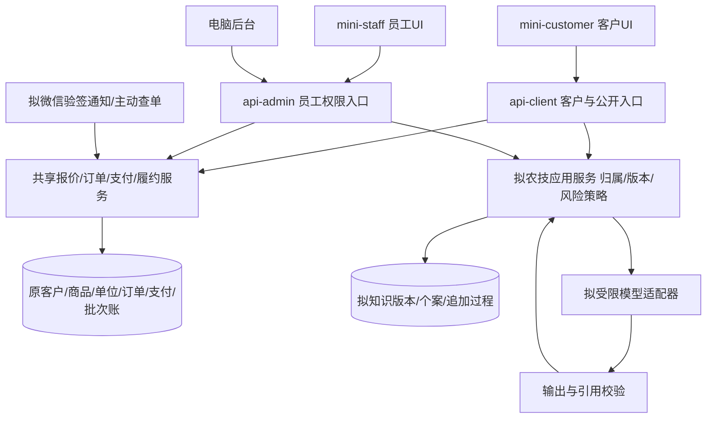
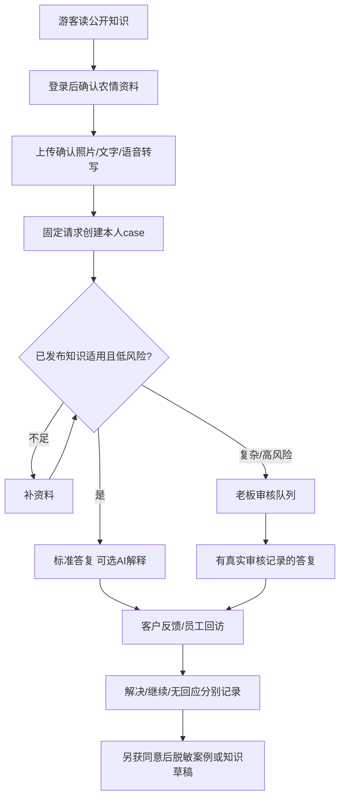
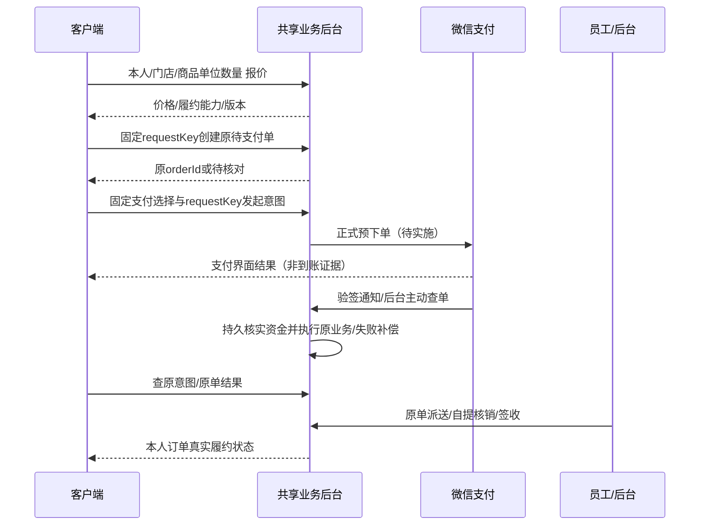

> **2026-11-09规则覆盖**：用户明确日期资料仅供参考，普通销售/调拨不因过期字段硬拦；库存展示、零量和新权限按[13最新决策](13-库存可售与权限决策.md)。共享库存代码已按f327c0b/a20ee14/700006f同步；客户端新目录仍未实现，不代表客户工程或验收已完成。

# 客户端小程序详细设计与实施手册

版本：V2.7；更新：2026-11-10；本批实现基线f2c1121。**mini-customer工程尚未创建，客户页面不是现有交付。**应用隔离/V143、身份行撤销/V144、平台号码短时核验，以及C0-B③/④开户/持久待核验/后台初次核验页与原决定恢复已落源码并通过自动验证；完整治理、客户工程、真实微信/支付/手机仍待。历史版本见[文档盘点](09-历史设计盘点与差异.md)。

## 1. 定位、服务人群与目标成果

面向黑龙江大庆及周边农户，以玉米、水稻和明确到具体作物的大棚/大田问题为主要服务场景；短视频带来的东三省外地客户需另有地域、品种适宜及快递限制说明。目前只有老板具备主要农技判断和下田回访能力，产品必须减少重复采集与重复答复，不承诺无限咨询、实时专家团队或拍照确诊。

客户端目标是“能找到可信帮助、记录自己的问题与答复、买到适用且能履约的商品、查到自己的订单”，并把经审核的经验沉淀给员工使用。AI是受限工具，不是一个可以自行改价、开单、扣款、调库存或开处方的代理。

| 交付版本 | 最终成果 | 必要验收 |
|---|---|---|
| C-服务MVP（先行） | 独立微信工程；无需登录的真实门店/已发布知识；安全客户登录/老客认领；文字/照片问题采集、本人记录、人工/标准答复、真实回访、简单商品查询 | C01—C09通过；未有AI/支付也可发布已完成服务范围，但不得假装可付款商城 |
| C-AI试点 | 基于已发布适用知识的解释、补资料、明确人工接力；预算与失败降级 | C10和服务试点通过；没有合格知识或数据处理条件则保持人工服务，不启用模型 |
| C-交易MVP | 单品、后端报价、同一原订单、真实微信支付、原配送/自提、本人查询、原来源退款与对账 | C11—C16全部通过；真实支付和已付缺货补偿是硬门槛 |
| 延后 | 会员钱包/优惠券可用性、常用地址、作物档案/持续提醒、积分商城、套餐线上销售 | 分别接现有真实服务并补专项验证；不因后台有接口就首期全开 |
| 排除 | 多商户、分销返佣、全国专家抢单、社交广场、遥感平台、自动农药处方/增产保证、后台全部功能 | 后续确有经营证据再设计 |

与员工端的最终成果互补：客户提交真实问题/订单，员工执行采集/交付，老板在后台管理审核。两端不创建第二套客户、商品、库存、订单或售后账。

## 2. 架构与功能模块



- 工程沿现Uni-app Vue3/TypeScript和独立构建；纯TS基础设施复用 `packages/mobile-contracts`，客户端新增独立customer-auth/DTO契约，不能复用员工CurrentUser身份或整页。
- 公开阅读与私有操作分开接口。登录后资源归属始终由后端真实客户确定，不信body中的customerId/OpenID。
- `api-client`用于客户，`api-admin`用于员工；前缀本身不等于安全，权限与归属必须在服务端验证。客户不能用员工POS目录接口来省开发。
- 农技是新增业务事实，需共享应用服务；模型供应商不直接连数据库、不持业务token，只接允许的最少上下文。
- 首期关键词+作物/地区/阶段硬过滤检索，不提前上向量库/工作流平台/多智能体框架。先验证低风险知识可用性。

## 3. 范围、页面树与交互设计

经2026-11-08农户易用性讨论，底部简化为三项：**首页、问农技、我的**。问农技内直接显示“我问过的问题/门店回复”；我的内明确“我的订单/我的资料”。不使用难理解的笼统“记录”底栏。商品查询从首页进入，未完成交易时不设空商城。此为更新后的设计建议，客户端尚无实现。

### 页面清单

| 拟页面路径 | 内容/入口 | 主动作与流程 | 空/失败/权限处理 |
|---|---|---|---|
| `pages/home/index` | 门店真实信息、营业/可联系时间、常见作物、最新已审核内容、商品查询 | 看帮助/提问/联系门店 | 没有内容不造案例、销量、专家与库存；不强制登录或定位 |
| `pages/knowledge/list/index` | 作物/地区/阶段筛选、标准知识标题/适用范围 | 选择适用知识 | 未知作物不硬套大田结论；失败和无适用内容分开 |
| `pages/knowledge/detail/index` | 版本、适用与不适用条件、来源、审核日期 | 看步骤/有无帮助/就此问题提问 | 撤稿阻新引用；历史内容标失效；分享不带原农户身份 |
| `pages/login/index` | 微信授权说明、服务与隐私用途 | code登录→当前本人资料 | 拒绝登录仍读公开；开发手机号登录不得出现在正式包 |
| `pages/identity/claim/index` | 新微信身份与旧门店档案关联说明 | 提交核验意向→老板线下核实→查看结果 | 未认领不显示旧钱包/欠款/订单；手机号相同不自动合并 |
| `pages/ask/index` | 作物/具体品种、地区、棚露地、阶段、症状时间、照片、文字/语音 | 填/录→确认事实→提交一次问题 | 缺资料就地提示；拒麦克风可打字；上传失败保留本机草稿，不显示“已提交” |
| `pages/cases/list/index` | 本人问题/回访、真实服务状态和最近更新时间 | 打开记录/继续补资料 | 无回应与已解决分开；不展示别人案例原文 |
| `pages/cases/detail/index` | 原话、附件、答复来源/引用、人工接力、回访、服务意向 | 补资料/请求人工/反馈结果 | 生成中不流出未审核建议；等待人工明确；版本冲突重读 |
| `pages/service/intention/index` | 所属问题、期望日期/地点/方式、门店服务范围 | 提交意向 | “待人工确认”不是预约成功，不做虚构剩余名额或提前收费 |
| `pages/catalog/list/index` | 合规公开商品、适用信息、规格/销售单位、门店/配送范围 | 搜索/看详情 | 服务版只查；无正式报价不挂可付款按钮 |
| `pages/catalog/detail/index` | 真商品档案白名单、包装规格、品种地域/使用限制、公开价格单位 | 选单位与数量/咨询 | 成本/利润/员工/货位不返回；资料不足下架或待核对，不由AI补标签 |
| `pages/cart/index` | 本机选购草稿、单位数量、服务端报价 | 去核对 | 切客户/店必须重新报价；草稿非订单、不锁库存 |
| `pages/checkout/index` | 真实履约门店、自提/人工配送/快递能力、地址快照、明细和应结算 | 核对→一次创建原单→支付 | 创建未知不新号；不凭前端计算运费/会员价或自造优惠 |
| `pages/payment/result/index` | 原单/原意图及后台支付结果 | 查结果/回订单 | 平台界面取消或成功都仅触发查单；未知不重付 |
| `pages/orders/list/index` | 本人原订单、订单/配送/售后状态及金额 | 筛选/打开原单 | 列表待补后端，不用积分兑换列表充普通订单 |
| `pages/orders/detail/index` | 原物料/单位/金额、配送真实状态、自提码、剩余与售后摘要 | 查物流/确认实际收货/联系门店 | 仅可执行后端能力；未付款不展示可用核销码；不把待审配送显示已发货 |
| `pages/after-sales/detail/index` | 首期门店联系与原售后进度；后续提交申请/物料/原因 | 先联系门店；接口完成后再开放申请 | 申请≠退款成功；退款沿原来源、原批次；不直接调员工refund入口 |
| `pages/profile/index` | 当前客户、绑定状态、服务/订单入口、隐私/退出 | 查看本人记录/管理同意 | 钱包/积分未接则不展示0；退出清敏感缓存，保留安全原请求恢复线索 |
| `pages/crops/index`（后期） | 多作物、多季节、本人确认地区/阶段 | 维护/选择提醒 | 不按购买量推断生育期；不开持续提醒时不先建作物档案表 |

### 核心交互规则

- 默认正文18px、大字模式22px、说明不小于14px、行高≥1.6；触控目标≥48逻辑像素。大字不隐藏风险条件，320宽能单列阅读。
- 每屏一个主动作；作物/地区明确选择，允许“不清楚”。无定位也能手选地区，不默认采精确地块坐标。
- 照片先选环境/整株/局部等必要信息，展示上传进度和可移除；建议单问题最多6张，每张≤10MB，语音≤120秒/10MB，服务端验证真实类型与上限；这些为拟定首期限制，不是现有上传API。
- 语音转写后确认作物、日期和数值，未经确认不作为事实；拒绝麦克风仍能完成文字路径。首期不承诺方言准确率。
- 数量显示有效小数，不固定0.0000；整件/计量按后端元数据；选择包装时明确“1箱=12瓶”。无合法换算不允许提交。
- 网络、无数据、资料不足、待人工、结果未知各有独立文字与下一步。无后台结果不显示“已解决/支付成功/预约成功”。
- 分享只公开内容或另行同意脱敏案例；拒分享不影响服务。截图中可见自己的信息不意味着可公开他人材料。

## 4. 身份与角色差异

| 身份 | 可读/可写 | 禁止 |
|---|---|---|
| 游客 | 已发布公开知识、真实店铺/公开目录 | 私有case/订单/钱包、提交绑定、员工接口 |
| 新微信客户 | 本人新服务记录；安全客户身份下新订单 | 因同名同手机号认领旧档案或余额 |
| 已核验关联老客户 | 当前身份实际绑定的原customer本人资源 | 任意指定customerId、跨AppID猜OpenID是同人 |
| 停用客户/身份 | 按服务端拒绝新业务并给联系路径 | 用缓存角色/未过期token继续操作 |
| 普通员工 | 仅从员工端授权、分配范围读取/采集 | 在客户端切员工身份绕权限 |
| 老板/农技审核者 | 后台或员工独立review/manage/publish权限 | 客户端按钮或模型自报“老板批准”替代实际审核 |

当前`AuthService.clientWechatLogin`按服务器配置AppID＋原大小写OpenID锁定既有身份；V143增加`customer_identity.app_id`与二进制唯一约束。旧AppID未知记录保留空命名空间，不猜成当前配置、不自动认领。新身份暂时明确拒绝登录，不再创建空手机号客户/钱包，手机号核验与后台受控关联尚待C0-B。

AppID明确、既有关联且启用的微信身份才签发独立新token，token级绑定身份ID/AppID；每次本人资源读取查当前身份状态/归属/AppID及客户未删除启用状态，旧无来源token拒绝。显式开发登录仅原非prod＋开关开启＋未配置微信AppID条件，并标为DEV_ONLY，不能冒充真实微信。会话字段不是永久撤销纪元；开放停用复启、解绑原样重绑等治理写入口前必须补持久撤销版本/旧token不复活验证，当前C02不能标全部通过。

员工首期账号登录不用客户OpenID，两端可以本地轮流用一个测试ID编译体验，但不是独立发布身份或正式同人绑定方案；正式环境与测试身份不能凭同OpenID猜关联。

老客认领优先老板线下核验：确认门店历史关系、目标档案、当前身份与核验理由→原子绑定与审计→重新登录读取当前本人。仅当前手机号验证码不能证明旧资金归属；不迁移或合并两份钱包余额、不重写历史订单customerId。已错绑定/已有交易需要单独人工方案，不能自动覆盖。

旧`/api/client/auth/qrBind`已明确关闭：合法请求也业务拒绝，不再调用销售关系bind或发布CustomerBind事件。它原先按自报customerId/openid改关系，不是安全身份认领。后续安全二维码须重新设计实际登录身份、原请求锁/防重、事件归属及审计，不恢复自报模式。

## 5. 后台接口现状与目标契约

### 5.1 已存在（须复核运行版本，存在不等于端到端可用）

| 方法/路由 | 已有功能/服务 | 当前限制和客户端处理 |
|---|---|---|
| POST `/auth/client/login/wechat` | `{code}`→原LoginResultVO，仅AppID明确的既有启用绑定；未知身份当前业务拒绝，不建客户/钱包 | AuthService/WechatService；独立token级来源，每请求复核；尚无客户前端或正式联调，不按role猜价格 |
| GET `/auth/client/info` | 裸customerId字符串、name、phoneMasked、bindingState(LINKED/DEV_ONLY)，无OpenID/sessionKey | AuthService实时来源/归属校验；成功/失败no-store；不是已开放支付/钱包能力的承诺 |
| POST `/auth/client/onboarding/wechat` | `{code:wx.login凭证}`→LINKED及原login结果，或PHONE_REQUIRED及短时tokenName/tokenValue/expiresAt | 未关联不建空客户，临时凭据不是客户登录；已关联沿原启用状态/版本校验 |
| POST `/auth/client/onboarding/phone` | 当前临时Authorization+`{code:手机号授权凭证}`→PHONE_VERIFIED新短时凭据/脱敏号/原截止时间 | phone/OpenID均不信前端；不同响应各属独立凭据，不写原凭据；不是档案认领/开户，失败不自动重放phoneCode |
| GET `/auth/client/onboarding/info` | 当前临时凭据→state/expiresAt/phoneMasked，无token回显/客户ID/OpenID | 不查询或暴露旧客户、钱包；过期/换AppID/普通CUST或STAFF拒绝 |
| POST `/auth/client/onboarding/registration` | 当前PHONE_VERIFIED+`{requestKey,displayName?}`→原请求/status/nextAction；工作区实现待最终验收 | 无匹配创建，任一同号包括停用/删除只REVIEW_REQUIRED；不返回客户ID/资金或token，成功后新真实微信登录 |
| GET `/auth/client/onboarding/registration/{requestKey}` | 当前真实同微信身份读取原申请，包括重登后的WECHAT客户；工作区实现待最终验收 | PHONE_REQUIRED亦可查本人原结果，不重复要求手机号；DEV/STAFF拒绝，UNKNOWN固定原UUID重试，不证明未落库 |
| POST `/auth/client/logout` | 退出客户会话 | 新端须清私有视图及旧响应；未知交易仍可重登核对 |
| POST `/auth/client/login/dev` | 显式开发开关条件注册 | 正式不注册/不可访问，不作为真微信验收 |
| POST `/api/client/orders` | OrderCreateCommand→原orderId；OnlineOrderCreationService | 当前无安全创建请求身份；待支付不出库；明确拒绝套餐，客户端不可先接生产写入 |
| GET `/api/client/orders/{orderId}` | getOrderDetailForCustomer | 有本人归属；复用较宽OrderDetailVO，接前端前做白名单审查，不默认内部deliveryItems/指纹等适合客户公开 |
| POST `/api/client/orders/{orderId}/payment-preview` | OrderPayCommand→OrderPayPreviewVO | 只预览，不以预览核销券/扣款/出库 |
| POST `/api/client/orders/{orderId}/pay` | 零外部支付可完成内部结算，外部支付返回预览 | 不是微信拉起支付接口；钱包/券未上线客户端暂不展示该分支 |
| POST `/api/client/orders/{orderId}/payment-intent` | 幂等键+支付选择→OrderExternalPaymentIntentVO | V140/V141持久身份和抵扣快照；仅待确认且未过期可同key重放；完成/失效拒绝发起重放；不是微信prepay参数 |
| POST `/api/client/orders/{orderId}/payment-confirmation` | 客户主动确认兼容入口 | 默认关闭保持；App不能凭前端流水直接声明微信已到账 |
| POST `/api/public/orders/payments/confirm` | shared-secret兼容回调 | **非微信API v3验签通知**，未配置返回503；不能把密钥放App代发 |
| POST `/api/client/orders/{orderId}/confirm-receipt` | 客户本人确认收货，原OrderFulfillmentService | 按原派单/SALE余量/售后守卫，不代表所有线上单都可签收 |
| POST `/api/client/wallet/auth-code/send`、`/verify` | 本人钱包授权，金额绑定 | 可信发送渠道默认关闭；不得显示假“已发送”，不在首期交易范围 |
| GET `/api/client/points/goods`、`/{id}`；POST `/exchange`；GET `/orders/my` | 积分礼品与本人兑换 | 不等于商品目录/普通订单列表，不纳入首期 |
| POST `/api/client/auth/qrBind` | 旧入口已关闭，业务拒绝 | 无bind/关系事件副作用；安全二维码及身份认领仍待实现 |

支付预览、pay、intent、confirmation的orderId都由URL填入，冲突body不能覆盖；确认还要核意图客户/原订单。IDOR、重复支付意图、金额快照等沿现守卫，不重写第二套。

当前支付重放必须区分**发起**与**确认**：发起先锁原订单，再核requestKey的订单/客户归属；仅意图1且未过期可按原四段资金快照返回，余额/专用金/券/外部渠道选项变化拒绝。过期用独立事务条件更新为3留痕；2/3不返回旧意图作付款参数。确认则先按最新意图状态分流：2且同平台流水返回原成功，3进入人工对账/告警，再处理真正仍待确认的过期；条件更新未命中需重读最新状态。内部/pay完成前作废原待确认外部意图，若之后渠道到账按失效意图对账。内部/pay不另落独立请求号，而由原订单锁及原支付选项实现同参数成功重放、异参数拒绝。客户端不能因发起被拒就自动换key重付，须核原单/平台状态。

### 5.2 拟新增或须改造的契约（本轮设计，未实现）

新接口统一客户白名单DTO、Long/金额/数量字符串、明确null含义与有界分页；公开与私有路由分离。新增裸DTO可沿api-client现风格，不全局重包装旧接口。先定OpenAPI/契约测试后接页面。

| 模块 | 拟接口 | 核心输入/输出与安全边界 |
|---|---|---|
| 认领 | POST `/api/client/identity/claims`；GET `/{id}`；后台独立审核入口 | 本人claim requestKey及最少核验信息；客户端不指定最终可信targetCustomerId；只有授权后台核验能绑定 |
| 门店与履约能力 | GET `/api/client/stores`、`/{id}/capabilities` | 店铺公开信息、支持pickup/local/express、真实地域/运费规则、版本；禁止猜未知类型为快递 |
| 公开知识 | GET `/api/public/agronomy/knowledge`、`/{logicalKey}` | crop/region/stage分页；仅PUBLISHED且有效公开revision |
| 商品 | GET `/api/client/catalog/products`、`/{id}` | 真实storeId、keyword/分页；名称规格/公开单位/适用限制/可售状态；不返回进价、利润、分配/货位 |
| 客户报价 | POST `/api/client/catalog/quotes` | storeId、items(productId/unit/quantity)、delivery选择；customer由会话，输出quoteId/版本/行金额/运费/总额/到期时间及限制 |
| 本人订单列表/安全详情 | GET `/api/client/orders?after=&status=`；改造GET详情为客户白名单 | 后端固定customerId，日期/有界游标；详情金额沿原计算，不暴露内部确认指纹；接口改造需兼容评审 |
| 创建防重 | 改造POST `/api/client/orders`；GET `/api/client/order-submissions/{requestKey}`；必要取消屏障 | 固定本人/店/quote/物料/履约摘要，同号同体重放原单；UNKNOWN不换号；独立客户请求身份，不冒员工staffId |
| 平台支付/结果 | 改造intent产生正式prepay信息；GET `/api/client/orders/{id}/payment-status`；独立微信通知入口 | 固定原意图，平台验签/解密/主动查单；客户端结果只查询，不自确认 |
| 客户售后 | GET/POST `/api/client/orders/{id}/after-sales`；GET本人售后详情 | 申请物料/数量/原因/幂等身份→原售后流程；正式退款仍由后台预览/授权执行，页面无独立退款计算 |
| 个案 | POST/GET `/api/client/agronomy/cases`；GET `/{id}`；POST `/{id}/entries`及明确动作入口 | requestKey/factsVersion、确认facts；归属当前客户，服务端决定actor/visibility/status |
| 上传 | POST `/api/client/agronomy/uploads`或受控上传凭证/完成接口 | case/草稿归属、大小/类型/hash；返回受限fileId；读取短期授权，不接用户任意远程URL |
| 受限AI | POST `/api/client/agronomy/cases/{id}/assistant-requests`；GET `/{requestKey}` | 固定factsVersion与requestKey；处理状态/缺资料/校验后答复，不给模型钱货工具 |
| 提醒/同意（后期） | 明确类型的订阅、同意撤回/分享许可入口 | opt-in、用途、版本、时间；不订阅也能查看结果，不把服务授权扩成营销 |

若真实运费、服务区域尚无持久规则，交易首期只开放已明确的自提或固定人工配送能力；种子快递待规则可核验后启用。不能在前端写“全国包邮”或把运费塞不明商品/备注。

## 6. 数据字段、状态及一致性规则

### 6.1 复用的既有数据

| 现有对象 | 客户可用字段/单位 | 不变的规则 |
|---|---|---|
| customer/customer_identity | 真实本人ID、必要姓名/联系方式、绑定状态 | 会员有效性由后端判断；OpenID非跨AppID全局ID；sessionKey不下发 |
| product/product_unit | productId/name/code/specification/manufacturer/image、saleUnits/unitName/baseQuantityPerUnit、粒度、price单位 | 单价按持久基准单位维护，经直接系数报价；客户端不从主辅单位猜价 |
| 库存账 | 可售状态/允许公开的数量 | 与实际出库同门店/货位/日期/预留/原单位；不发私有批次位置，不承诺支付前锁货 |
| order | id/orderNo/storeId/orderType/status、receiverName/Phone/Address快照、创建时间 | type2自提/type3配送；真实customer取会话；地址快照不随客户档案改写 |
| order_item | 原商品/单位/quantity/unitPrice/totalPrice、套餐快照（如历史含有）、实际可退摘要 | totalPrice是原成交分配事实，不用现商品价倒算；线上首期不创建套餐 |
| order_payment/intent | 已核实支付与原意图身份、选择/抵扣快照、原流水 | 预览/意图不是资金到账；原意图重放不得重新读钱包重算快照 |
| order_delivery | deliveryType/status、真实快递公司/单号/时间、签收状态 | 与订单/售后/实出库余量联合；客户不能读deliveryStaff个人资料或改派指纹 |
| after_sales/退货事实 | 本人申请/审核/退货数量/冲欠/已退来源摘要 | 0元物料也记录数量；退款原来源，未知结果不新号再退 |

字段类型：ID为正Long十进制字符串；金额元的十进制字符串（结算到分）；数量最多4位销售有效小数，整件基准校验需换算，不能依数据库舍入；原批次余额读取可达8位。日期`YYYY-MM-DD`，时间采用明确服务端时区/ISO时间协议，实施时固定时区，不能手机本地猜DB当天。未知字段使用null及原因，不显示0余额/0库存。

财务口径沿后台：净应结算N=C+B；欠款D=B-P-W；累计退货冲销R=W+F；净额N-R=(C+P-F)+D。C开单已收、B原赊销、P明确实还、W冲欠、F退已收。客户端首期不赊销，但历史本人订单仍可能有欠款，不得把payAmount全称实付。还款渠道4银行与原支付4本金余额分开命名。需从现财务VO白名单投影，不在App复算退款。

### 6.2 新业务数据提案（不存在，不一次性建表）

| 拟对象 | 必要字段与约束 | 理由/更简单方案/何时才建 |
|---|---|---|
| 客户身份认领审计 | requestKey/hash、identityId、source/targetCustomerId、核验方式/人/时间/原因/证据引用、结果 | 现identity映射不保留旧账认领审核过程；先人工核验，不建多级审批。C0确需认领时评审迁移 |
| 身份AppID范围 | appId/identityType/value及唯一性、现映射迁移证据 | 多客户AppID共库时现结构不足；单一环境可先限制单客户端，不猜回填历史AppID |
| agronomy_case | id/storeId/customerId/creator、requestKey/hash、status/version、schemaVersion、confirmedFacts、assignedStaffId、requiresReview、nextFollowupAt | 一次问题事实/待办；无法用订单备注表达归属状态。C2实现时新增 |
| agronomy_case_entry | caseId/type/actor/requestKey/hash/body/visibility、附件引用、来源/审核关系、knowledgeRevision/hash、createdAt | 追加原话/更正/答复/回访；历史正文不可覆盖。C2与case同阶段评审 |
| agronomy_knowledge_revision | logicalKey/revision/status/audience、crop/region/stage/限制、正文/来源/hash、reviewer/time、effectiveFrom/Until | 需要能撤稿和追溯当时版本；早期试稿可用受控文件，C1正式发布时才迁移 |
| 客户创建请求身份 | customerId/storeId/requestKey/hash/status/orderId/timestamps | 原POS请求表要求staffId，不能用；原订单本身不能表达未建单取消屏障。C5评审最小client_order_submission，不复制订单明细账 |
| 微信资金事件/补偿事实 | provider/appId/merchant/outTradeNo/transactionNo、核实金额币种/状态、原intent/order、退款身份/状态、幂等唯一键 | 当前intent三态不能完整表示已付但履约失败；C6按事件/退款需要逐项评审，先复用原payment能表达的字段 |
| crop_profile（后期） | 本人/门店、季节、具体作物/品种、地区、棚露地、确认阶段/日期、提醒选择 | 首期用case facts可解决；持续多季提醒真需要才建 |

case facts建议固定schema：`crop, variety, regionCode, cultivationType, growthStage, stageConfirmedAt, symptomStartedAt, symptomDescription, affectedScope, recentOperations, knownUnknowns`。地区以手选行政区域为主；阶段“不清楚”合法，不由模型猜作既定事实。附件引用包含fileId/hash/mediaType/size/owner/用途，实际媒体不存DB正文。

约束建议：请求按actor+requestKey唯一，同号异体拒绝；知识logicalKey+revision唯一；case按customer/created、store/status/due索引；entry按case/request唯一，状态比较version更新。AI请求复用受控entry处理元数据并关联追加输出，不为漂亮聊天再建独立重复会话账。发布/撤稿与答复引用需真实MySQL并发测试。

### 6.3 状态字典

| 命名空间 | 状态/转换 | 页面与动作规则 |
|---|---|---|
| 现订单 | 1待支付→实际结算后3待自提或4待发货→5已发货/6完成；7取消、8退款、9部分退款；2已支付历史/中间语义 | 不凭单状态允许发货/签收，读后端能力；售后10/40属于after_sales，不是订单 |
| 现配送 | 1待审→真实线上付款后2待派→3配送中→4已送达；5拒收 | 未真实付款不推进；快递真实deliveryAt满10天走同签收入口；不造物流节点 |
| 现意图 | 1待确认/2已确认/3失效（过期与新意图替代均为3） | 发起重放仅1且未过期；确认路径2同流水重放、3人工对账先于过期检查；不新增第四意图态，不降级已派/已签状态 |
| 拟创建请求 | PENDING/COMPLETED/CANCELLED（查询可UNKNOWN） | UNKNOWN不证明未创建；取消必须持久屏障才能阻迟到请求，具体存储C5评审 |
| 拟支付UI | 待发起/处理中/待核对/已核实支付/已付待履约处理/退款处理中/已核实退款 | 是显示层结果，不能不迁移就塞入order_status新数值；未核实不叫已支付 |
| 拟知识 | DRAFT→REVIEWED→PUBLISHED；WITHDRAWN/EXPIRED | 仅当前已发布且受众/范围/日期适用者可供新回答；撤回保留历史引用标记 |
| 拟case | COLLECTING→ACTIVE（适用低风险标准知识）或WAITING_REVIEW（复杂/高风险）；ACTIVE→FOLLOW_UP→CLOSED；另CANCELLED | AI生成完成不关闭；资料不足留采集；客户要求人工或加重转审核 |
| case重开 | CLOSED→COLLECTING 同问题追加；新问题另建 | 保留全部原entry；取消不静默重开；NO_RESPONSE关闭不算解决 |
| 拟AI请求 | QUEUED/RUNNING/COMPLETED/FAILED/UNKNOWN | 固定requestKey/factsVersion；超时不自动另发付费生成；当前version变了旧输出不能冒新答案 |
| 服务意向 | 待人工确认/已约定/改期/已取消 | 用case entry追加双方确认，不先建排期容量或抢号表 |

### 6.4 知识和AI发布规则

普通低风险标准知识可由规则匹配后直接展示并记录引用，AI只解释已允许知识；不把所有问题排队给老板。具体药剂、混配、剂量、药害或复杂诊断必须人工审核。模型不得新增知识没有的关键数字/处方，也不能把员工草稿标“老板答复”。

公开/内部受众在查询层先过滤，不能检索全库后只靠提示词禁止泄露。模型最少上下文默认不包含姓名、电话、钱包、精确地址、订单明细或其他客户原案例。返回结构至少含summary/knownFacts/missingFacts/nextSteps/citationIds/requiresHumanReview；后端检查引用真实、已发布、适用及可见，再展示最终答复。无证据、冲突、过期或越范围时补资料/转人工。

### 6.5 短时授权证据（C0-B②已接后端，非客户档案）

- `LINKED`：已有当前AppID启用绑定及有效客户，返回原`login`对象。不会按手机号切换客户，仍受V144版本撤销约束。
- `PHONE_REQUIRED`：新微信身份已由平台交换验证，返回ONBOARDING_命名空间的随机短时凭据；SaToken会话只有kind/appId/openId/state/expiresAt，无SessionKey/wxCode。最多600秒。
- `PHONE_VERIFIED`：手机号已通过平台核验，签发另一份不可变临时凭据，增加纯大陆手机号/verifiedAt内部证据；API只返回phoneMasked。expiresAt沿原开始时间，不续期。并发响应各自独立，界面不能把旧响应当新凭据的数据。
- 响应裸`{state,login?,tokenName?,tokenValue?,expiresAt?,phoneMasked?}`；expiresAt为Unix秒JSON数字（不是本地日期字符串），需要新端按服务端截止时间显示。info不回显token，所有成功/错误no-store。
- 目前PHONE_VERIFIED后还没有持久待关联/开户端点；不能展示“客户登录成功”。后续必须在实际事务中重核凭据/绑定、匹配号码、持久请求与核验审计，再决定创建或交门店处理。临时证据不直接代替客户ID或财务授权。
- 授权结果丢失时当前可重新启动真实授权，无客户/钱包副作用；没有用原phoneCode自动重试或伪造号码。需持久请求恢复的是下一阶段开户/关联动作。

## 7. 关键端到端流程

### 7.1 服务与员工接力



销售/助理只处理明确分配给本人的同店case，允许发送已发布且完整适用的标准答复；任何改写专业方案进入review。老板在后台审知识和复杂case；客户看到真实“等待人工”，没有承接能力时给可联系时段而非承诺马上上门。回访记录真实动作，不用购买跟进预测代替。

### 7.2 下单、支付与履约



1. 客户不提交可信成交单价、会员等级或客户归属。报价返回真实单位/适用店与失效信息；提交需核报价是否变化，现创建入口仍需补此合同。
2. 创建待支付单不扣库存；支付预览/意图不提前用券。未建立可靠创建防重前，不开放正式创建按钮。
3. 微信平台资金到账必须先有可追溯持久事实；不能因库存扣减失败回滚丢失到账信息。已付缺货进入原单待处理/原来源退款，不改成本、造库存或擅换货。
4. 自提码来自原订单且按真实已支付可核销状态显示；员工线上核销与库房提货是不同入口，但都不额外收款/重复出库。
5. 同城派单与本人配送复用现order_delivery；快递只读真实物流公司/单号，未接快递轨迹就显示“已发出，暂无轨迹服务”。
6. 发生售后按原事实：部分退款只交剩余；售后10/40暂停；全退/取消停止交付；完成事件与客户积分/提成只按首次结算规则一次并补齐必要回冲。

### 7.3 退款与异常

首期客户联系门店，后台原售后入口处理；后续客户仅提交申请，不自行定退款金额。后台资金预览→原身份正式退款→退原批次及原来源→客户查进度。未知不新号；优惠券仅净成交全部冲销且全部物料实退后恢复，0元物料仍必须退量。外部资金退款另要平台确认/查退与对账，后台“申请已受理”不能显示为客户已到账。

## 8. 实施步骤与里程碑

以下估算按单主力开发、既有后端复用、老板每周可参与内容审核安排；从实际开工起计。累计可能超过三个月，不能为满足日期跳过发布门禁。员工MVP先收口，再启动C端主线；前12周优先交服务MVP与AI受控试点，真实交易依外部条件另过门禁。

### C0 工程、身份与安全地基（1—2周）

**拟文件：** `mini-customer/src/{App.vue,main.ts,pages.json,manifest.json}`、`pages/{home,login,profile}/index.vue`、`services/auth.ts`、`packages/mobile-contracts/src/customer-auth.ts`；AuthClientController/AuthService、拟CustomerIdentityClaimService与白名单VO、相关HTTP/MySQL测试。

- [ ] 先测试客户A/B及员工交叉token、旧登录401、隐藏页迟到响应、手机号冒领、二维码自报customerId；正式环境dev入口必须不注册。
- [ ] 建锁文件可复现工程、API源站配置/安全ID/契约解码；不配置域名时不往未知站发登录资料。
- [ ] 增当前身份读取；按实际AppID范围限制登录映射。认领流程最小原子绑定/审计；迁移必须列历史证据和回退，不猜AppID或自动合并钱包。
- [ ] 安全盘点限制/加固旧qrBind，不作为新认领复用。客户本人与原单/附件归属验证准备好再接私有页。
- [ ] 自动、类型/构建、安卓/iPhone授权与游客阅读C01/C02通过；中文提交。

### C1 真实店铺、公开知识和商品只读（1—2周）

**拟文件：** ClientCatalogController/ClientCatalogQueryService及专用DTO；公开知识Controller、KnowledgeRevision模型/服务/仓储与后台发布页；`mini-customer/src/pages/{knowledge,catalog}/...`。

- [ ] 先用少量真实审核内容跑流程；由老板提供/审核至少20条高频SOP，覆盖实际作物，不让模型编造首批知识。
- [ ] 测草稿/内部/撤稿/过期/跨地区知识不可见，发布并发与旧引用可追溯；正式发布版本表本阶段单独评审迁移。
- [ ] 商品只读白名单映射原product/unit/报价服务；缺合法地域或资质信息时不伪造可售。实现有界分页/搜索/加载失败。
- [ ] 无真实订单能力时仅查询和联系，不给假结算。C03/C04通过；中文提交。

### C2 个案、人工接力与回访（2—3周）

**拟文件：** `domain/agronomy/model/{AgronomyCase,CaseEntry}`及仓储、`application/agronomy/service/AgronomyCaseService`、Admin/ClientAgronomyCaseController、后台队列和员工采集页、客户ask/cases页。

- [ ] 用同requestKey重放/改体、跨客户/店/分配、expectedVersion冲突、无回应、重开和取消测试先失败，确保规则明确。
- [ ] 评审case+entry必要迁移，原话追加不覆盖；固定schema facts与actor/受众服务端填写。只在有权限/归属时发附件授权URL。
- [ ] 接照片/文字先闭环；语音转写与服务意向在相同entry过程追加。未上传完不标已提交；拒相机/麦克风走文字。
- [ ] 老板后台真实队列、员工标准答复、回访与客户反馈共用同case；不做新订单式“服务单”。C05—C09通过；中文提交。

### C3 受限AI和试点（2—3周，供应商条件就绪后）

**拟文件：** AgronomyAssistantService、ModelGateway/KnowledgeRetriever/AnswerValidator，供应商adapter；服务端50条以上固定评测JSON；客户端assistant service及case内答复区。

- [ ] 老板审核至少50例标准集：缺事实/地区不适用/知识冲突/撤稿/具体药剂混配剂量/提示注入/私有资料/重复/超时。先用虚构媒体和可控替身，不传真实顾客材料。
- [ ] 完成每人每日次数、单请求token与总预算上限、超时/降级；数额由老板确认后部署，不填虚构免费无限额度。
- [ ] 检索先权限/受众/适用范围过滤，引用与输出校验后再显示；模型不能执行写业务工具，不能自动专业处方。
- [ ] 保存原请求状态和factsVersion，未知不自动另发收费调用；供应商无查询/幂等时明确不确定费用，不承诺绝不重复计费。
- [ ] 目标农户至少5位试用，记录资料完整率、有效帮助、老板分钟数及失败，不从代码推断收益。C10通过才启用；中文提交。

### C4 作物与提醒（可选，1—2周）

- [ ] 只有多季持续服务真实需要时再评审crop_profile；否则继续用case facts。
- [ ] 当前种植信息由本人确认；订阅仅具体服务结果/约定回访，可拒绝；同意撤回停止新分享/通知，历史必要交易事实依法留存。
- [ ] 单独验收不串作物/季节、不重复通知、拒订阅仍可读，不强行作为交易前置。

### C5 交易准备：报价、本人订单与创建防重（2—3周）

**拟改文件：** OrderClientController/OnlineOrderCreationService、拟ClientOrderSubmissionService与仓储；客户专用订单查询VO/服务；客户端cart/checkout/orders/result页、共享client-order契约。

- [ ] 写双击/丢响应/迟到请求/同key改商品或门店、别客户、价格变更/非法单位失败例。
- [ ] 先审客户请求身份存储必要性；不能用员工POS表假staffId。请求锁、原订单与取消屏障同现Flex连接，UNKNOWN不新号。
- [ ] 白名单目录/quote/订单列表详情接真实数据，履约区域/运费规则有据；历史交易只显示原事实。
- [ ] 待支付原单不扣库，不提前核销券；当前线上拒套餐保留；内部钱包/券首期关闭可不接。
- [ ] 隔离MySQL并发和手机恢复测试通过C11/C12；未C6完成仍不开真实付款。

### C6 微信支付、补偿、退款和履约（至少2—4周技术工作，外部开通周期另计）

**拟改文件：** WechatPayGateway及官方SDKadapter、独立平台通知Controller、ClientOrderPaymentService/意图与资金事实、原退款服务适配、对账/结果查询、客户端payment/result与订单页。

- [ ] 实际主体AppID/商户号、网络/HTTPS、允许货品、平台发货/隐私要求复核；不从历史文档照搬政策或费用。
- [ ] 测验签失败/金额币种商户AppID不符、重复乱序通知、查询成功但通知丢失、平台成功页面取消、关单迟到支付、支付成功库存不足、退款未知。
- [ ] 设计“已核实资金→原业务完成或待补偿”持久链，确保本地库存失败不丢平台资金。原平台流水唯一，不全局关闭校验。
- [ ] 客户端只发起/查结果；平台成功核验后推进原单/券/库存，不开放主动确认兼容开关绕联调。
- [ ] 原来源退款、查退、账单/本地支付/库存/履约逐项核对；真实小额收付由用户在合格环境亲自执行。
- [ ] C13—C16全部通过才开交易MVP；中文提交。

### C7 发布与运营（1周准备+4周小范围观察）

- [ ] 独立客户AppID与构建，正式账号不与员工共享身份；接口/前端/DB版本绑定，恢复场景全过。
- [ ] 每条验收证据包括提交/环境/设备/角色/原请求/实际API和SQL；全自动/构建门禁通过，不使用旧测试总数代替本轮结果。
- [ ] 先服务范围试点，不满足支付门槛时只发服务版；关闭未完成入口，不挂“即将支付”假按钮。
- [ ] 观察老板处理时间、用户有帮助反馈和净成本；每周保留失败案例与改进。数量小只能报告样本，不保证增产/规模化。

## 9. 验收标准与证据

所有数字为本轮设计门槛，**尚无客户端实测成绩**。缺失测试为未测，达标为通过，政策/供应商/主体条件为依赖，不以“前端写完”代替。

| ID | 可复核场景/样本 | 通过门槛与证据 |
|---|---|---|
| C01 公共与私有隔离 | 游客、客户A/B、员工、停用身份各一；每类至少10次跨对象请求 | 公开可无登录读；私有越权0；B case/order/file或员工token客户写入0放行；HTTP与实际DB归属验证 |
| C02 登录/认领 | 同名/同手机号不同人、换号、已绑定/未绑定、多AppID、并发/重复认领各一 | 无核验0次开放旧订单/钱包；同请求1次绑定及审计；旧登录/4010次污染新会话；正式dev登录不可用 |
| C03 知识版本 | 草稿/内部/公开/撤回/过期/地区阶段不符各至少2条；并发发布2次 | 未发布/越受众0次检索给客户；引用revision/hash100%可追溯；撤回后新答复引用0次；历史保留失效提示 |
| C04 商品/单位 | 两店≥25商品、至少3销售单位、计量/整件、过期/预留/停用货位 | 客户与后台同条件可售/报价100%一致；成本/利润/员工/货位泄露0；未知字段不造0；非法粒度0成交 |
| C05 提问防重 | 文字/照片/语音各1；同key重放10次、异体、断网/存储失败/杀进程 | 只1case及对应追加事实；旧请求不换号重复建；失败草稿不标已提交；摘要恢复不串客户 |
| C06 附件 | 超限/伪类型/别人的fileId/过期URL/任意远程URL各5例 | 全部明确拒绝；允许媒体可本人/授权员工读；过期/撤权拒绝；日志无公开长期私有URL |
| C07 人工与标准答复 | 10个真实虚构流程样本，含标准、缺资料、高风险、人工请求、无回应/重开 | 所有动作有actor/时间/version；普通员工越权审核0；NO_RESPONSE计解决0；客户可区分AI/标准/人工 |
| C08 手机体验 | 320/375/430宽、大字；低端安卓+iPhone；文字和拒绝权限路径各5次 | 关键条件不截断，无横向操作滚动/遮挡；拒权限仍完成文字服务100%；6张图上传中断状态准确 |
| C09 用户/承接 | ≥5位目标农户完成找知识→提交→读回复→反馈；老板记录10单 | 无帮助完成率≥80%；资料完整率≥90%（按必需字段）；老板无效重复追问中位次数≤1；记录处理分钟数，不强行宣布效率提升 |
| C10 AI安全/实用 | ≥50条老板审核版本化集，含危险/注入/撤稿/跨人/超时 | 危险自动处方0、越权泄露0、引用真实可见且适用100%；无证据明确补资料/转人工100%；重复同请求不新增本地生成任务；有预算/降级记录 |
| C11 创建/报价 | 双击/同key10重放、异体/异店、报价变更、失效/迟到取消各一 | 同号仅1原订单；取消屏障后迟到创建0；客户端金额篡改0生效；待支付0新增SALE/收款/核券 |
| C12 订单隐私/一致 | 本人线上/原POS/欠款/部分退/套餐历史/0元物料/分页与缺证据 | 本人范围100%；原单号/明细总分/已收欠款退额与后台一致；内部指纹/成本/私有批次位置0返回 |
| C13 真实支付 | 隔离provider全异常集+合格环境至少1笔用户实际小额收付 | 错签名/AppID/商户/金额币种全部拒绝；重复/乱序10次仅1核实资金事实；意图1未过期快照重放、2/3发起重放拒绝、过期留痕及确认2同流水/3对账优先分流全部通过；客户端自报成功0次直接完成 |
| C14 已付缺货/未知 | 平台成功同时库存被售出、到账响应丢失、查单失败/关单迟到各一 | 已到账事实不丢，进入原单待处理/原来源退款；不造库存/成本；未知0次自动重付；有最终处置证据 |
| C15 履约/退货 | 自提、人工配送、真实快递各一；部分退/全退/处理中售后/改派/重复签收 | 同原单交付剩余；重复0次二次钱货/首次事件；真实物流时间与状态一致；没开快递时此交付不算通过 |
| C16 对账/退款 | 券/钱包若启用则专项；原来源部分/全退及0元物料，丢响应/重复通知 | 平台核实支付/退款金额=本地原来源事实；库存SALE-RETURN与余量一致；尾分/优惠不重退，10次重放只1退款结果 |
| C17 性能/恢复 | 固定2店/1000商品/10000订单测试集，稳定网络50次；弱网及切账号各10次 | 只读API p95≤1秒、首屏可操作p95≤2.5秒；0未处理异常/跨人旧响应；超时不把旧值显示最新；AI等待单列不混首屏指标 |

C01—C09+C17是服务版门槛；C10是AI启用门槛；C11—C16是交易版门槛。钱包/积分/券/快递未启用的专项可明确“不在本次发布”，不得以此宣称完整交易功能已验。

联合验收必须逐步核对：客户问题→员工分配采集→后台审核→客户回复/回访；客户原单→后台同orderId→原批次SALE→实际交付→原售后RETURN与资金来源。数据不一致先定位事实源，不能只截图两个页面相同就判钱货一致。

## 10. 部署、运维、回退与现场手册

### 开发/联调

1. C0工程真正建立后新增`mini-customer/package.json`锁文件及test/type-check/build:mp-weixin脚本；目前不能直接运行不存在的命令。共享包沿现`npm --prefix packages/mobile-contracts test`。
2. 服务端Java17、MySQL/Redis测试配置；每批迁移先在随机独立开发库验证，保留原库，不在原正式库生成虚构成本和用户。
3. `.env.local`只含测试API源站，AppID按构建环境，AppSecret/商户私钥/API密钥仅服务端秘密配置。不把此前对话密钥写入任何文档/仓库。
4. 先真实HTTP验证最小DTO和归属，再工具逐页，再安卓/iPhone；游客模式和关闭域名校验只算开发证据，结束恢复，不作为发布要求。
5. 每次变更跑受影响测试，跨钱货后端完整`./mvnw -B -Dmysql.it=true -Dauthority.mysql.it=true clean verify`与`python3 scripts/verify-backend-reports.py`，再共享包及两端测试/类型/构建。统计实际报告数，不复制983旧结论。

### 老板/员工日常

- 每天看未完整资料、待审核和到期回访；标准问题由已发布知识处理，专业问题留给老板。业务量超过真实承接能力时明示等待并允许退出，不虚假派单。
- 知识更新先新revision审核发布，不覆盖旧版本；严重错误撤稿，受影响case追加更正/通知，保留原答复证据。
- 身份认领只在核验后操作，发现错绑立即停止访问、保留审计并人工处理，不直接合并账户。
- 待核对支付先查原intent/平台单，再处理履约/退款；严禁让顾客“再付一次试试”。退款中先查原退款号。

### 监控/告警/回退

至少记录：接口requestId与匿名actor标识、原case/order/intent/requestKey、结果类型/时延、版本冲突、拒绝原因、AI模型/提示/知识版本/次数/费用、资金待补偿时长；不记录密码/token、密钥、完整私有媒体或无必要身份证明。

服务试点每日检查待审核/回访积压、AI失败/费用、未核实交易和平台差异；资金异常立即暂停新支付，由用户核账，保留查询/退款/原请求能力。可分别停AI/新交易入口，不关闭原单结果查询。不删order/payment/case历史或请求屏障，不用降库删表回退。新表增量可保持只读兼容，回退发布程序前检查旧版兼容，不擅自执行反向DDL。

## 11. 依赖、风险与决策清单

| 项目 | 当前事实/风险 | 处理与门槛 |
|---|---|---|
| 客户工程 | 尚无代码 | C0先工程，不宣称“接口有了小程序就完成” |
| 老客身份 | V143有AppID；旧未知不猜，身份映射不等于老账认领 | 身份行撤销V144及平台号码/开户/初次核验V145已实现；客户级撤销与完整治理仍待，未核验不开放旧账 |
| qrBind旧入口 | C0-A已关闭，不再执行自报归属及关系事件 | 安全二维码的实际身份、原子防重和审计另行实现，不能直接恢复 |
| 公开商品与履约 | 无专用目录/报价/能力接口 | 复用后台领域服务，返回白名单；缺真实运费/区域时缩范围不编造 |
| 订单DTO | 现客户详情复用内部宽VO | 接前端前审嵌套字段/指纹/操作人及最少公开数据，保归属 |
| 创建与平台支付 | 客户创建无请求身份；意图不是平台预下单 | C5/C6及已付缺货/退款/对账硬门槛，不开兼容自确认逃过 |
| 正式账号/服务可达 | 测试号能开发不证明正式可发布 | 独立AppID、实际HTTPS/域名、真实平台配置由账号持有人验收 |
| 货品及AI公开要求 | 与实际主体、类目、地区及服务形态相关 | 发布前按当期官方要求复核，不照旧日期/费用作合规结论；未确认品类不开放交易 |
| 知识和人手 | 老板是主要审核与服务者 | 首批内容/有限队列/标准答复，真实试点测负担；不建无人员支撑的专家平台 |
| 模型与顾客资料 | 未选供应商、授权/预算和保留策略待定 | 先虚构评测；真实上传前确定用途、处理范围、存储/删除与费用；条件不足保留人工服务 |
| 新表范围 | 多个提案可能被误当已批准 | 只在对应里程碑评审需要的最小结构，不预占Flyway编号，不批量建未来表 |

实施前需实际确定但不阻碍文档/工程基础：正式主体/两个AppID与服务环境；老板可承接时间和首批内容；模型供应商/预算/数据处理约定；首期可交易货品、履约区域、真实运费/售后说明。未确定时按本文收窄范围推进，不用虚构配置填空。

## 12. 资料来源与版本维护

2026-11-08核对的微信官方[支付回调和查单指引](https://pay.wechatpay.cn/doc/v3/merchant/4012075249)说明未收到通知时应主动查单；[小程序支付开发指引](https://pay.wechatpay.cn/doc/v3/partner/4012884395)包含通知验签与平台AppID校验机制。后者为服务商文档，实施时按实际直连/服务商模式选对应官方SDK及接口，不能混用商户身份。这些来源支持平台技术机制，不能证明本项目已完成接入。

V2.0更新：明确无客户端工程、现有API与拟API、身份/qrBind风险、客户创建与真支付缺口、最小数据提案、服务与交易分期及逐项验收。日后接口/字段/状态修改必须更新版本与本手册，不让旧设计再次成为代码事实。

## 附录A：当前后台追溯入口

| 主题 | 当前源码（仓库相对路径） | 可复用验证/不能误解 |
|---|---|---|
| 微信身份 | `api-client/src/main/java/com/agri_system/api/client/controller/AuthClientController.java`；`core-application/src/main/java/com/agri_system/application/auth/service/AuthService.java`；domain的CustomerIdentity | ClientHttpBoundaryTest；不是老客认领完成证据 |
| 旧二维码 | api-client同目录QrClientController；application的`performance/service/OneTimeQrService.java` | 需C0安全加固，不复用作身份认领 |
| 创建 | api-client同目录OrderClientController；application的`order/service/OnlineOrderCreationService.java`、`dto/command/OrderCreateCommand.java` | 现无创建requestKey/取消屏障；线上拒套餐 |
| 支付 | application的`order/service/ClientOrderPaymentService.java`、`dto/command/OrderPayCommand.java`、`dto/vo/OrderExternalPaymentIntentVO.java` | OrderPaymentPreviewTest、ClientCouponSettlementTest、ClientHttpBoundaryTest；不证明平台资金接入 |
| 意图持久 | `core-infrastructure/src/main/resources/db/migration/V140__payment_intent_idempotency_and_outer_trans_unique.sql`、`V141__payment_intent_amount_snapshot.sql` | 同key重放抵扣快照，不同选择拒绝；客户创建与平台预下单仍是另一个缺口 |
| 本人订单详情 | application的`order/service/OrderQueryService.java`、`dto/vo/OrderDetailVO.java`及嵌套VO | 归属验证已有；接新端仍须客户白名单及嵌套敏感字段检查 |
| 平台兼容确认 | api-client同目录OrderPaymentPublicController；application的ClientOrderPaymentService | shared-secret不是微信通知验签；不对App提供密钥 |
| 履约/售后 | application的OrderFulfillmentService、OrderRefundService；domain的OrderDeliveryEligibility | OrderDeliveryFlowTest、DeliverySettlementLifecycleTest等；客户申请页缺口不能靠授员工退款权限解决 |
| 新农技 | 10月29日共享设计及本V2第6/7节 | 当前无业务模型/迁移/接口/客户端实现，代码落地前先迁移评审 |

缩写application均指`core-application/src/main/java/com/agri_system/application/`。本附录是导航，不代表每个历史测试已覆盖本V2所有新增要求。

## 附录B：待实现契约样例与验收记录

下列为**目标样例**，不是当前接口可复制执行请求。客户ID、actor、权限、来源标签由后端确定：

```json
{
  "requestKey": "安全生成的UUID",
  "factsVersion": 3,
  "facts": {
    "schemaVersion": 1,
    "crop": "玉米",
    "variety": null,
    "regionCode": "实际选择的行政区编码",
    "cultivationType": "OPEN_FIELD",
    "growthStage": "UNKNOWN",
    "symptomStartedAt": "2026-05-20",
    "symptomDescription": "用户确认的原始描述",
    "knownUnknowns": ["生育期尚未确认"]
  },
  "fileIds": []
}
```

首次创建使用新事实版本（建议1），后续追加/AI请求携带已读取的expectedVersion/factsVersion；字段名称在C2 OpenAPI定稿时统一，不能混用expectedVersion控制并发和schemaVersion描述格式。上例3代表已有个案的确认事实版本，不代表schema3。

验收记录模板：

| 字段 | 必填内容 |
|---|---|
| 编号/版本 | Cxx、前端提交/产物摘要、后端提交、迁移版本、测试库标识 |
| 身份/设备 | 游客/客户A或B/员工授权，AppID环境类别、手机/微信/基础库版本 |
| 原事实 | case/order/intent/requestKey/fileId（只用虚构测试数据），测试前余额/数量/状态 |
| 输入与步骤 | 具体请求或手机操作、故障注入点、重放次数 |
| 预期/实际 | 返回、后台原单与状态、资金/数量增减，若未知说明原请求核对进度 |
| 证据 | 脱敏HTTP/只读SQL、截图或录像、平台测试或真实小额证据（区分） |
| 结论 | 通过/失败/未测/明确不在本次发布范围、复测时间与遗留负责人 |

服务版本可先用case/entry与已发布知识的联合只读查询核归属/版本/状态；因这些表尚未存在，本轮不提供伪装可执行的农技SQL。迁移落地后必须补具体查询，沿员工手册的原单/库存核账方法扩展。平台资金核对必须取正式经核验的平台记录，不能使用自造externalTransactionNo当真实收款证据。

## 补充设计 V2.1：手机号快捷登录与后台客户身份治理

用户于2026-11-08确认需要手机号快捷登录，并要求后台具备账号合并等对应操作。当前C0-A、C0-B①身份版本及C0-B②平台手机号核验/短时凭据已落源码和自动验证；持久档案匹配、首次开户、后台治理及合并仍未实现。以下为完整目标设计，进度以本手册首部及末尾补记为准；涉及新字段、表、权限和资金处理仍须实现前审查，不直接执行DDL。

### 一、首次登录与建档调整

- 微信登录凭证与手机号授权凭证分别由后端向平台核验，绑定同一次受控登录流程，不能相信前端手机号字符串；获取手机号须用户主动同意，不等于wx.login自动返回手机号。
- 已有微信身份优先定位原客户；手机号不同不得自动切换到另一个客户。换手机号是联系资料变更或需核验的身份操作，不是自动合并指令。
- 首次微信身份在手机号授权/匹配完成后再决定是否创建客户，避免先创建空手机号客户再被动合并。无匹配才原子创建并绑定；并发首次登录只能产生一个有效身份映射。
- 唯一手机号匹配也不直接开放历史资金/订单：引导关联核验，未通过只读公开资料。命中多档案或已有微信绑定冲突，交后台处理；不得静默选第一条。
- 拒绝手机号授权仍可浏览公开内容，不为浏览创建钱包/客户。需要提问时可再次自愿授权或由门店协助核验；首期不额外设计无限匿名私有个案。
- 线下建档先查已验证联系方式及明确关联码。发现同号建议复用现档案；不同号码同人由门店核验；家人共用号码不得默认合为一人。手机号是匹配线索，不是客户永久唯一身份。

### 二、后台页面与操作

在原客户管理下增加“身份与重复档案”工作区，不另建客户主系统。以下均为拟实现。

| 页面/能力 | 内容与交互 | 最小拟权限 |
|---|---|---|
| 客户详情—身份信息 | 当前联系号码及验证来源/时间；微信关联AppID、状态、绑定时间；操作历史；OpenID仅脱敏展示，不显示sessionKey | `customer:identity:query`，并校验客户数据范围 |
| 待关联/异常队列 | 同号候选、未认领、身份冲突、疑似重复；展示产生原因，不把“疑似”自动判为同人 | query范围 |
| 关联已有档案 | 核验当前微信身份和目标客户，记录核验方式/原因，预览影响后明确确认 | `customer:identity:bind` |
| 解除/更换关联 | 展示解除影响、要求原因和核验；立即失效受影响会话；不删除历史交易 | `customer:identity:unbind` |
| 修改联系方式 | 区分原联系方式和新验证号码，不改历史订单收货快照；已有绑定冲突转人工 | `customer:identity:phone:update` |
| 重复档案对比 | 两档案并列：联系/身份、订单、余额/冻结、欠款、券、积分、待处理退款/支付、原销售关系与提成；未知不显示0 | `customer:merge:preview`，敏感财务需原有相应权限，单纯预览权限不扩大资金可见范围 |
| 合并申请/结果 | 选择保留档案、核验同人、预览可执行/阻断原因、固定请求摘要、确认、查询原结果/审计 | `customer:merge:execute`，限老板实际授权，不授普通收银/配送 |

入口文案为“关联微信”“修改手机号”“处理重复档案”；只有真正符合合并条件时显示“确认合并”。绑定错人不采用合并掩盖错误，先撤回错误关联并核对访问影响。

### 三、合并分级与数据守恒

1. **身份关联**：把经核验的微信身份关联到原客户，不是把两人合并；无独立副档案时无需进行客户合并。
2. **空壳重复档案合并（首期可执行范围）**：源档案必须无任何交易、资金流水/冻结/余额、应收/还款、券/积分、提成关系事实、服务记录或未决请求；仅有初始化零钱包可在核查无流水/引用后按受控方案处置。预览不能只检查余额为0。核验同人后，迁移允许的身份映射到保留客户，源档案停用并保留去向与审计，不物理删除。
3. **双方已有业务的合并（必须支持后台识别与受理，但首期禁止直接执行）**：预览列清原单、账户与阻断项，交专项核账。后续完整能力应采用可追溯归属关联/受控资金结转方案，保留原交易customerId及退款、还款来源，不直接批量改所有外键、不直接把钱包余额相加。该能力未专项设计和验收前，后台明确显示“存在历史业务，需核账处理”，不能给出假成功。
4. 源/目标档案稳定顺序加锁，锁后重查全部资格；预览期间源档案新增业务则拒绝。身份/源停用/原请求结果/审计同现Flex事务提交，异常整笔回滚。合并不触发SALE、RETURN、收款、提成、新客或会员赠送事件。
5. 合并按独立requestKey和摘要防重，超时固定原请求查询，同号异体拒绝；不能点击两次产生两个迁移。源档案此后禁止新业务，现有会话立即失效。合并A到B后，B再到A或形成关联环必须拒绝。
6. 完成的合并不提供不经核验的一键撤销。纯误绑定按解除关联处理；已有后续业务的纠错走单独审计方案，不把历史事实恢复到猜测状态。

数据提案：先核现有操作日志能否完整保存请求身份、源/目标、前后映射、执行者、核验原因和结果；若无法保证原子防重与可查询结果，再评审最小客户治理请求/审计结构。不得把合并关系塞进客户名称/备注，不复用员工POS请求表。联系电话是否允许多人共用须同步审查既有手机号查重/索引与开发登录假设，不能仅删除唯一约束就上线。

### 四、实施顺序与专项验收

C0拆为：①微信与手机号授权核验/当前身份；②后台关联、解除、换号与审计；③重复档案预览及空壳合并；④双方有业务合并专项另立里程碑。前3项纳入客户端身份地基，不能只有前端快捷登录而没有后台处置入口。

2026-11-09 C0-A实施计划（基线673bf23，身份安全基础，非完整手机号登录）：

1. 既有customer_identity增加必要app_id及AppID/OpenID二进制唯一约束（V143）；旧无AppID记录保持空命名空间，不猜当前配置、不自动迁移归属。OpenID按原大小写区分。仓储微信查找必须显式AppID；通知也只使用当前AppID下唯一启用身份。无新表，无钱包/订单数据迁移。
2. 微信code交换校验配置及完整响应，结果携带服务端配置AppID；错误不带凭据。登录先核真实AppID/启用身份及有效未删除客户，再更新sessionKey；新身份不再创建空手机号客户/钱包，当前阶段明确要求继续手机号授权和门店核验，尚不发客户会话。下一C0-B接真实授权及受控匹配流程，不能把此阶段写成新客登录完成。
3. 已绑定客户登录使用独立新token及token级身份/AppID关联；每次读本人资源核当前绑定、身份/客户启用状态及服务端AppID，解绑/停用/换配置后旧token拒绝。开发登录仅现有显式dev条件及dev标记会话有效，正式默认与prod继续拒绝。增加GET /auth/client/info返回当前本人白名单，不返回OpenID/sessionKey。旧qrBind自报归属入口在完成安全重放/事件审查前明确关闭，不当成身份认领复用。
4. 先失败用例再实现：真实MySQL迁移/大小写/跨AppID/旧未知记录、停用身份不更新、新身份钱货零创建、当前会话撤销/换AppID/旧token、通知错误AppID不发、qrBind不触发关系事件。完整后端mysql/authority与共享/员工回归；独立审查后文档/提交/推送。平台手机号文档本次不可读取，真实授权适配/手机号匹配和后台治理仍待下一阶段，不能用假手机号或测试号能力推断正式授权已过。

- 同号线下先建/线上先入、不同号同人、同号不同人、微信已绑A但手机号命中B各至少1例：无重复有效身份、无自动错绑/旧账泄露。
- 并发首次登录10次只1有效映射；重放合并10次只1治理事实；同号改目标/原因拒绝；丢响应后可按原requestKey查到唯一结果。
- 空壳合并允许；余额0但有流水、冻结、欠款、券/积分、售后、服务记录或未决支付各1例均阻断。预览后并发新建业务至少1例，执行必须拒绝。
- 合并前后库存、支付/退款/还款、账户金额、积分券、绩效事实增减均为0；源历史记录可追溯，身份只迁允许映射，源不可新交易。
- 普通收银/配送/无财务权限查看或执行治理：越权0；解除/合并后旧会话访问私有资源0放行；关联环/同档案合并拒绝。
- 双方有业务合并未实现前，按钮明确阻断并给核账路径，验收不得写“完整账号合并已完成”。

### C0-A实现与验证补记（2026-11-09）

- V143只改既有身份表：新增app_id、大小写敏感值/应用域与唯一约束，旧客户/身份状态/凭据/钱包/订单不改，旧未知AppID保持空串。新客不再绕手机号先建空档案。当前没有为新用户提供可用登录闭环，不能将本批独立发布为客户端登录交付。
- 关联记录存在不等于后台核验流程已实现，绑定可信来源/审计仍须C0-B补齐。GET `/auth/client/info`已存在，裸`{customerId:string,name:string|null,phoneMasked:string|null,bindingState:LINKED|DEV_ONLY}`，成功和错误均no-store；无OpenID、sessionKey、钱包/欠款或内部员工资料。实际认证仍每请求核当前来源与归属。新微信登录仍沿原LoginResultVO包装，首次关联/授权的下一阶段契约尚未接入。
- 敏感身份仓储采用既有JdbcAccessConfig同Flex连接，ConnectionCallback手动绑定，不经MyBatis StdOut或参数TRACE；授权/通知元数据投影完全不读session_key。登录写本次真实平台凭据；元数据保存的null不误清旧凭据（保持原ignoreNull语义）。查询类型、命名空间、行锁及事务不放宽。
- 完整Java17 mysql/authority clean verify164报告1040项失败/错误/跳过0，真实MySQL5项含实际迁移、大小写/跨应用/未知历史、控制台假凭据零输出及同Flex回滚。独立审查发现开发SQL打印凭据P2已修复补审；永久撤销纪元尚未完成，不以实时状态校验冒充全部C02。
- 下一C0-B：核对可用官方手机号授权接口及其与微信身份的绑定→受控授权/匹配，不先建空壳→后台关联/解除/换号/审计与持久撤销版本→空壳合并预览及安全执行。原单/钱包/还款来源不直接改归属或相加；客户工程在这些契约可用后接入。真实平台/正式账号/手机、手机号授权与合并无本轮验收证据。

### C0-B①执行计划：微信身份撤销版本（2026-11-09）

本项落实已批准的永久会话撤销要求，不替代后续手机号核验、后台治理/审计、空壳合并及客户工程。现有status/customer_id/AppID的实时比对无法分辨“停用后恢复、关联改出后改回”与原状态，因此仅增加既有customer_identity.auth_version（V144，正数BIGINT，旧行初始化1），无新表、不重写钱货或身份归属。旧无版本会话要求重新登录，不从当前行猜补版本。

1. 先补登录/本人资源失败测试：原有无版本会话不能访问；版本改变后即使同客户同AppID且重新启用，旧会话仍拒绝；重新平台登录可发新会话，正常多设备登录互不撤销。
2. 仓储元数据投影加入版本；保存读取原行并校验调用方版本，授权字段（customer_id、identity_type、app_id、identity_value、status）任一改变则递增，凭据/更新时间刷新不递增。条件更新再次核版本，陈旧快照不能恢复原归属/状态，溢出或未知版本拒绝。保持同Flex连接、原空凭据忽略语义与凭据零日志，不暴露版本给业务表单作可信授权。
3. 微信登录把原持久版本写入token级绑定；每次本人资源检查要求版本存在、正数且与实际行一致。开发会话仍沿显式非生产限制，不借微信字段绕过；客户停用后再启用的客户级纪元仍须未来客户生命周期入口单独落实，不能把身份行纪元声称为所有账户撤销已完成。
4. 真实隔离MySQL验证V143→V144旧行保留、版本迁移、同状态/凭据更新不递增、停用恢复/改归属改回单调递增、陈旧保存拒绝及同Flex回滚；HTTP核对旧token拒绝。再完整后端mysql/authority与两端回归、独立审查、更新状态/部署手册并提交推送。无原运行库升级或真实平台/手机验收。

执行方式：在当前工作区按上述步骤直接实现，不创建额外工作树；全过程记录在本节和最终验证记录，避免散落另一份现行方案。后台治理写入口必须调用本仓储并在同事务保存治理请求/核验审计，不得通过Mapper或直写SQL绕过撤销版本；这些入口尚未实现。


C0-B①实现与验证补记：上述身份行版本计划已实现。定向实际MySQL11、迁移16、应用7、HTTP49项通过；完整Java17 mysql/authority clean verify164报告1049项，失败/错误/跳过0；共享77/员工135/管理端286回归通过。独立只读审查未发现确定P1/P2。未改前端/未重新构建微信包、未做真实平台/手机，未升级原库/服务。详见[执行记录](../reviews/2026-11-09-客户端身份持久撤销版本.md)。客户主档级纪元、手机号/首次开户/治理与审计/合并、mini-customer仍待实现，不能关闭整体C02。

### C0-B②执行计划：手机号平台核验与短时授权凭据

基线e6f5f2e，继续落实既定手机号地基，完成后接持久待关联/首次开户与后台核验，再接客户工程。短时凭据属于认证过程，不是客户档案，不创建空客户、钱包或身份映射。本批不新增表或数据库字段；既有customer_identity要求非空客户，不能用虚构客户ID绕过。

1. 从现订阅消息服务提取唯一WechatAccessTokenService，复用wechat:access_token:{AppID}与配置，订阅及手机号共用，不另建缓存来源。平台HTTP固定HTTPS主机/路径、连接5秒/单次10秒超时、禁止重定向，异常只留固定业务文案/错误码，凭据与平台自由文本不进日志。凭据请求不用会打印URL/请求体的普通RestTemplate调试日志链。
2. 手机号核验实际调用code与服务端微信OpenID，校验响应errcode、号码字段相互一致、countryCode=86、watermark.AppID/时间；目前门店范围仅接中国大陆11位手机号，其他明确拒绝不猜。成功结果仅作为受控授权证据，不是旧客户认领。无响应/非法响应/超时均拒绝，不自动重放一次性phoneCode；令牌明确失效只清缓存供下一次用户授权，不在本次重用code。
3. POST /auth/client/onboarding/wechat（code）：既有绑定复用原AuthService与持久版本发LINKED；未关联只发PHONE_REQUIRED的ONBOARDING_临时凭据，有效最多600秒。服务端会话只保存真实应用/微信身份及截止时间，不保存SessionKey或原wxCode。普通CUST/STAFF会话不等于此凭据。
4. POST /auth/client/onboarding/phone（code）：仅上述真实临时身份可调用平台手机号核验，成功发新的不可变PHONE_VERIFIED短时凭据（截止时间沿原流程，不续期），旧待授权凭据不被异步覆写。GET /auth/client/onboarding/info只返回当前阶段/截止时间/脱敏号码，不暴露OpenID/候选客户/钱包。并发授权结果各属独立凭据，不能用旧响应改另一凭据的号码。
5. 临时凭据不能通过CUST_前缀和AuthService本人资源校验。资料缺失、过期或应用配置变化即拒绝；电话授权失败不升级状态。拒绝授权仍可公开浏览。授权成功但结果丢失时重新授权，不猜成功、不凭自报号码恢复；本批没有持久开户动作，后续开户必须按原持久请求与实际当前绑定重查防重，不能把短时凭据当审计事实。
6. 先失败测试平台传参/响应校验/凭据脱敏/缓存共用，及真实MVC临时身份越权/过期/换AppID/只脱敏字段/已绑定原路径；再实现并完整后端mysql/authority、共享/员工/管理回归和独立审查。更新接口/状态/运行手册。官方微信页面本环境不可读取，接口形状交叉核WxJava主SDK实际getPhoneNumber(code,openid)与号码模型；实际平台能力/正式账号/收费规则与手机授权仍待真实验收，不据SDK存在宣称已开通。

C0-B②当时边界：彼时仅PHONE_VERIFIED，不是客户登录成功。现③/④已实现持久匹配/开户/初次核验；解除/改号、客户级纪元/合并和客户端工程仍须继续，PHONE_VERIFIED仍不能提供历史资金访问。


C0-B②实现与验证补记：计划已到后端代码/自动验证，3个接口及实际字段见5.1/6.5。原订阅与登录均复用固定目的地安全HTTP；独审P2正文超时/无限缓冲经真实本机JDK两项RED→GREEN修为完整future总截止、超时/中断取消及65536字节上限。手机号平台调用返回后重核原token真实映射和原证据，取消竞态已先红后修；凭据诊断串泄露、超大errcode截断与号码前缀也已先红验证修正。最终完整后端166报告1064项零失败错误跳过；共享77/员工135/管理286通过，独审补审无剩余确定P1/P2。无真实平台/手机或原运行环境升级，完整记录见[手机号核验与短时授权](../reviews/2026-11-09-客户端手机号核验与短时授权.md)。下一阶段仍须持久档案匹配/开户/后台治理审计与客户工程，不能把PHONE_VERIFIED当客户登录成功。

### C0-B③执行计划：持久开户/待关联与初次核验后端（2026-11-10）

基线f2c1121。sys_operation_log只有自由文本/耗时与成功标记，没有请求唯一键、待办状态、固定输入和结果；customer_identity又必须已有客户，无法承载未建档的待核验申请。因此新增一张customer_identity_enrollment（V145），仅记录这条初次申请及一次决定；不复用POS请求表，不复制客户/资金账，不提前设计通用工作流。后续解绑/换号/合并是另外的真实操作，不能覆盖本表原决定充当审计。

1. 抽出原CustomerApplicationService的建档/三零钱包创建到CustomerRegistrationService，后台与新客共用，原字段、事务及后台详情返回保持；不发布新会员/提成/收款/库存事件。已有手机号唯一约束保持，不擅自放开家人共用号。
2. ClientOnboardingService提供应用层PHONE_VERIFIED证据校验，注册入口仍在/auth/client/onboarding，不能为临时身份放宽整个/api/client的CUST前缀。POST registration只接安全UUID requestKey和可选姓名（默认微信客户，最长100），手机号/AppID/OpenID来自真实当前短时证据；不信客户端customerId/phone等。GET registration/{requestKey}仅当前相同AppID/OpenID可查，返回状态/原请求及下一步，不返回候选客户ID/旧账或登录token。
3. 新表保存固定申请摘要、真实号码核验时间及状态。request_key唯一；active_subject唯一散列锚定当前AppID/OpenID在途或成功申请，重复/并发先争用同记录锁再决定。拒绝后释放锚，可新申请但原记录/结果不覆盖。同号异体拒绝；同微信并发不同UUID但相同内容返回同一原申请，不能造两客户。
4. 锁下读当前身份；已有绑定拒绝新建并引导原微信重登。手机号匹配包含停用/逻辑删除档案且有界检测多条，任一命中仅REVIEW_REQUIRED、没有候选私有数据泄露、不建副档案。无匹配才复用原建档并写当前AppID身份，客户/三钱包/映射/申请结果同Flex READ_COMMITTED事务提交；离线并发抢先建档的唯一冲突整笔回滚，原请求重试重新匹配，不用负面查询猜无人。返回CREATED仍须新的真实微信登录，不凭申请结果发客户token。
5. 后台GET /api/admin/customer-identities/enrollments与/{id}只读待核验白名单；POST /{id}/decision接受独立UUID、LINK/REJECT、目标客户、核验方法与原因。读取需customer:identity:query+原customer:query；处理需customer:identity:bind+原customer:query，V145只增菜单权限不自动授员工。真实当前在职员工核验，先申请锁，再目标客户锁，再身份锁；只关联启用未删除客户，同AppID已有别的微信绑定拒绝。核验方式IN_PERSON或KNOWN_CONTACT_CALLBACK，原因必填；不按同号自动推断同人，不改客户原手机号或原交易归属。
6. 决定requestKey/摘要/员工/核验原因及结果与绑定同事务；相同重放只原结果，异体/另员工拒绝。拒绝零身份/钱货写且释放锚允许新申请。成功保存身份ID与版本快照、不删除旧未知AppID证据。最终状态CREATED/LINKED/REJECTED不可通过另UUID覆盖，解绑纠错不得偷偷修改本记录。
7. 先失败测试手机号命中/无匹配、并发/改内容、别身份查询、旧请求恢复、审核重放/冲突/拒绝、目标变化/停用/已有绑定；真实MySQL执行V145、唯一锚、原子客户/三钱包/身份/审计及回滚，HTTP测试最小权限与临时身份边界。完整mysql/authority回归、独立审查后更新统一文档与提交。只升级随机隔离测试库，不升级原运行库/服务，不冒充真实微信手机。

本批交付后端闭环及真实权限项，接着实现后台待核验页面与客户端工程；客户级停用纪元、解绑/改号、空壳合并/双方有业务核账仍待，不关闭完整C02或整体目标。


C0-B③实施裁定：真实MySQL十并发复现多唯一索引upsert的1213死锁；开户入口用现有Flex事务管理器的TransactionTemplate明确独立事务，仅在MySQL SQLState40001/error1213确认整笔回滚后，固定原UUID/姓名/号码证据有限重试（最多5次），不对连接/提交未知或普通业务错误重试，不换请求号。外层已有事务则拒绝该入口，避免在已回滚事务中续写。首次主键问题定位为新测试夹具在Flex全局配置前注册Mapper导致NoKeyGenerator，按生产顺序初始化夹具，不改产品主键策略或补造ID。


C0-B③锁序补正：仅重试未能消除十并发死锁。读取实际本机InnoDB诊断确认upsert持主键等唯一索引，而OR二级索引FOR UPDATE持唯一索引等主键，形成反向锁序。acquire改为upsert后非锁定定位，再按PRIMARY/id取锁；findByRequestKey的锁定读同样先定位后主键锁。保留只对1213整笔回滚的有限重试作为保护，不把重试次数增加当根治。并发用例改为3轮各10请求并在清库前等所有工作线程退出。


C0-B③/④当前验收状态（2026-11-10）：此前额度不足已恢复；本日09:13最后仓储补丁完整1090项过，后续号码别名/并发、候选搜索、原决定恢复及终态屏障补充后09:42完整1099项过，170报告门禁过。管理端301/员工135/共享77、管理端类型/构建通过。后台页面已接，原环境未升级；浏览器仅虚构队列只读视觉核查，连接器拒绝点击/脚本，完整点击联动与手机仍待。

真实Flex提交未知复核：审查最初直接hold原连接的简化探针会吞SQLException；真实生产FlexDataSource连接代理会将物理commit的08S01经InvocationTargetException/UndeclaredThrowableException传播，不能将简化探针当实际结论。使用当前JdbcAccessConfig+真实FlexDataSource+H2验证提交前故障/实际提交后丢响应均不返回成功、XID清理且下一事务可用；未修改公共事务适配。入口同时拒绝Spring外层和原生Flex XID，未知提交不自动重试。后续仍需隔离环境完整页面联动、客户工程及完整身份治理。

### C0-B④执行计划：号码防重与后台核验入口（2026-11-10）

沿用本手册已批准的初次核验范围，不新建业务表。由当前工程直接实施，分两步验证：

1. `CustomerRegistrationService`与`CustomerMapper.selectIdsByPhoneIncludingDeleted`统一大陆手机号识别：仅明确的11位手机号及86/+86前缀，允许ASCII空格/短横分隔；新建保存11位规范值，历史只读匹配不批量改写。查重包含停用/删除及最多两条别名候选，任一命中不新开户、不自动绑定；非大陆号码不猜归属，保留原联系方式规则。线上先建后线下建、反向顺序、历史别名、多匹配/停用/删除、钱包不重复均用真实MySQL验证；新建并发继续依靠原phone唯一约束，不放开同号多客户。
2. 后台核验页复用原样式/身份/权限。待办列表、详情及同号候选选择，明确当面或原联系方式回访及必填原因；不按手机号默认选人，不展示钱包。决定携独立安全UUID及固定内容。后端补只读原决定状态（按申请、原决定号及实际员工核对），前端丢响应冻结原决定并查询/同号同内容重试，不凭“申请已关联”猜本次成功；切换账号/对象/离页作废旧响应。本页与服务权限均按原customer:query叠加独立query/bind，不扩大给普通收银。

验证顺序：先真实用例RED→号码修复GREEN，再原决定恢复RED→GREEN，再页面交互/权限/请求隔离回归；最后完整Java17/MySQL/权限、管理端/员工端回归、类型构建、独立只读审查。原运行库和服务不自动升级，微信平台/手机证据另验。上一批最终补丁已于本日09:13完整1090项通过、报告门禁通过，先前“额度限制未执行”是此前状态，不能继续当当前阻塞。


C0-B④恢复裁定：明确业务拒绝可能使原决定A持续UNKNOWN且原内容无法成功，不能据此解冻。页面提供明确确认的“结束本次申请（拒绝）”：独立UUID的拒绝B与固定A一起先持久保存读回，再复用原decide。A先完成则B不覆盖；B先完成则最终REJECTED，迟到A被原锁/终态拒绝。恢复/重试沿同B，核本员工/同申请/原号/完整内容；B原拒绝或A原成功才清等待。第三人须两号CONFLICT后显式查看，未知/不完整/存储失败继续冻结。结束后客户须重申，不是修改目标或撤销成功关联；无新增字段/权限。见[执行验收](../reviews/2026-11-10-客户开户初次核验与后台入口验收.md)。


2026-11-10独立运行验收：实际后台页面与随机库V145完成初次关联/拒绝、不同号码选择、A/B先后、一次已完成丢响应及刷新/重登/跨员工隔离、撤bind后禁用操作；最终钱货与旧资料保持，见[页面记录](../reviews/2026-11-10-开户核验独立环境页面联动.md)。上文“浏览器仅队列只读/点击未验”是前一阶段，不再代表这些已列操作；精确迟到网络注入、自然TTL、真实平台与手机依旧未验。原运行环境未升级，mini-customer仍不存在。下一步先补客户级生命周期撤销及身份治理，再推进客户工程。
