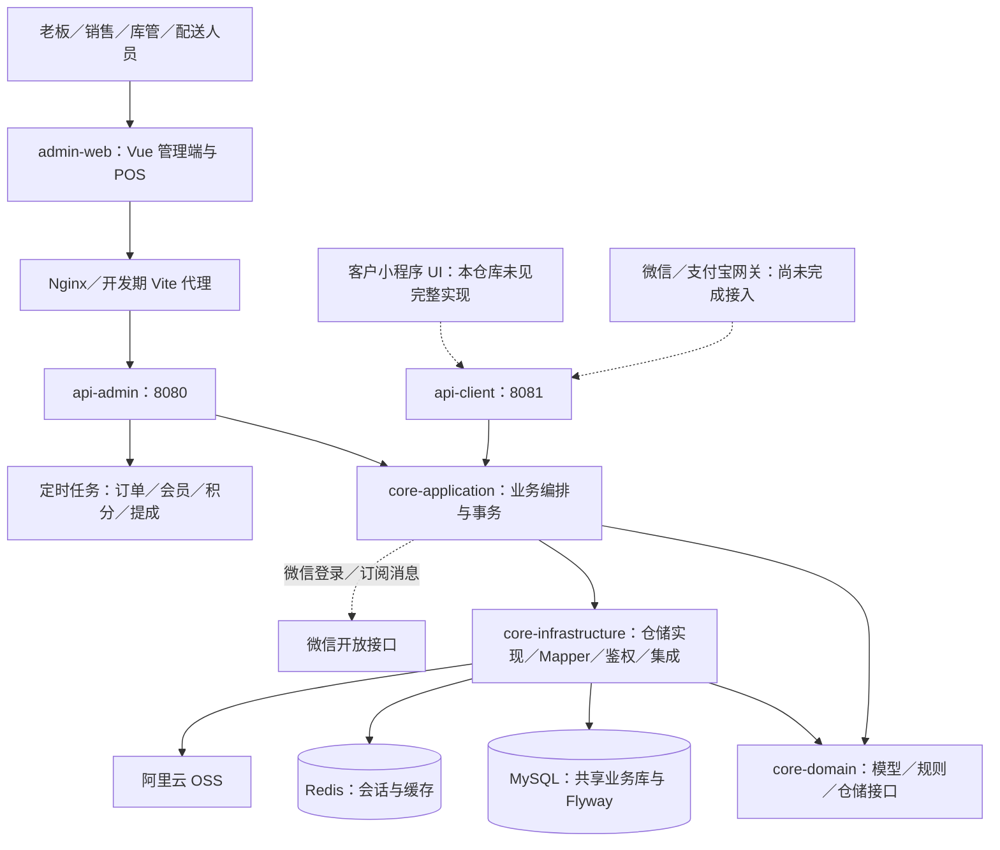
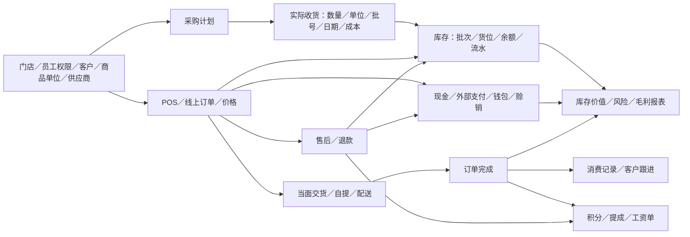
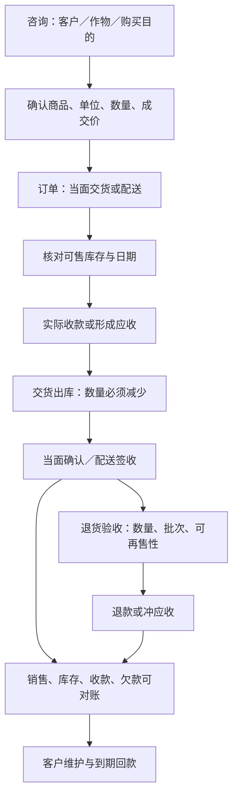
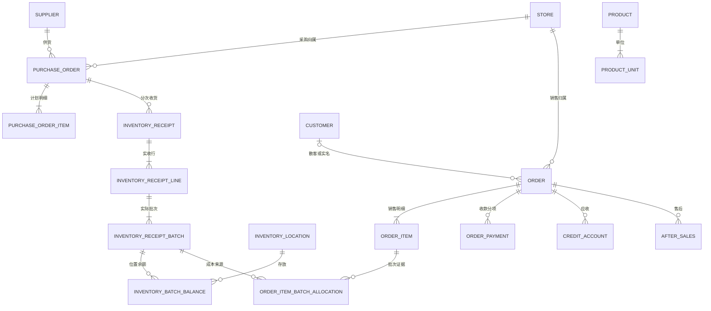

# 项目重新接管报告

> 本报告记录修复前的体检基线。2026-10-12已按“尚未上线”的实际情况取消双模式建议并统一库存；当前结果以[库存统一修复验收](2026-10-12-库存统一修复验收.md)为准。报告中的灰度切换建议不再作为后续开发要求。


审查日期：2026-10-11（北京时间）
代码基线：`/Users/yzym/project/agri_system`，`master`，`6675d12`。
审查范围：当前主检出，不把 `.wt-task*` 中未合并内容算作已交付。开始审查时工作区干净。本轮只新增报告与扫描索引，没有修改业务代码、配置、数据库、启用开关或提交 Git。

## 一、接管结论与项目现状

**建议选择方案 B：保留当前技术栈与模块化单体，局部重构交易、库存、退款与结算边界。先修业务事实，再整理代码。当前不能认定已具备真实营业条件。**

项目已经积累了大量可复用功能，既不是空架子，也没有证据支持整体推倒重写。最大的风险是：**一个模块内部看似完成，模块连接处却没有共同遵守“货减少了多少、钱收到了多少、客户还欠多少”的业务事实。**

最直接的例子：

1. 未切换新库存模式的商品，采购收货可能仅记录收货事实、推进采购状态，却没有增加销售所读的库存。
2. 切换新库存模式的商品，POS 销售记录批次归属后跳过传统扣库，但新链路本身没有完成销售扣库。
3. 退款接口可推进售后完成状态，但外部退款没有接通；纯赊销退货被要求走线下冲账。
4. 财务、报表和提成仍存在不同成本及状态口径。

这些问题比目录命名、是否严格 DDD、是否拆微服务更紧急。

### 1.1 经营范围

本报告按用户认可的“小规模农资零售、门店收银＋赊销＋采购库存＋人工配送”制定 MVP。实际首批门店数量、各角色人数尚未确认，不把历史评估中的“三店”当成当前已确认事实。

首期角色建议为老板/店长、收银/销售、收货/库管、配送；同一人可兼任，不需要为组织图新增系统角色体系。客户在线下单与真实微信/支付宝网关支付作为独立交付项，是否必须同批上线仍需商业排期决定。

### 1.2 当前规模与可确认的资产

| 项目 | 当前仓库证据 |
|---|---|
| 后端 | Java 17、Spring Boot 3.2.4，5 个 Maven 模块 |
| 前端 | Vue 3、TypeScript、Vite、Element Plus、Pinia；115 个 `src` 文件，35 个 `views/**/index.vue`，含布局/登录等，不能等同于 35 个业务模块 |
| 数据库与缓存 | MySQL 8 系列、Redis；MyBatis-Flex、Flyway、Sa-Token |
| 管理端接口 | 35 个 Controller，179 个方法级 HTTP Mapping 注解 |
| 客户端接口 | 8 个 Controller，21 个方法级 HTTP Mapping 注解 |
| Migration | 84 个 SQL 文件，最高版本 V128；含 V5_1、V6_1、V59_1 等非整数版本，不能说有 128 个迁移 |
| 表设计规模 | 迁移文本中涉及 71 个不同的建表名称；这是源码统计，不是线上实际表数 |
| 静态接口契约 | `openapi` 只有门店、套餐两个 YAML，共 5 个路径条目；不能代表全部接口 |
| 客户端 UI | 当前仓库未发现完整客户小程序前端，不能把 `api-client` 当成可交付小程序 |
| 新库存模型 | 有单位、收货、货位余额、销售批次归属、成本、风险、切换与对账代码；上线手册明确存在未接通路径 |

### 1.3 验证范围与证据等级

本轮完成全模块目录、类/接口结构、迁移清单、前端路由、配置和测试分布扫描，并重点逐段追踪采购、库存、POS、支付、退款、赊销、配送、权限、成本及提成。**这是一轮接管审查，不宣称已对近十万行源码逐行证明正确，也不是生产库审计或全业务黑盒验收。** 所有模块的扫描索引另附。

| 验证项 | 本轮结果 | 能证明什么 |
|---|---|---|
| 前端 `npm run build` | 通过；有单个产物块超过 500 kB 的警告 | TypeScript 检查及生产构建可完成；不能证明页面操作正确 |
| Maven 常规测试 | 361 项：348 项通过、13 项跳过，0 失败、0 错误 | 当前默认测试集通过；不是 361 项全部执行 |
| 首次 Maven 执行 | Mockito 无法自附加 JVM 代理；随后显式加载本地 Byte Buddy agent 成功 | 首次失败属于测试运行环境问题，没有为通过测试修改实现 |
| MySQL 真实迁移/锁/E2E | 本轮未执行门控用例 | 不能据此宣布全量迁移、并发库存或真实数据库事务通过 |
| 浏览器实操、扫码枪、打印机 | 未验证 | 页面静态存在和构建通过不是员工可用性证明 |
| 微信/支付宝、线上运行与生产数据 | 未连接/未验证 | 无法确认真实收款、对账、启用 SKU、余额及历史脏数据 |

测试命令及分模块统计见附录。以下标为“代码确认”的问题来自当前控制流；标为“并发风险”的问题仍需真实数据库重现。既往评估只用于定位，历史成本双算、菜单覆盖等结论未直接照搬。

## 二、当前系统地图与架构评价

### 2.1 部署与依赖图



这是**共享代码、共享数据库的模块化单体，提供两个 API 进程入口**，不是微服务。当前 `deploy` 生产 Compose 仅构建和运行管理端后端，未体现完整客户端部署，见证据 E21。

实际 Maven 方向为 `core-application → core-infrastructure → core-domain`，应用层同时依赖领域层。模块 README 中“不依赖 infrastructure”的表述与代码不符；基础设施 README 所写反向依赖 application 也不符。没有据此发现 Maven 循环依赖，问题在职责和文档漂移。

### 2.2 模块关系与业务入口



这张图描述模块连接意图，**不意味着每条箭头已经闭环**。下文给出实际断点。

### 2.3 架构中值得保留的部分

- 单体部署和 MySQL 本地事务适合当前规模，没有必要增加微服务、消息总线或多租户 SaaS 层。
- 领域仓储接口和基础设施实现已有分离；批次、单位、收货行、订单行有明确结构。
- 新收货保留原始业务单位与基准单位，不需要用猜测解释“一箱多少瓶”。
- 新表增加复合外键、正数量约束、唯一基准单位和追加式审计，属于有价值的数据保护。
- 客户端主要订单入口已经从登录态解析客户身份；管理端有 RBAC 与菜单动态注册。
- 部分库存及钱包操作已有数据库锁、业务幂等和审计流水，不应因发现缺陷而全部否定。
- 管理端/客户端重复执行定时任务的问题已有调度归属开关处理；后续若扩多实例仍需验证任务单执行策略。

### 2.4 维护性问题

| 问题类型 | 当前例子 | 判断与处理 |
|---|---|---|
| 重复业务实现 | `CustomerFollowUpController` 与 `CustomerFollowUpApplicationService` 均含复购算法 | 同一算法修一处可能另一处仍错；Controller 应调用统一服务 |
| 大型编排服务 | `OrderApplicationService` 1960 行；商品服务 852 行；库存服务 800 行 | 按下单、收款、履约、退款拆用例，保留清晰事务边界；不按行数机械拆类 |
| Controller 过重 | 客户跟进 Controller 直接查客户、订单、商品并推算周期 | 真实存在；不能泛称所有 Controller 都过重 |
| 前端大页 | 客户页 1887 行，商品页 1224 行，结算弹窗 1170 行 | 高频用例收口后按业务动作拆组件；不先大改全站 |
| 领域边界偏弱 | 订单实体大部分是状态赋值，守卫、定价、结算散落应用层 | 把关键状态转换与不变量集中，不必全面追求“纯 DDD” |
| 新旧模式复杂度 | 两套单位、两套批次/余额、两条销售成本路径长期并存 | 灰度过渡可以保留，但必须有模式矩阵、停用条件和退出期限 |
| 不必要的目标 | README 仍计划命令处理器、CQRS、消息队列 | 未见当前经营问题需要这些；撤出近期路线 |
| 合理抽象 | Repository、价格上下文、单位转换快照 | 这些本身有用，不应为了“精简”一并删除 |

## 三、模块完成度评估

以下百分比是**相对本报告 MVP 的工程估算区间**，综合页面/API覆盖、业务正确性和验证证据，不是测试覆盖率或精确工时进度。核心缺陷具有一票否决作用，不能平均出一个“系统已经完成 80%”。

| 模块 | 完成度估计 | 已有能力 | 主要问题 | 是否需要重构 |
|---|---:|---|---|---|
| 门店、员工、用户权限 | 65–75% | 登录、员工生命周期、RBAC、菜单、门店范围 | 保存角色可绕过授权入口；客户绑定身份仍有缺口；跨店矩阵未验收 | 局部收口 |
| 客户档案 | 70–80% | 档案、消费历史、钱包/欠款查询、归属员工 | 客户归属、欠款归属和门店统计口径需统一 | 保留主体 |
| 商品、分类、单位 | 65–75% | 商品、分类、主辅单位、新多单位、价格 | 新旧单位接入不一致；报价失败放行；套餐展开依赖前端 | 局部收口 |
| 供应商、采购、收货 | 45–60% | 采购单、审核/取消、分批与多批次收货 | 未启用 SKU 收货不增有效库存；旧页面多行入库与后端不兼容；供应商结算/退货未闭环 | 必须局部重构 |
| 库存、盘点、调拨 | 35–50% | 旧批次锁与流水、新货位余额、调整和调拨 | 新销售不减库存；旧链可选过期批次；调整不是完整盘点作业；调拨无在途签收 | 必须局部重构 |
| POS、销售、订单 | 55–65% | 选客、商品、混合收款、订单、凭条 | 新库存扣减断裂；改价只留痕；支付兼容分支多 | 必须局部重构 |
| 现金/线下收款登记 | 60–70% | POS 记账、支付流水 | 缺营业日收款核对、交班/差异闭环；收款确认与系统记账需区分 | 定点补齐 |
| 微信/支付宝在线支付 | 20–35% | 意图、确认、幂等入口、共享密钥保护 | 无真正支付下单、平台验签、退款、主动查单与对账 | 独立补齐网关边界 |
| 赊销、还款 | 45–60% | 台账、额度、FIFO 还款、生成对账汇总 | 并发还款风险、固定 30 天、纯赊销退货缺口、历史时点对账不完整 | 必须局部重构 |
| 自提、配送 | 45–60% | 核销、指派配送员、物流单号、确认收货 | 库房取货与客户自提易混淆；自动完成不执行同一结算链；POS 配送用例需补 | 局部收口 |
| 售后、退货、退款 | 35–50% | 售后申请/审核、退回库存、部分退款 | 外部退款空实现、新库存回库被守卫阻止、赊销冲账缺失 | 必须局部重构 |
| 会员、钱包、优惠券 | 60–75% | 三类钱包、充值赠送、VIP权益、券核销返还 | 超出首期必要范围；资金链和订单链耦合，实网场景未验 | 冻结扩展、保留必要修复 |
| 积分商城 | 55–70% | 兑换、审核、通知、核销、商品库存锁 | 有独立库存/履约模型，首期价值低；部分通知依赖未配置渠道 | 暂缓 |
| 绩效、提成、工资单 | 35–50% | 规则、流水、冲回、月结、冻结机制 | 固定提成算法错误、成本口径与新模型脱节，冻结默认关闭 | 暂停自动发薪用途，局部修正 |
| 报表、门店分析 | 40–55% | 销售、库存、客户、财务报表 | 估算/真实成本分离已有基础，但销售折扣、退款、赊销和门店范围仍不统一 | 先统一指标，再优化查询 |
| 客户跟进/CRM | 30–45% | 档案、跟进记录、复购提醒页面 | 复购时间由名称及固定天数猜测，含取消/退款订单；扫码绑定返回伪图片 | 保留人工跟进，简化推算 |
| 通知、存储、系统工具 | 55–70% | 通知、OSS、字典、日志、编码 | 外部通知默认关闭/配置待核实；打印后端明确弃用，依赖前端/硬件 | 按试点需要验证 |
| 客户在线渠道 | 20–35% | 登录、订单详情、支付相关、售后申请、积分接口 | 缺完整客户前端及常规商品目录、客户订单列表等端到端能力 | 后置为独立交付 |
| 部署、测试、发布 | 40–55% | Docker、CI、迁移、单元测试、门控 E2E | CI 分支不覆盖当前 master；默认跳过关键 MySQL/E2E；生产拓扑和文档不一致 | 定点修复，不换平台 |

## 四、最大问题与历史 AI 开发遗留

不能从代码证明问题由哪个 AI 造成。能确认的是反复交付留下了重复实现、假设未闭合、兼容层积累和“测试验证了实现而没有验证经营结果”等迹象。

### 4.1 P0：必须先于真实营业或相关能力启用处理

**P0-1：采购收货没有覆盖未切换模式。〔代码确认，E01〕**

`inbound` 已改成 `receiveLocked` 适配器，且只支持单采购行；新收货保存 `inventory_receipt*` 后调用 `increaseFromReceipt`。后者对未启用 `BATCH_LOCATION` 的 SKU 直接返回，没有回写传统 `inventory_batch`。采购却可被标记为已入库。若单位尚未持久化，旧商品收货还会被“SKU单位尚未确认”拦住。

业务后果：货到店了，采购显示已收，收银仍报没货；或收货员根本无法完成旧商品入库。不能通过额外手工调整库存长期掩盖。验收应覆盖“只用旧模式”的完整采购→销售路径。

**P0-2：新模式 POS 只登记批次归属，没有销售扣库。〔代码确认，E02〕**

`recordDirectSaleEvidence` 对启用 SKU 返回 `true`，订单服务因此跳过传统出库；该方法保存 allocation、刷新成本，却不减 `inventory_batch_balance`。库房履约调用的是后仓→前仓 `PICK`，只移动位置，没有货交给客户后的出库。库存投影仅汇总余额，也不减 allocation。

关键反证：现有 E2E 第 390 行明确断言“直接销售不扣前仓余额（仍 10）”。这不是仅缺测试，而是验收目标错了。反复销售会复用库存，缺货时还可能以 UNKNOWN 证据继续完成订单。

建议：商品数量出库与“究竟来自哪个批次”的证据置信度分开处理。批次未知可以显式标记待确认，但**已交货的商品数量必须从可售库存中扣减**；未交货订单必须保留待履约/占用状态。不要用启用开关把 P0-1 换成 P0-2。

**P0-3：退款完成不等于资金或欠款已退回。〔代码确认，E03〕**

现金/微信/支付宝退款分支目前没有第三方调用或完整退款执行记录，售后服务可随后标记完成。纯赊销直接被要求线下冲账；混合含赊销的退款不能仅靠订单主支付方式判断。已激活 SKU 的传统回库路径还会被库存守卫拒绝。

线下现金可由员工实际退钱后确认，外部渠道必须由回执确认；两者都需要可对账的退款记录。赊销退货必须同步减少应收，部分已还款时区分退现金和冲欠款。当前不能只看“售后完成”状态认定闭环。

**P0-4：已过期批次没有形成不可售边界。〔代码确认，E04〕**

传统 FIFO 查询只过滤活动与正库存，再按有效期排序，没有排除过期；实际上“最早过期”可能最先被选中。新风险服务也明确只提示和记人工决定，不会改变可售库存。

此处与旧设计“风险只提示”的决策有关，不应误称漏写一条 SQL。新的经营建议是：未知日期进入人工核验，临期由老板决定促销/调拨，明确过期的货进入隔离及处置流程；这些状态要真实影响可售数量。农资类别、标签和适用要求由经营方确认，本报告不代替专项合规核验。

**P0-5：角色创建/保存入口可绕过专用授权入口。〔代码确认，E05〕**

`POST /api/admin/roles` 只要求 `role:save`，请求允许传现有 `id`、角色 `code` 和 `menuIds`；`saveRole` 会更新角色并替换菜单。`PUT` 已禁止编辑编码，但 POST 没有同等约束。拥有保存权限、没有 `role:assign` 的员工仍可能改授权，且角色编码关系到管理员识别。

应分开创建/编辑/授权职责，拒绝创建入口更新现有对象；不能只隐藏前端按钮。此问题不应拖到普通页面打磨之后。

### 4.2 P1：资金、状态及解释一致性

| 编号 | 发现与影响 | 证据与处理方向 |
|---|---|---|
| P1-1 | 还款先无锁读总欠款、再无锁读未还账户、再普通更新；无版本字段。两次并发还款可能都记流水却覆盖余额 | E06；属于高置信并发风险，待 MySQL 双请求验证。加明确事务串行化/条件更新与请求幂等；本轮未声称已复现 |
| P1-2 | 提成 FIXED 使用销售额/成本额近似“数量” | E07；售 10 件、收入 1000、成本 800，每件提成 2 元会按 1.25×2 算成 2.50，而非 20。必须使用真实业务数量及明确单位 |
| P1-3 | 新毛利用 allocation，提成却读旧 `costPriceSnapshot`/商品平均成本并乘销售数量 | E07/E08；按箱成本与按瓶数量混用会错。新快照 `unit_cost/base_quantity` 没被提成统一使用；不能自动拿工资单发薪 |
| P1-4 | 自动收货只改订单状态；人工确认还更新配送及发布完成事件 | E09；同样“已完成”，自动路径不触发同一客户统计/积分/提成流程。应调用统一完成用例，确保幂等 |
| P1-5 | POS 报价失败仍采用客户端价；正常改价仅记录差价，操作人和确认人相同 | E10；保留现场议价有业务价值，但需要明确谁能改、理由与异常提示。报价失败时没有 quote，连差价审计也不会建立 |
| P1-6 | 采购旧页面仍提交多行 `/inbound`，后端只允许一行 | E11；页面可打开不等于业务可用。统一导向实际收货页面，保留员工熟悉的采购入口 |
| P1-7 | 客户扫码绑定直接信任 body 中 customerId/openid；返回的二维码图片只是 `QR:token` 文本 Base64 | E12；登录客户可能绑定别人的身份，图片也无法作为真正二维码扫描。关闭入口或完成身份与图像链路 |
| P1-8 | 毛利 ACTUAL 判定只检查事实非空和成本字段，不验证归属数量覆盖；销售额按单价×数量，未构成完整折扣/退款净毛利口径 | E08；“已归属成本”不能直接当作完整经营净利。统一数量覆盖、净收入和退货冲回定义 |
| P1-9 | 待配送报表读订单表 delivery_status，而履约写 order_delivery；门店看板新增赊销、新增客户使用全局查询 | E13；数字可能与业务列表不一致，不能用图表齐全表示老板已经能正确看账 |
| P1-10 | 对账单区间查询发生额，但结余来自当前总欠款；生成历史月份时不是该月期末欠款 | E06；增加期初、区间变动、期末的清晰定义。不要把“当前欠款”贴成历史结余 |
| P1-11 | 固定 30 天账期、复购按商品名称×固定天数，且包含订单状态 7/8（取消/全退） | E14；农时、亩数、作物和约定回款日不能由这些数值推断。先提供人工到期日和跟进记录 |

### 4.3 独立上线阻塞：真实支付与客户端

E15 确认存在支付意图和确认入口，但没有真实微信/支付宝支付下单参数、平台通知验签、主动查单、退款及账单核对闭环。公开回调**不是毫无保护**：共享密钥未配置返回 503，密钥不匹配返回 401；它也**不等同于支付平台验签**。客户端自行确认默认关闭属于已有防护，应保留。

门店可以先采用现金或“员工在渠道端核实到账后登记”的经营方式，但必须明确登记凭据与交班核对，不能宣传为系统已自动收款成功。若商业决定首期必须小程序在线支付，则该项升级为首期 P0，门店路线的范围和工期要同步调整。

### 4.4 P2：历史遗留与交付治理

- 文档写“不依赖 infrastructure”“暂无问题”“22 张表”，代码已经不同；V128 已修复早前菜单冲突中的客户跟进入口，本轮不再把原菜单覆盖直接算作当前未修故障。
- 旧平均成本双算方法已不在当前采购服务中；当前问题是收货与有效库存连接及不同成本口径，并非原样重报旧 bug。
- `core-domain` 直接使用 MyBatis 注解及分页类型，严格领域纯度不足；对于当前单体可接受，不应优先清洗全部实体。
- 前端和后端存在定价与单位兜底、混合支付兼容路径；优先将成交事实由后端决定，前端用于展示与输入。
- 两个后端共享基础设施，但生产 Compose 与 CI 镜像流程不是同一套部署形态。CI 仅配置 main/develop，当前审查分支为 master；仓库内这个 workflow 不会由 master 普通 push 触发。
- 真实 MySQL 测试默认关闭；部分标为 E2E 的测试使用 MockMvc 和定制装配，不含浏览器与硬件。测试命名不能替代验证边界。

## 五、从农资老板角度审查业务闭环

### 5.1 应有的最小闭环与当前断点



| 老板/员工的真实问题 | 当前支持情况 | 断点与最简单补齐方法 |
|---|---|---|
| 客户进店，查以前买什么 | 档案与销售历史已有 | 先完善查客、散客、电话去重及快捷检索，不建复杂销售线索漏斗 |
| 一箱进货、拆瓶销售，数量对吗 | 新单位模型能表达，旧主辅模型仍在用 | 收货、销售、退货、盘点、调拨必须使用同一基准数量，不能仅商品页配置成功 |
| 同一商品两个厂家批号如何收 | 新收货支持一采购行多实际批次 | 未切换模式的库存增加需要补齐；允许员工按批录入，通常不需每瓶贴码 |
| 店里到底还有多少能卖 | 旧库存可读，新余额已有 | 优先修 P0-1/P0-2；分清账面、占用、可售、隔离。不能用“风险提醒”代替这些数量 |
| 价格能不能临时便宜一点 | 可以议价并部分留痕 | 老板定义授权范围；报价失败需清晰提示并留证，不替经营者默认发明复杂审批流 |
| 收到钱没 | POS 可登记渠道，在线网关未接通 | 现金点收、渠道到账核实、营业日对账；系统记账不能自动等价渠道到账 |
| 老客户赊账，秋收再还 | 有欠款和还款台账 | 可约定到期日、限额/超额授权、催收记录；不应统一强设 30 天 |
| 买完让司机送到地头 | 订单有配送数据和指派能力 | POS 当前固定当面已完成，需验证/补齐“门店销售转配送”用例；先用简单派单、签收、异常原因 |
| 买多了退两袋，其中一袋破损 | 有退货单及自动回库 | 退回货分可售/待检/报损，按原销售数量和成本归属冲回，退钱和冲欠款独立确认 |
| 两家店调货途中丢了怎么办 | 当前直达调拨，不含在途 | 单店试点可后置；多店日常调拨时必须补发出、在途、收妥和差异处理 |
| 月底为什么赚了这些钱 | 有报表，但口径分散 | 先给销售净额、毛利、收款、欠款、损耗、库存价值；毛利不是净利润，配送/租金等另列经营费用 |

**结论：功能入口多数存在，但“采购→可售库存→销售扣减→退货回库→现金/应收对账”尚不完整。** 首期不能删掉退货、盘点和日结，因为它们虽然不在主菜单名单里，却是库存、销售、支付闭环的必要用例。

### 5.2 四条必须写成验收条件的等式

1. **实物库存**：期初＋实际收货＋调入＋可售退回－销售交货－调出－报损±盘点差异＝期末；内部货位移动不改变门店总量。
2. **订单金额**：成交金额－整单折扣－合法优惠＝本单结算额；结算额＝各类实际收款＋新增赊销，不能混同收现金和核销余额。
3. **客户应收**：期初欠款＋本期赊销－已核销还款－退货冲账±有凭据的调整＝期末欠款。
4. **退款上限**：累计退款/冲账及累计退货数量分别不超过可退金额和数量；多次部分退货不能反复从原支付全额开始分配。

报表、自动任务和人工操作都要验证这些等式。原有三层库存对账主要验证账本投影与位置移动一致，没有覆盖销售减量的完整经营等式；账本彼此一致也可能共同漏了一笔销售。

## 六、数据库评价

### 6.1 当前数据主线



图中表示业务关联，不承诺每条都是数据库现存外键。传统 `inventory_batch → inventory` 与新链并存，`inventory_balance_feature_status` 决定权威来源。

### 6.2 正面评价

- 金额/数量主要使用 Decimal/BigDecimal；新数量保留 8 位精度，较适合拆零换算。
- 采购计划与实际收货分开，收货单→行→批次能表达分次到货、混批和不同成本；这些表并非仅凭数量就可判为过度设计。
- 新批次、货位、移动使用 SKU/门店复合关联约束，比只存一串裸 ID 更可靠。
- 审计表禁止更新/删除、移动幂等键、每 SKU 唯一启用基准单位，是应保留的设计。

### 6.3 核心问题

| 主题 | 评价与建议 |
|---|---|
| 事实来源 | `inventory` 是汇总快照，不应再成为独立业务写入口。每种模式明确收货、销售、退货、盘点谁写明细、谁投影 |
| 数量语义 | 同一个 `inventory.quantity` 在切换前后可能分别表示旧主单位与新基准单位；所有读取者都要使用单位上下文，不能静默切换后继续按旧单位展示 |
| 单位重复 | 旧 `main_unit/aux_unit/ratio`、`product_unit_conversion` 与 `product_unit` 并存；列出读写调用者后收敛，不直接删旧字段 |
| 成本重复 | 商品平均成本、旧订单成本快照、新订单基准单位成本、批次归属成本并存；历史快照合理，但必须注明适用单位和置信度 |
| 状态重复 | 订单状态、订单表配送状态、配送表配送状态、取货请求、支付意图、售后状态并存；缺少唯一状态转换服务，自动任务尤其容易绕开 |
| 权限重复 | `staff.role` 与 RBAC 关联表并存；代码已将前者视为默认遗留值，应防止旧路径再次用于权限判断 |
| 赊销约束 | 还款没有锁/版本保护；`credit_account.order_id` 早期为普通索引，业务却假定订单唯一欠款。必须核对最终迁移和真实库唯一约束后强化幂等 |
| 退款事实 | 当前支付退款分配不具备完整的逐笔退款/核销记录闭环；先盘点可复用表字段，证明确需新表后才设计，不能用“以后要支付”作为建表理由 |
| 历史对账 | 账面总额、台账、流水、实际渠道钱需要相互勾稽；不能只验证外键存在 |
| 文档多源 | DDL README 仍称 22 张表、迁移只到 V10；schema.sql 有 43 个建表语句，缺少 migration 中多个关键表，虽然追加了部分新零售表，仍不是完整当前 schema |
| Migration 运维 | 存在多个手工 Flyway checksum/repair 脚本；不能将这些作为默认发布步骤。以迁移目录为准，在空库及上一版本副本上演练，并核对真实 `flyway_schema_history` |

**不建议立即删表或重新设计全库。** 71 个建表名称不是主要风险；“谁是事实、谁是缓存、谁仍被旧链路读取”不明确才是。第一轮应产出逐表清单：业务主人、写入口、读入口、事实/快照/审计属性、保留或退出条件。不得把追加审计与历史快照简单当成冗余删除。

## 七、成熟系统参考：借鉴边界，不照搬体量

以下参考来自本轮查阅的官方文档或项目主仓库，建议是结合本项目后的判断。

| 参考 | 值得借鉴 | 本项目的最小落地 | 暂不照搬 |
|---|---|---|---|
| ERPNext 库存/会计账本 | 原单保留、取消用反向记录，账本能追溯来源 | 收货、销售、退货、报损有来源单；错误用冲销纠正 | 完整总账、多公司、多币种和财务全套。来源：[Immutable Ledger](https://docs.frappe.io/erpnext/immutable-ledger-in-erpnext) |
| ERPNext 收付款与信用 | 收款及供应商付款可关联具体单据；部分收付、应收核销分开 | 客户欠款逐单核销、期初期末对账、手工收款凭据 | 尚未确认的复杂信用审批和信用评分。来源：[Payment Entry](https://docs.frappe.io/erpnext/payment-entry)、[Credit Limit](https://docs.frappe.io/erpnext/credit-limit) |
| Odoo 库存 | 批次、位置、有效期及 FEFO 拣货思路 | 到货录批次；可售批次内先到期先出，临期处置有结果 | 复杂波次、自动路径优化、逐件序列化。FEFO 排序本身不等于禁售过期。来源：[Expiration dates](https://www.odoo.com/documentation/17.0/applications/inventory_and_mrp/inventory/product_management/product_tracking/expiration_dates.html) |
| Open Source POS | 聚焦销售、收货、商品、客户、收据与日常操作 | 一个收银入口完成查客、选单位、议价、付款、交货/配送 | 用其普通零售模型直接替代农资批次、多单位和赊销要求。来源：[项目主仓库](https://github.com/opensourcepos/opensourcepos) |
| Odoo CRM | 活动关联客户/业务记录，包含负责人和跟进时间 | 客户购买历史＋人工下次联系时间＋处理结果 | 完整线索评分、商机漏斗、自动营销编排。来源：[CRM activities](https://www.odoo.com/documentation/19.0/applications/sales/crm/optimize/utilize_activities.html) |
| ERPNext 权限 | 角色能做什么与用户能访问哪些单据分别控制 | 角色动作权限＋门店/客户范围＋关键写操作验证 | 过细字段权限平台。来源：[Role Based Permissions](https://docs.frappe.io/erpnext/permissions) |

农资适配应优先保留：拆零单位、厂家批号/日期、赊销到期、送货地点、客户用药/种植场景的人工备注、破损/过期处置、门店调货。先让业务人员准确记录这些事实，不用名称关键词猜农时，不为未知未来需求建通用规则引擎。

## 八、是否重构：三方案比较

| 方案 | 优点 | 缺点与适用边界 | 建议 |
|---|---|---|---|
| A：继续当前代码定点优化 | 改动小，较快封住角色漏洞、页面错接、单一错误算法 | 新旧链路和大服务继续叠加，跨流程不一致容易复发 | 用于第 1–2 周紧急修补，不作为整季唯一策略 |
| B：局部重构 | 复用页面、主数据、表与仓储，聚焦库存记账/收退款/状态完成/成本口径 | 需要先写业务不变量和回归矩阵；过渡期必须管理双模式 | **推荐主方案** |
| C：重新设计核心模块 | 可重定库存与结算模型，历史包袱少 | 数据迁移、双系统对账、界面重接和工期风险大；可能重犯业务口径不清的问题 | 仅当 B 的验证表明现有事实无法追溯/约束无法修复时，局部升级到 C；不建议全库重写 |

方案 B 的具体边界：

1. **库存记账入口**：收货、销售、退货、调整、调拨统一执行数量不变量；批次归属作为证据，不代替数量账。
2. **订单用例**：下单、收款、交货、完成、退款用例边界清晰；人工和定时任务调用同一完成入口。
3. **结算口径**：收款记录、应收、退款、净销售额和批次成本能相互核对；提成读取已定义的销售结算结果。
4. **前端入口**：收货保留一个可信路径；POS 只提交输入事实、呈现服务端报价和状态；成熟后再拆大组件。
5. **架构整理**：修到哪个用例就收敛哪个边界，避免与营业正确性无关的全面抽象重写。

近期不做：微服务、CQRS 平台、消息队列平台、通用审批引擎、供应链金融、复杂会员裂变、自动采购、自动定价、自动农技推荐。

## 九、未来三个月路线与开发优先级

时间窗口：2026-10-12 至 2027-01-10。假设有人持续负责后端与前端联调，并有经营负责人每周参与验收；这里是分阶段交付路线，不是未核实人力下的工期保证。若人力不足，减少高级功能，不能降低货/钱一致性的验收门槛。

### 阶段 1：必须完成 MVP 闭环（第 1–6 周）

保留客户、商品、库存、采购、销售订单、支付/赊账、配送；退货、盘点、日结作为这些模块的必要用例，不能删掉。

| 时间 | 交付目标 | 经营验收证据 |
|---|---|---|
| 第 1 周，10/12–10/18 | 固定试点角色/商品样本/支付边界；建立库存与资金等式；关闭或标识不可营业路径；修角色入口 | 形成按模式/入口/角色的验收矩阵；采购、销售不变量有失败用例证明；不直接启用新 SKU |
| 第 2 周，10/19–10/25 | 修采购→库存及 POS→扣库两大断点；统一旧采购页入口 | 未切换和已切换 SKU 均验证“进 10、卖 3、剩 7”；零库存、混批、并发最后一件、失败回滚都检查数据库 |
| 第 3 周，10/26–11/01 | 收款、赊销、还款幂等与并发控制；最小现金/渠道登记对账 | 同一还款重复提交只入账一次；双收银并发不丢余额；订单、收款和欠款逐笔能勾稽 |
| 第 4 周，11/02–11/08 | 部分退货、退款/冲应收、批次回库与报损；单位和成本一致 | 现金、余额、赊销和混合支付分别验收；多次退货不超量/超额；不可售退货不进入可售库 |
| 第 5 周，11/09–11/15 | 门店销售配送、核销/签收、自动完成统一；可用库存与日期处置 | 店内卖货后配送可追踪；重复签收不重复积分/结算；过期和未知日期按已确认经营政策处理 |
| 第 6 周，11/16–11/22 | 一家门店受控试点；营业日结、盘点、权限、恢复演练 | 连续试营业逐日对账无未解释差额；真实收银/库管/司机完成演练；有备份恢复与版本回退记录 |

**第一阶段通过条件**：数据正确、异常可恢复、非老板账号能操作、当天货/钱/欠款能对上。只通过编译和单测不算通过。

### 阶段 2：提升效率（第 7–10 周）

| 时间 | 重点 | 验收方式 |
|---|---|---|
| 第 7–8 周，11/23–12/06 | 批量收货、商品条码/单位快捷操作、常卖商品、查客、临期处置、到期回款清单；统一前端/报表口径 | 记录试点每类操作耗时和返工原因，与试点前比较；每条预警有处理人和结果 |
| 第 9–10 周，12/07–12/20 | 有多店需求时补调拨在途/签收及跨店权限；按 SKU 灰度收敛旧链；营业日与门店报表 | 调拨发出/收妥/差异可对账；跨店读写越权测试；复用试点场景在第二门店演练 |

若客户在线支付是明确商业优先项，从第 7 周开始用其替换部分效率功能：先取得商户/回调条件，再完成下单、通知验签、查询、退款、对账、超时补偿及端到端验证。不要同时承诺全部效率项和完整在线渠道。

### 阶段 3：高级功能与收敛（第 11–13 周）

| 时间 | 条件性目标 | 进入条件 |
|---|---|---|
| 第 11–12 周，12/21–01/03 | 修正提成算法和成本来源，建立人工复核；有实证需求再恢复少量会员优惠、客户提醒；在线渠道按独立计划验收 | MVP 账目稳定，经营负责人能解释每笔提成/优惠的收益；没有 P0 未闭合 |
| 第 13 周，01/04–01/10 | 复盘营业数据；删除已证明不用的兼容入口/死代码；文档与迁移同步；确定下季度范围 | 出具发布证据包及旧路径退出清单；若首期不稳定，本阶段继续修闭环而非赶高级功能 |

### 9.1 第一批开发任务顺序

1. P0-1/P0-2/P0-5：采购入库、销售扣库、角色授权漏洞。
2. P0-3/P0-4：退货资金与库存闭环、不可售库存边界。
3. P1-1/P1-4/P1-6：还款并发、统一完成用例、收货页面接入。
4. 成本、毛利、提成、对账单与看板口径。
5. 非管理员权限、真实 MySQL、页面实操、硬件、迁移和恢复验收。
6. 再根据门店效率证据决定在线支付、CRM、会员与绩效的排期。

研发应先用独立验收案例重现问题，再修改实现。本轮没有提前改代码。

## 十、新的开发规则

以下六条沿用用户本轮要求，作为后续开发约束：

1. **修改前说明影响范围**：涉及哪些经营动作、页面/API、服务、表、历史数据、角色和开关；是否影响新旧模式。
2. **不允许随意增加表**：先查现有表能否表达；确需新增时说明业务事实、唯一性、生命周期、数据量、读写主人、迁移与回退。默认先解决现有断点。
3. **不为未来可能需求预建复杂结构**：没有当前用例和验收人的功能不进入实现；不因为成熟 ERP 有就照搬。
4. **优先业务闭环**：新增主流程必须同时覆盖取消、重试、退货/冲销、异常及对账；“后端写了、页面未接”单独标为未完成。
5. **高内聚低耦合**：Controller 做鉴权、输入校验、调用和返回；业务计算只有一个权威实现；人工与任务共享同一业务用例。
6. **每个新功能必须回答**：为什么需要？解决谁的什么问题？是否有更简单方案？没有答案不新增功能。

每次改动采用这一页说明即可，不需要新的流程平台：

| 项目 | 必填内容 |
|---|---|
| 业务问题 | 真实角色、触发场景、今天如何处理及代价 |
| 最小方案 | 为什么需要；更简单方案及未采用原因 |
| 影响范围 | 页面/API/模块/表/历史数据/权限/开关 |
| 事实与状态 | 数量、金额、单位、状态转换及唯一权威来源 |
| 异常处理 | 重复请求、并发、超时、部分成功、撤销/退回 |
| 验证证据 | 业务预期、数据库前后值、执行命令、通过/跳过情况 |
| 发布与回退 | 迁移前提、旧模式兼容、试点范围、恢复方案 |
| 完成定义 | 已实现 / 已默认启用 / 已真库验证 / 已门店验收，分别填写 |

额外的接管约定：

- 已执行的 Flyway 迁移默认不改历史内容，修正用新迁移；先核对最大版本，本轮为 V128。
- 不自动启用当前休眠 SKU；修复并完成迁移确认/业务验收后再按名单切换。
- 不把规则推测写成数据事实；未知批次、未知成本、未知到账状态必须可见。
- 资金与库存测试先写经营等式，不能为了匹配当前实现将“销售不减库存”设成正确预期。
- 每轮交付同步一份当前状态文档；历史计划留档，不再把多个“完成报告”当作并列真相。
- 不直接删除存量表/字段，不静默重算历史交易，不在真实库运行测试写入或修复脚本。

## 十一、尚需用真实环境完成的接管验证

这些是可执行的后续验收项，不是本轮已通过的结论：

1. 只读核实生产/试点实际版本、`flyway_schema_history`、启用 SKU、门店和角色配置、是否有真实交易/存量钱包。
2. 从空库执行全量迁移，再从上一部署版本副本升级；核实外键、CHECK、触发器、权限种子及回退恢复。
3. 真实 MySQL 并发验收最后一件库存、重复还款、两次部分退款、重复支付通知和任务重复执行。
4. 使用店员而非 SUPER_ADMIN 走采购、收货、POS、赊销、还款、退货、配送、盘点；核验跨店读写。
5. 扫码枪与小票打印实测；客户多单位、无日期、过期、同 SKU 多批次、零成本/赠品等样本由经营者提供并确认处理方式。
6. 核实实际供应商结算方式、农资类别及台账要求；首期可保留现有会计工具，但交接凭据必须能核对，不能宣称财务 ERP 已完整。

本报告给出的完成度会随这些结果调整。当前可确定的下一步，是修复数量与资金事实的连接并用门店场景验收，而不是再开一个业务大模块。

## 附录 A：验证命令与结果

Maven 与 Java 默认版本不同：shell Java 为 17，Maven 默认 Java 为 25；本轮显式使用 JDK 17。初次测试因 Mockito 自附加代理失败；下列第二次命令成功，未改测试或生产源码：

```sh
env JAVA_HOME=/opt/homebrew/opt/openjdk@17/libexec/openjdk.jdk/Contents/Home \
  mvn -o test -q -DskipTests=false \
  -DargLine=-javaagent:/Users/yzym/.m2/repository/net/bytebuddy/byte-buddy-agent/1.14.12/byte-buddy-agent-1.14.12.jar
```

前端：在 `admin-web` 执行 `npm run build`，成功。

| 模块 | 测试总数 | 失败 | 错误 | 跳过 |
|---|---:|---:|---:|---:|
| core-domain | 30 | 0 | 0 | 0 |
| core-infrastructure | 41 | 0 | 0 | 6 |
| core-application | 276 | 0 | 0 | 0 |
| api-admin | 14 | 0 | 0 | 7 |
| api-client | 0 | 0 | 0 | 0 |
| 合计 | 361 | 0 | 0 | 13 |

跳过包含 MySQL 测试 5 项、零售事实链 E2E 1 项、POS/混合支付/自提 3 项、VIP 集成 3 项、初始化数据 1 项。默认测试通过不能说明这些场景通过。

## 附录 B：源码证据索引

以下链接由本轮源码定位生成，见同目录《项目地图与扫描索引》的完整 API、服务、迁移、页面及测试目录。报告中的 E 编号用于交叉核查，不将文档“已完成”当作实现证据。

- **E01**：[收货适配入口](</Users/yzym/project/agri_system/core-application/src/main/java/com/agri_system/application/purchase/service/PurchaseApplicationService.java:218>)；[收货后更新采购状态](</Users/yzym/project/agri_system/core-application/src/main/java/com/agri_system/application/purchase/service/PurchaseApplicationService.java:353>)；[未启用直接返回](</Users/yzym/project/agri_system/core-domain/src/main/java/com/agri_system/domain/inventory/service/BatchBalanceService.java:116>)。
- **E02**：[POS 跳过旧扣库](</Users/yzym/project/agri_system/core-application/src/main/java/com/agri_system/application/order/service/OrderApplicationService.java:629>)；[销售仅写归属](</Users/yzym/project/agri_system/core-application/src/main/java/com/agri_system/application/order/service/PickupFulfillmentService.java:83>)；[取货仅位置移动](</Users/yzym/project/agri_system/core-application/src/main/java/com/agri_system/application/order/service/PickupFulfillmentService.java:312>)；[库存投影只求余额和](</Users/yzym/project/agri_system/core-domain/src/main/java/com/agri_system/domain/inventory/service/BatchBalanceService.java:277>)；[E2E 错误业务预期](</Users/yzym/project/agri_system/api-admin/src/test/java/com/agri_system/e2e/RetailFactChainEndToEndTest.java:390>)。
- **E03**：[退款分支](</Users/yzym/project/agri_system/core-application/src/main/java/com/agri_system/application/order/service/OrderPaymentService.java:297>)；[退货完成与回库](</Users/yzym/project/agri_system/core-application/src/main/java/com/agri_system/application/after_sales/service/AfterSalesApplicationService.java:139>)；[售后回库成本](</Users/yzym/project/agri_system/core-application/src/main/java/com/agri_system/application/after_sales/service/AfterSalesApplicationService.java:440>)；[新旧路径限制](</Users/yzym/project/agri_system/docs/runbooks/retail-fact-chain-rollout.md:197>)。
- **E04**：[旧可选批次查询](</Users/yzym/project/agri_system/core-infrastructure/src/main/java/com/agri_system/infrastructure/inventory/mapper/InventoryBatchMapper.java:28>)；[只提示风险](</Users/yzym/project/agri_system/core-application/src/main/java/com/agri_system/application/inventory/service/InventoryRiskService.java:36>)；[原设计边界](</Users/yzym/project/agri_system/docs/superpowers/specs/2026-09-06-retail-unit-batch-cost-price-design.md:188>)。
- **E05**：[角色保存权限](</Users/yzym/project/agri_system/api-admin/src/main/java/com/agri_system/api/admin/controller/RoleController.java:35>)；[保存角色实现](</Users/yzym/project/agri_system/core-application/src/main/java/com/agri_system/application/staff/service/StaffAuthorityService.java:77>)；[角色编码识别](</Users/yzym/project/agri_system/core-application/src/main/java/com/agri_system/application/staff/service/StaffAuthorityService.java:207>)。
- **E06**：[还款流程](</Users/yzym/project/agri_system/core-application/src/main/java/com/agri_system/application/credit/service/CreditRepaymentService.java:25>)；[台账无锁查询](</Users/yzym/project/agri_system/core-infrastructure/src/main/java/com/agri_system/infrastructure/credit/repository/CreditAccountRepositoryImpl.java:38>)；[历史对账汇总](</Users/yzym/project/agri_system/core-application/src/main/java/com/agri_system/application/credit/service/CreditApplicationService.java:94>)。
- **E07**：[固定提成用比例代数量](</Users/yzym/project/agri_system/core-domain/src/main/java/com/agri_system/domain/performance/service/PerformanceDomainService.java:74>)；[旧成本参与提成](</Users/yzym/project/agri_system/core-application/src/main/java/com/agri_system/application/performance/listener/PerformanceEventListener.java:82>)。
- **E08**：[新成本快照](</Users/yzym/project/agri_system/core-application/src/main/java/com/agri_system/application/order/service/OrderCostAllocationService.java:62>)；[实际成本缺数量覆盖条件](</Users/yzym/project/agri_system/core-application/src/main/java/com/agri_system/application/order/dto/vo/OrderMarginVO.java:18>)。
- **E09**：[自动完成](</Users/yzym/project/agri_system/core-application/src/main/java/com/agri_system/application/order/job/OrderAutoFinishJob.java:31>)；[人工完成](</Users/yzym/project/agri_system/core-application/src/main/java/com/agri_system/application/order/service/OrderApplicationService.java:1578>)。
- **E10**：[报价失败放行](</Users/yzym/project/agri_system/core-application/src/main/java/com/agri_system/application/order/service/OrderApplicationService.java:289>)；[人工改价审计](</Users/yzym/project/agri_system/core-application/src/main/java/com/agri_system/application/order/service/OrderApplicationService.java:372>)；[价格引擎](</Users/yzym/project/agri_system/core-application/src/main/java/com/agri_system/application/product/service/ProductPricingService.java:51>)。
- **E11**：[旧页面多行入库](</Users/yzym/project/agri_system/admin-web/src/views/purchase/order/index.vue:725>)；[后端单行限制](</Users/yzym/project/agri_system/core-application/src/main/java/com/agri_system/application/purchase/service/PurchaseApplicationService.java:222>)。
- **E12**：[客户绑定入口](</Users/yzym/project/agri_system/api-client/src/main/java/com/agri_system/api/client/controller/QrClientController.java:25>)；[伪二维码与信任身份](</Users/yzym/project/agri_system/core-application/src/main/java/com/agri_system/application/performance/service/OneTimeQrService.java:42>)。
- **E13**：[看板查询口径](</Users/yzym/project/agri_system/core-application/src/main/java/com/agri_system/application/report/service/ReportAnalysisService.java:77>)；[配送写入](</Users/yzym/project/agri_system/core-application/src/main/java/com/agri_system/application/order/service/OrderApplicationService.java:1634>)。
- **E14**：[复购 Controller](</Users/yzym/project/agri_system/api-admin/src/main/java/com/agri_system/api/admin/controller/CustomerFollowUpController.java:43>)；[重复应用服务](</Users/yzym/project/agri_system/core-application/src/main/java/com/agri_system/application/customer/service/CustomerFollowUpApplicationService.java:35>)；[固定账期](</Users/yzym/project/agri_system/core-domain/src/main/java/com/agri_system/domain/credit/service/CreditDomainService.java:38>)。
- **E15**：[共享密钥回调](</Users/yzym/project/agri_system/api-client/src/main/java/com/agri_system/api/client/controller/OrderPaymentPublicController.java:39>)；[客户端确认开关](</Users/yzym/project/agri_system/core-application/src/main/java/com/agri_system/application/order/service/OrderApplicationService.java:99>)。
- **E16**：[应用层实际依赖](</Users/yzym/project/agri_system/core-application/pom.xml:28>)；[过时依赖说明](</Users/yzym/project/agri_system/core-application/README.md:24>)。
- **E17**：[单位和收货表](</Users/yzym/project/agri_system/core-infrastructure/src/main/resources/db/migration/V119__retail_unit_and_receipt_foundation.sql:4>)；[切换与移动约束](</Users/yzym/project/agri_system/core-infrastructure/src/main/resources/db/migration/V121__inventory_batch_balance_cutover_and_movement_audit.sql:4>)。
- **E18**：[过时数据库文档](</Users/yzym/project/agri_system/ddl/README.md:105>)；[菜单冲突已补修](</Users/yzym/project/agri_system/core-infrastructure/src/main/resources/db/migration/V128__restore_missing_page_menus.sql:4>)。
- **E19**：[库存对账脚本](</Users/yzym/project/agri_system/scripts/verify-retail-fact-chain.sh:193>)；[全量门控 E2E](</Users/yzym/project/agri_system/api-admin/src/test/java/com/agri_system/e2e/RetailFactChainEndToEndTest.java:99>)。
- **E20**：[动态路由](</Users/yzym/project/agri_system/admin-web/src/router/registry.ts:72>)；[调度归属](</Users/yzym/project/agri_system/core-application/src/main/java/com/agri_system/application/config/SchedulingConfig.java:21>)。
- **E21**：[CI 触发分支](</Users/yzym/project/agri_system/.github/workflows/ci-cd.yml:5>)；[生产服务清单](</Users/yzym/project/agri_system/deploy/docker-compose.prod.yml:39>)；[仅构建管理端](</Users/yzym/project/agri_system/deploy/Dockerfile.backend:12>)。
