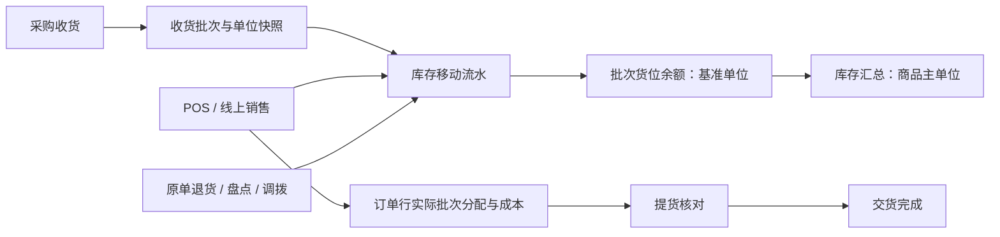

> 文档状态：历史审查/验收证据，仅对文内提交、环境和覆盖范围负责，不代表当前全系统完成度。现行入口见[统一文档中心](../current/README.md)。

# 库存统一修复验收

日期：2026-10-12。范围：采购收货、库存、销售出库、原单退货、盘点、调拨、提货核对及相关查询。系统尚未正式上线，本次按这一事实收敛设计。

## 原因与修复

采购收货已被改为保存新收货记录，但增加库存依赖每个门店商品的模式开关。没有开关时只记收货、不增加可售库存，采购仍可能变成已收货。销售端又把“保存批次归属”视为完成库存处理，从而跳过实际扣减。传统批次和新余额同时存在，退货、调拨与查询仍访问不同来源。

另外，历史单位只是内存投影、没有数据库ID；采购列表还调用只支持单采购行的旧接口。这些问题共同破坏了正常收货和销售闭环。

| 入口 | 当前行为 |
|---|---|
| 商品创建 | 同事务保存持久化单位；已有名称、系数和基准含义冻结，主单位保持启用 |
| 门店创建 | 同事务建立默认后仓 |
| 采购收货 | 统一页面支持多行、多批次、分次收货；批次、余额、RECEIPT流水和采购状态同事务提交 |
| POS / 线上支付 | 共用真实出库入口；锁定库存，按有效期分批扣减，记录订单行实际批次成本 |
| 退货 | 按原销售单位比例回原批次、原货位，保留成本与日期，累计不能超过实际售出数量 |
| 盘点 | 后端按实盘单位、数量与最新基准余额计算差异；账面变动时拒绝旧盘点；防重复提交 |
| 调拨 | 按实际单位精确换算；两店一并提交；目标批次保留供应商批号、日期和成本 |
| 库房提货 | 核对已出库分配；多批次逐项完整确认；已退货或退款不可再交货 |
| 库存 / 报表 | 读取统一余额及其投影；库存资金占用也改读实时批次余额 |
| 批次标签 | 收货返回已保存的真实内部批次码，打印内容与取货核对对应 |

收货、盘点、调拨使用请求标识防止网络重试重复改变库存。所有库存写入遵循锁序；JDBC 使用 MyBatis-Flex 的事务数据源，已验证两者的实际数据库连接ID一致。

## 当前架构

`inventory_receipt_batch`、`inventory_batch_balance`、`inventory_movement` 是当前库存事实链。`inventory` 只是主单位展示缓存。店内移库不改变门店总数，调拨出入两端净额守恒。

不存在按SKU选择库存来源的运行分支，也没有启用/灰度/切回旧库存步骤。旧迁移中的 `inventory_batch` 和 `inventory_balance_feature_status` 保留为历史结构，业务代码不再向它们写库存或读模式开关。旧种子数据和回填草案已归档，避免再次写入另一套余额。

缺失日期保持缺失；只有有效期的批次仍参与到期判断。`KNOWN / PARTIAL / UNKNOWN` 只描述日期资料完整度。

## 数据库与开发环境

新增 V129 Java迁移，没有增加业务表。新增字段用于旧批次来源追溯、旧流水与新批次关联、调拨批次关联以及请求防重。数量与单价精度统一到8位。历史迁移文件未改写。

V129 对可证明独立的旧库存进行转换；存在两套来源重叠、无有效成本、矛盾日期或无来源快照时会报告具体记录并拒绝猜测。迁移的数据变更在事务内完成，预期失败可回滚，新增DDL支持重试。

本机原开发库停留在 V118，有157个正库存批次，其中28个没有有效成本、13个只记录有效期。用户明确确认全部为测试数据并允许重建后，执行了：

1. 完整备份并校验哈希。
2. 重建 `.env` 指定的本机 `agri_system`。
3. 从空库执行85份SQL/Java迁移到V129，无失败迁移。
4. 初始化默认门店、后仓和本地管理员，不导入旧业务测试数据。
5. 对重建库执行三层只读对账，全部一致。

备份：`.local-backups/agri_system_before_unified_20261012_145005.sql`，2,589,148字节。哈希 `f7cd7d4e548118b83f1067b350b7ed53bcaca95e242362d4adb6a5a6f298d347`。该目录已忽略，不进入Git。

本地管理员：`admin / admin123`。完整管理端启动、登录及授权库存查询已经验证。迁移触发器由本机迁移账号创建，应用账号及全局MySQL配置没有扩大权限。

## 验证证据

- 全量Maven常规运行：405项，零失败、零错误；13项有条件集成场景跳过。
- 单独启用真实MySQL E2E及5项库存基础约束/行锁测试后，最终报告为398通过、7条件跳过；最高迁移V129，实际85份迁移均通过。
- 真实闭环：收货、多单位销售、原批次退货、提货、调拨、正负盘点、重复请求及缺货/超量退货回滚。
- MySQL默认REPEATABLE READ旧快照并发：两笔销售争抢最后2袋，仅一笔成功；两笔退货争退原单2瓶，仅一笔成功。死锁/锁超时不计为预期成功。
- 拆零精度：1箱3瓶，调拨1瓶与按瓶盘点保持精确基准量，不先将瓶数舍入成小数箱。
- 多批次提货：完整核对后完成待办，库存和流水不第二次变化。
- 每批次货位余额等于全部移动净额；收货流水不重复计入。
- H2迁移覆盖原成本保留、半DDL重试、事务回滚、已有余额投影及部分日期保留。
- 前端 `vue-tsc` 与Vite构建通过；仍有已有的较大打包块提示。
- `git diff --check` 通过。

常规日志 `/tmp/agri-unified-final-suite.log`；MySQL日志 `/tmp/agri-unified-final-mysql.log`；基础约束日志 `/tmp/agri-unified-final-constraints.log`；前端日志 `/tmp/agri-unified-final-web.log`；开发库重建日志 `/tmp/agri-dev-rebuild.log`；启动冒烟日志 `/tmp/agri-unified-smoke.log`。E2E仅使用随机隔离库，完成后清理，不向开发库写验收单据。

## 后续约束

以后库存功能应沿这套账扩展，不再引入另一套可写库存或按商品切换权威来源。演示数据经业务入口建立。新增功能先说明实际用途、影响范围和更简单的替代方案。

开发规则已写入根目录 `AGENTS.md`。此前接管报告保留为修复前体检基线，其中双模式/灰度切换建议已明确撤销。当前状态见 `docs/WORKING_STATE.md` 和 `docs/runbooks/retail-fact-chain-rollout.md`。

本次完成库存闭环修复；第三方在线支付、赊销治理等其余项目体检事项仍按原开发路线单独处理。
