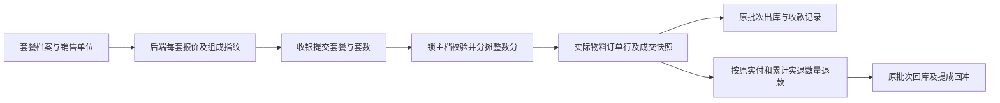

> 文档状态：历史审查/验收证据，仅对文内提交、环境和覆盖范围负责，不代表当前全系统完成度。现行入口见[统一文档中心](../current/README.md)。

# 套餐独立定价验收

日期：2026-10-13。用户已明确将套餐独立定价纳入本轮，本次恢复门店 POS 的套餐销售。

## 结论

收银员只维护商品价格和套餐每套价格。套餐按自己的零售价、有效会员价或授权议价成交，物料零售价合计不再覆盖套餐价。前端保留一行套餐，后端生成实际出库物料，并保存准确成交金额。退款、库存和提成可以沿原成交事实核对。

例如，物料正常售价合计100元，套餐价80元，购买两套就按160元开单。套餐含每套1件（12瓶）农资和1袋种子，实际扣24瓶和2袋；物料金额分摊96元和64元，总额严格等于160元。

## 原问题及修复

| 原问题 | 本次处理 |
| --- | --- |
| 套餐编辑加载商品资料时重新覆盖独立套餐价 | 保留已维护的套餐价，商品资料只提供物料和合法销售单位 |
| 前端拆成单品，后端按单品重新报价，标价与收款可能不同 | 套餐只提交套餐ID、套数及报价指纹，后端一次确定总价和物料分摊 |
| 套餐价格没变但组成已变，旧报价仍可能成交 | 指纹覆盖价格、物料、单位和数量，组成变化也拒绝旧报价 |
| 多物料展开后仍用原购物车下标，取货标记错配或越界 | 出库和取货都按展开后的物料对应，混卖用例先失败后通过 |
| 主档锁后仍可能读取事务旧组成 | 开单使用 READ_COMMITTED；配置替换和开单共用套餐主档锁 |
| 分摊单价先保留两位小数，退款丢尾分 | 权威物料小计按整数分分配，参考单价保留12位；累计退货计算尾分 |
| 整单优惠又被退成现金，0元物料无法退货 | 按原实付分配净可退份额，0元退货仍保存数量并回原批次 |
| 直退没有累计明细事实，后续可能重复退货 | 直退与售后共用现有售后记录，锁订单并校验累计数量和金额 |
| 固定套餐提成按物料重复计算，分次回冲丢分或超冲 | 按套餐组实际套数计提一次，回冲依据已完成实退数量补足差额 |

## 经营规则

- 套餐价格按元/套维护；只售正整数套。会员价和最低价可选，0表示未启用，不增加门店、渠道、会员等级或日期价格策略。
- 实际客户档案决定会员有效性。套餐会员价不会再叠加子商品会员折扣。
- 单品普通零售价仅作为物料金额分摊权重。系统按整数分分配尾差，不要求员工维护物料分摊价。
- 套餐议价及整单优惠共用现有销售议价权限，绑定登录员工并填写原因。普通收银员可以按标准报价售卖。
- 停用商品、失效销售单位、失效报价或任一物料缺货都会拒绝整单。可售套数按门店可用基准库存和每套真实需求计算。
- 历史订单保存的套餐价、名称、套数和物料金额不随档案修改变化。

## 数据与架构

没有增加表，没有套餐库存账，也没有新的价格模式。

V131 在既有 `order_item` 增加4个成交快照字段：`package_group_no`、`package_name`、`package_quantity`、`package_unit_price`。仅有原 `package_id` 无法区分同订单中同套餐的不同销售组，也无法保存档案修改前的套数与成交价，因此这些字段用于确定历史事实。每个组仍只保存实际商品订单行，复用现有库存、退款及绩效结构。

`total_price` 是按分保存的权威金额；`unit_price` 和既有议价审计单价提升到 `DECIMAL(24,12)`，避免三件分1元或七件分10元的参考单价损失精度。这不是新增价格维护维度。新快照有非空、正整数套数和正成交价检查；历史行保持空快照，不从当前套餐配置猜测回填。

含套餐订单的可退净额按原实付在所有物料间分配，不改原成交小计。实测套餐议价78元、整单优惠8元，原实付70元，两个物料分别可退42元与28元；尝试按原物料46.80元退款被拒绝。原成交快照仍合计78元。

提成沿用现有规则类别及上限：销售额/毛利依据物料成交小计与实际批次成本，固定套餐提成依据实际套数。本轮没有重新定义整单优惠对销售额、毛利提成的经营口径；净可退份额用于退款。修改这一经营口径需单独说明影响及取得明确业务决定。

## 验证证据

- 全量后端常规运行：487项，474通过、13项条件跳过，0失败、0错误；单独启用真实MySQL闭环后，最终报告为475通过、12项条件跳过。
- 真实MySQL随机隔离库执行全部87份迁移；通过实际控制器、SaToken登录身份、数据库事务、库存服务和退款事件完成闭环，测试库已自动清理。
- 两套80元套餐收款160元、第三销售单位实际出库、同套餐不同销售组的套数与提成、同价组成变化拒单、缺货整单回滚全部通过。
- 真实数据库保存 `0.333333333333` 分摊单价，三件一元按0.33、0.33、0.34元分次退完；原2分提成精确回冲。三套共3分提成分六次物料退货后精确归零，重复事件不再次回冲。
- 真实授权套餐议价产生两条物料审计，无权限议价整单拒绝；整单优惠后的退款合计原实付70元，成交快照保持78元。
- 单元与前端用例验证：三件共享1分时逐件可退0、0.01、0元，三次均保留实物数量；全额退款后的0元物料仍可回库，超量/超额不能产生新事实。
- 独立迁移验证：保留历史金额及空快照、拒绝缺失套数/成交价和小数套数、保留12位单价及审计差额。
- 前端32项确定性回归全部通过，类型检查与生产构建通过；保留既有Sass及较大打包块提醒。本轮没有做真实浏览器逐页点击验收。
- 后端全模块打包通过；实际管理端启动、登录、员工授权、套餐列表及退出登录验证通过，临时管理端进程已停止。
- 本机开发库已从V130升级到V131，87份迁移成功、失败0；商品0、订单0，未导入本轮验收业务数据，未再次清库。
- `git diff --check` 通过。工作区包含前轮库存、单品价格和本轮套餐修改，尚未提交Git。

日志：`/tmp/agri-package-final-suite.log`、`/tmp/agri-package-final-mysql.log`、`/tmp/agri-package-final-ui-tests.log`、`/tmp/agri-package-ui-build.log`、`/tmp/agri-package-final-build.log`、`/tmp/agri-package-dev-smoke.log`。测试入口：`bash admin-web/tests/run-pos-pricing-tests.sh`。

## 验收边界与下一步

本轮恢复门店POS套餐销售。小程序尚无套餐销售目录，不把本轮视为客户在线套餐下单的交付。赊销退款仍沿用现有线下冲账限制；微信/支付宝真实网关及对账问题仍在项目待办中，本轮未接网关。

下一步优先按门店真实样例验收采购、收货、单品与套餐混卖、收款/赊销、提货和人工配送。不得为了可能的促销需求再引入价格策略维度、前端兜底或第二套库存来源。
