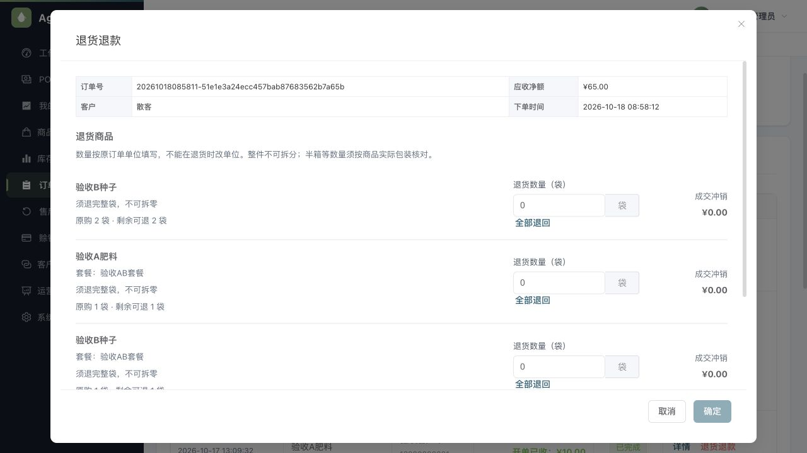
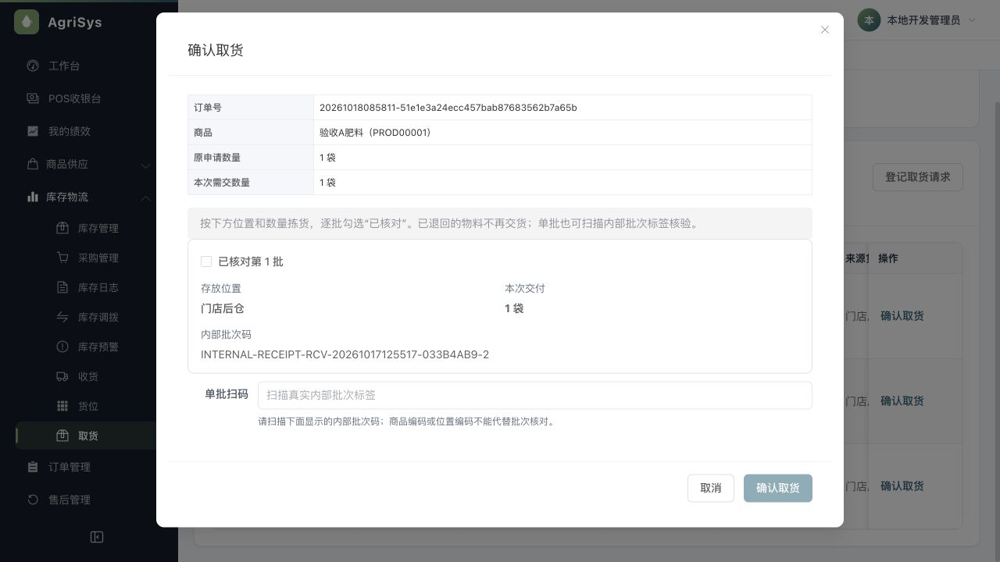
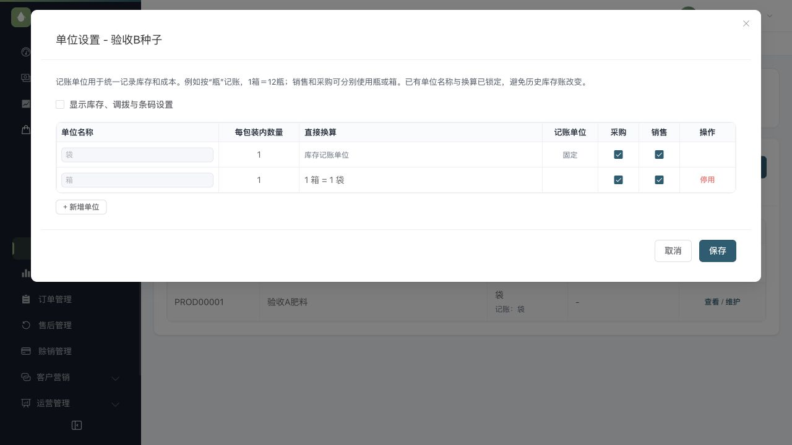
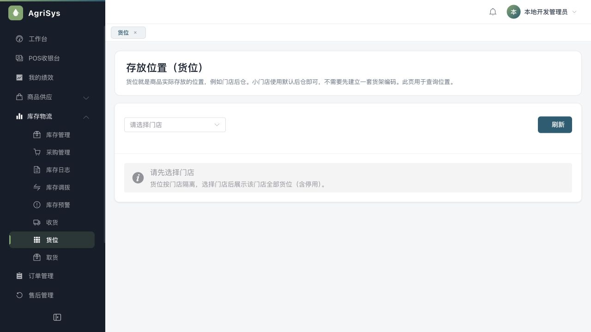

> 文档状态：历史审查/验收证据，仅对文内提交、环境和覆盖范围负责，不代表当前全系统完成度。现行入口见[统一文档中心](../current/README.md)。

# 单位数量与库房交互验收

日期：2026-10-18；基线72994d8。根据用户五张截图反馈，用户明确确认整件最小记账单位不可拆分、计量单位允许小数、半箱必须换算成完整最小单位。本轮修改前已说明影响退货/POS、商品单位、采购收货、货位与提货页面，以及后端统一数量校验；不新增表、持久字段、迁移或业务模式。

## 业务解释与界面结果

| 入口 | 用途与本轮处理 |
| --- | --- |
| 退货退款 | 商品、原购/剩余数量和可编辑数量放在同一行，无需横向拖到末尾；显示0、2、0.5，去掉固定尾零。底部按钮固定，长内容单独纵向滚动。数量沿原订单单位，不在退货时另选单位，保证原出库、退款金额及套餐分钱一致。 |
| 采购收货 | 供应商到货后核对实际收到的商品、批次、成本并入库；采购单代表采购计划，实际收货才形成库存。补收货图标及直白说明；未选采购单时不再叠加一张空表。 |
| 存放位置（货位） | 查询商品实际存放在哪里。小门店用默认“门店后仓”即可，无需先配置货架编码。本轮保留查询页，不制造不存在的维护入口。 |
| 库房交货确认 | 收银选择库房取货后，在此核对并交给顾客；确认不再次扣库存或收款。弹窗拆开商品、位置、数量和内部批次码，长码可换行；实际单位取原批次持久记录。修复复选框组继承零行高导致明细叠字的问题。 |
| 商品单位与包装换算 | 可按权限新增包装、维护采购/销售用途及条码，不是单纯展示。常用库存单位与真实记账单位分开标示；默认只露出常用字段，库存/调拨/条码折叠。已有名称、系数及记账单位锁定；固定系数自然数字显示，不再显示1.000000。 |

记账单位就是统一记录库存和成本的尺子。例如瓶为记账单位、1箱12瓶；只按袋进销时，仅一个袋单位即可。固定基准不是日常操作，不能为了改展示单位而重定义已有账本。未增加多级换算链。

## 数量规则

- 标准计量名称白名单集中在QuantityGranularityPolicy；公斤、克、米、升等允许小数，其余非空记账单位按整件。当前没有另增可随意切换的配置开关。自定义计量别名需先明确纳入政策，不能自动猜测。
- POS前端提示基于后端只读元数据；销售创建、收货、盘点、调拨、退款预览和正式回库仍由后端校验。原始销售/实退数量最多4位有效小数，基准换算最多8位，超出拒绝而非舍入。
- 1箱12瓶时，0.5箱是6瓶可接受，0.1箱是1.2瓶拒绝；1瓶不可退0.5瓶。公斤等计量商品保留合法小数。
- 退货从原销售分配与原批次的持久化基准单位取证据，不从当前主单位补猜历史；证据缺失拒绝自动退货。既有钱货锁序、请求防重和退款来源规则不变。
- 单位弹窗加载失败不能保存空记录；旧商品加载/保存响应不能污染或关闭新弹窗，保存期间锁定编辑和关闭。POS切换单位也验证数量粒度，不能将合法半箱换成半瓶。

## 验证

- 全后端打包：717项，702通过、15条件跳过，0失败/错误。不是717项全部执行通过。
- 真实MySQL：权限HTTP35项通过；Retail2项通过，合计37项。其余12项环境条件用例未执行。
- 新增真实事实链场景：采购收货1箱12瓶，销售1箱；0.1箱在预览及正式退货均拒绝，钱货事实不变；0.5箱按原批次退6瓶、退6元。既有部分退货/交货并发场景的“袋”测试单位改为“公斤”，保留原小数场景，不放松整件政策。
- 全前端188项通过，0失败/跳过；类型检查及Vite构建通过。既有Sass弃用、vendor体积提示仍在。
- 数量校验与异步守卫均做修改前失败、修改后通过验证。限定独立复核发现单位保存旧响应和POS单位切换两项P2，已修复并复核关闭；后端限定复核无有证据的新增P1/P2。
- 最终真实浏览器1280×720：退货弹窗top16/bottom704，正文可滚、底部按钮可见；各商品行及正文scrollWidth等于clientWidth，无水平溢出；输入0.5袋被拒绝并保留原0。取货弹窗位置/数量/长批次码清晰，无叠字。单位页锁定基准、固定数字无尾零，收货图标可见、货位用途说明可见。
- 浏览器只做导航、打开/取消弹窗及临时数量校验；未提交退款、取货、开单、还款、采购或库存。自动化事实链只用独立可丢弃测试库。

## 运行与数据边界

本机前端3090、API9080、Redis6389保持运行。后台不可变包api-admin-acceptance-f2edf125d310.jar，进程42193，运行清单仍在既有ignored scratch/browser-env.json。复用原页面验收库，V132无新增迁移，保留用户订单与采购；不bootstrap、不清库、不补造数据。

当前示例商品已有“1箱＝1袋”配置，页面如实展示，本轮未擅改为12袋。真实商品投用前应按实际包装核对档案。前端以开发服务提供最新页面，后端不可变包对应本轮生产Java，后续改动仅测试及页面样式。

本轮没有手机、硬件扫码枪、打印机或真实支付验收，也不将这几页通过称为全系统无缺陷。提交仅本地，无推送或生产部署。回退需同时回退本轮前后端版本，不能只回退客户端以绕开后端数量规则；没有数据库回退步骤。

## 页面效果

