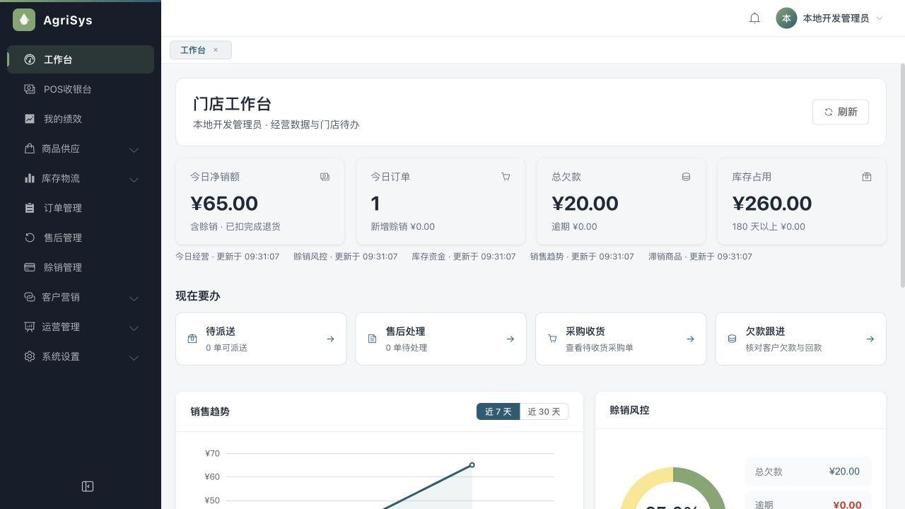
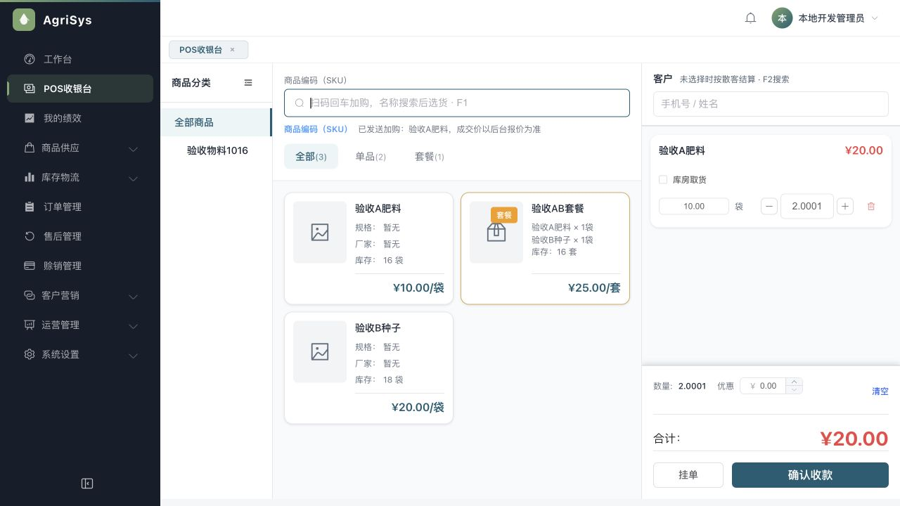
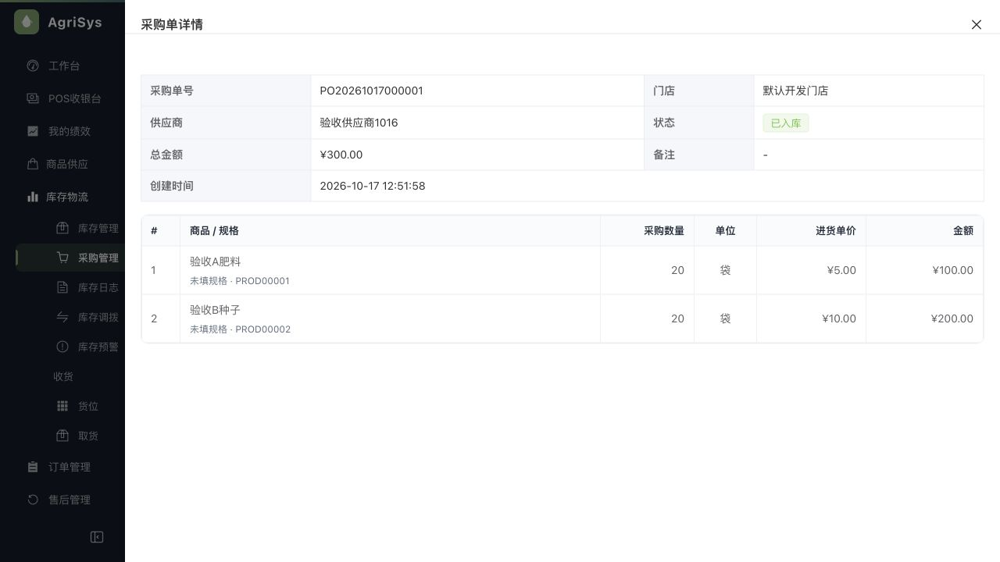
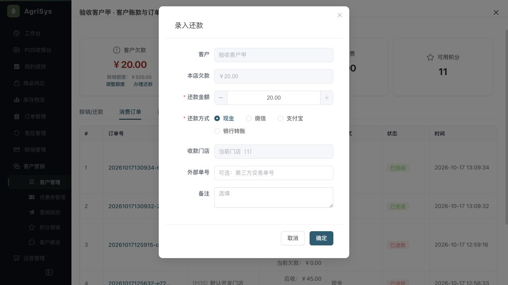

> 文档状态：历史审查/验收证据，仅对文内提交、环境和覆盖范围负责，不代表当前全系统完成度。现行入口见[统一文档中心](../current/README.md)。

# 门店交互与界面优化验收

日期：2026-10-18。落实用户“按照你的方案优化完善”授权，基线为a6080f4。本轮以高频门店流程和公共视觉为范围，未改后端、业务表或迁移。

## 完成内容

| 范围 | 结果 |
| --- | --- |
| 还款 | 实际定位初始欠款0使InputNumber最小值大于最大值，组件异常阻断弹窗；等待真实欠款后挂载，零欠款禁用。首次和重开可见，原请求身份、资金校验和未知结果冻结不变。 |
| 工作台 | 四项主要指标、配送/售后/采购/欠款任务。每块独立权限、请求序号与会话隔离；加载、失败、旧值、成功零值分开，保留更新时间和重试。采购直达真实/inventory/purchase/order?status=2。 |
| POS | 完整唯一编码回车加购，名称/模糊/重复不自动加；后台报价失败仍阻止开单。数量直接输入，原始字符串最多4位小数，套餐正整数；按钮和连续扫码合并按整数万分位计算。提交/拒绝清除草稿，防止后续扫码数量显示滞后。 |
| 选货体验 | 卡片由320px高大图改为约160px紧凑小图；分类可折、增加全部商品入口，商品/分类/筛选支持键盘，图标和输入有名称；空车和未完成报价禁用结算。 |
| 采购/订单 | 固定操作区180px，主动作+更多保留权限/原状态；订单号短展示、完整复制。扩大详情、规格厂家并入商品列，数量/单位/单价/金额能同屏核对。支持真实任务query及清筛选，旧列表响应隔离。 |
| 客户 | 姓名作为详情标题，账款/订单优先；欠款、还款在前，档案折叠、营销操作移更多。列表本金余额说明中保留专用金/冻结/积分；不逐行查询欠款、不新增接口猜数。 |
| 公共UI | 正文14px、加深辅助文字、中性面板、统一主色/控件/表格/弹层，去掉广泛彩色渐变、消除卡片双层内边距。减少动画支持。菜单只默认展开当前组，首页从真实可访问高频入口选择。 |

规范固化至PRODUCT.md、DESIGN.md与AGENTS.md，样式仍使用现有令牌，无新增依赖或另一套主题。

## 验证证据

- 全前端：**179项通过，0失败、0跳过**。原报价/套餐、赊销退款、配送、权限、提货回归均在统一runner内。
- 类型检查与Vite构建通过；仍有既有Sass弃用及vendor包较大提示，非构建失败。
- 新行为回归已验证修改前失败、修改后通过：还款初始上下限、失败不伪零、版本和权限隔离、任务路由解析、筛选与操作守卫、SKU精确匹配、原始数量精度与整数套餐、浮点加减和合并。
- 独立限定代码复核：数量草稿覆盖及浮点尾数问题已修复并复核关闭，其余本轮范围未发现有证据的新增P1/P2。
- 真实浏览器1280×720：工作台、POS、订单、采购列表/详情、客户详情及还款弹窗。准确SKU回车加一件；输入0.5对应5元；1.0001再次扫码显示2.0001；1.00001被拒绝并回退。没有点击确认收款。
- 还款最终弹窗top16、bottom652，720高视口内可见全部按钮；未提交还款。采购详情数量、单位、单价、金额同屏，订单金额与状态未被固定操作区盖住。
- 1024×720：POS选货/结算均在视口内；折叠分类后选货区364px，结算按钮可见。1440×900工作台四指标/四任务，页面无横向溢出。已恢复原视口。

## 数据与运行环境

继续使用既有页面验收库与隔离Redis6389，前端3090/API9080保留运行。保留用户已有订单和采购，仅临时购物车、导航、打开/取消弹窗，无新增销售、还款、退款、派单、采购或库存提交。未清库、重置、种数、迁移、推送或部署。本轮未触及Java/SQL，未重复运行后端测试；历史705项/37项数据库证据不冒充本轮新跑结果。

## 验收边界与下一步

公共UI覆盖全系统，深度流程核对集中在高频门店页面；不宣称所有营销/报表边缘态均已逐页验收。扫码枪、打印机、手机、真实支付网关和完整无障碍认证未验。下一步以真实商品和较多记录试用，优先记录收银/收货/客户查账中的实际卡点，再处理其余低频页的一致性。先保经营闭环，不继续扩营销和供应链。

## 页面效果

