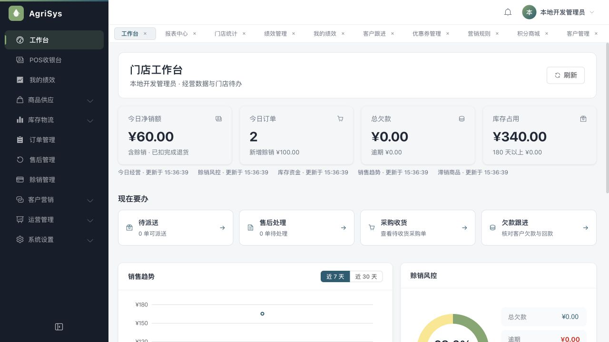

# 真实浏览器综合验收报告

## 结论

**管理员身份的钱货核心闭环已实际跑通，但整体验收不通过。** 本轮发现7项功能或统计口径问题，其中最小收银/库管岗位不能顺畅完成本职工作、计量单位被误判、销售趋势不扣退货，应优先修复后再开展门店员工试用。

本轮不是自动测试结果复述：真实浏览器逐一进入33个业务路由，通过页面创建资料、采购、收货、3笔销售、4次退货、还款、交货、签收、盘点、调拨、充值、券及礼品等；数据库仅用SELECT取证。最终27项数据一致性断言通过。该数字只代表所列断言，不代表所有功能或所有异常场景通过。

## 环境与边界

- 日期：2026-10-19；桌面浏览器1280×720，后台操作；业务源码5dcba01，起始HEAD9cce1f7。
- 独立验收环境：前端3091、API9081、Redis6390，新建随机隔离数据库，88项迁移成功、V132。不可变后台包指纹8dab2ec77573。
- 仅初始化管理员、默认门店和后仓；后续测试业务均经页面建立，无SQL/接口写入代替操作。
- 原预览3090/API9080/Redis6389保留，收尾只读确认原端口及原进程清单仍在；本轮未对其重建、清库、迁移、重启或提交业务。没有另行做原库全表前后内容指纹比较。
- 所有客户、电话、地址、金额均为隔离环境虚构资料。现金、银行还款均为本地登记，没有真实银行/微信/支付宝资金动作、外发客户消息或打印配送硬件动作。
- 权限配置首次被自动审批拒绝后已取消；用户随后明确授权两个测试角色、员工和最小权限，才继续配置。原管理员未降权。
- 本轮没有修改生产业务源码、表结构和迁移。独立验收服务及测试记录保留，方便复查。

## 按模块结果

| 模块 | 实际操作与核对 | 结果 |
| --- | --- | --- |
| 登录与工作台 | 管理员、收银、库管分别登录；空工作台与最终金额、会话菜单切换 | 菜单隔离有效；岗位取数存在F04/F05 |
| 商品、分类、单位 | 建分类与A袋/B瓶/C千克商品；B添加1箱12瓶；后端报价与半箱换算 | F01采购选项遗漏、F02计量识别错误 |
| 供应商、客户 | 页面建档、查询、客户额度1000、订单与账款详情 | 已执行场景通过 |
| 采购与收货 | 建单360、提交、B2箱实收24瓶、A两批不同实际成本、仅有效期/日期未知 | 采购状态3，实收成本380；余额及4条入库流水一致 |
| 库存与货位、日志 | 汇总、批次明细、默认后仓查询、16条移动记录核对 | 管理员数据一致；库管首次加载受F05影响 |
| POS普通销售与套餐 | A2普通40＋AB独立套餐25，现金65；套餐分配8.33/16.67 | 成交及库存分配一致 |
| 赊销、还款 | 赊销A5=100、银行还40；退A4=80，先冲欠60、退原还款20 | 原挂账100、实还40保留，欠款0，来源已退20 |
| 退货、售后 | 套餐两件分次退25；半瓶拒绝；半箱全退55、0.1箱拒绝；售后事实汇总 | 原批次回库、资金分配、尾分和全退入口符合预期 |
| 库房提货 | 套餐已退后两请求可交0，仅普通A2可交；核对后确认 | 管理员确认不新增钱货；真实库管被F05阻塞 |
| 门店人工配送 | 赊销单退4留1后派单、签收 | 保留部分退款状态9，配送状态4，不重复扣库收款 |
| 盘点、调拨、预警 | 16.5袋盘点拒绝，17→16合法盘亏；二店调入2袋；二店低库存2/最低5 | 数量、成本及双向流水一致；F03结果显示不全 |
| 角色、员工 | 创建最小收银/库管角色及员工，真实登录；无退款/派单/盘点/调拨权限时不显示相关动作 | 未见菜单残留；岗位依赖失败，不能判完整岗位链通过 |
| 报表与门店统计 | 工作台净销、应收、库存；报表趋势和一二店切换、大户排行 | F06销售趋势不扣退货；F07新增客户全局口径未说明 |
| 优惠券、营销、钱包 | 建满20减5券、手工发1张；充值100赠10；券核销后全退返券；钱包支付预览 | 本金100、专用金10；券恢复可用；钱包实际扣款未执行 |
| 积分商城 | 建10积分/库存2礼品，查兑换订单；全退订单赠55积分并回扣55 | 档案落库及积分归零一致；未完成兑换履约链 |
| 绩效、个人绩效 | 四页签查询、保存收银员10月目标1000/2/50并核对数据库 | 目标保存通过；无提成规则，未验证工资结算/发放 |
| 客户跟进 | 查询近期客户的跟进列表 | 无逾期客户，空态可用；未执行真实回访 |
| 字典、系统日志、通知 | 字典读取、操作日志分页、通知查询与无数据态 | 已访问；业务操作审计存在，未改全局字典或发通知 |

上述覆盖33个注册业务路由，不等于逐个完成所有新增、编辑、删除、导出及边界组合。截图和数据库证据分别保存，发现失败没有通过扩大权限或改数据掩盖。

## 已确认问题与优先级

| 编号 | 级别 | 复现与影响 | 证据/定位 |
| --- | --- | --- | --- |
| F01 | P2 | B启用箱=12瓶且允许采购，但采购单单位下拉只有瓶；收货手填2箱可正确入24瓶，采购录单入口与单位档案脱节 | 截图06；purchase/order/index.vue的getUnitOptions仍沿用旧主辅单位 |
| F02 | P1 | 商品内置选择“千克(kg)”后，POS填0.5被提示“换算后须为完整千克(kg)，不能拆零”，恢复1；不能按正常计量销售 | 截图58及measurement-rejection-evidence.json；V43内置字典字面量与QuantityGranularityPolicy白名单不一致 |
| F03 | P2 | 调拨成功后“调出拆批”表暂无数据，调入映射和实际双向流水正确，难以核对源批次 | 截图23；InventoryLedgerService返回batchDetails空列表，界面仍展示该表 |
| F04 | P1 | 有POS收款、订单/客户查询的最小收银员实际登录，商品与套餐0，无法选货收银 | 截图26；控制台拒绝product:query、product:category:query，商品面板取数依赖未纳入岗位闭环 |
| F05 | P1 | 最小库管首次库存为空；手动查询才出现本店库存。提货无法选门店，收货列表加载失败；收银订单页也有门店查询错误 | 截图28—31；库存loadOptions失败阻断loadTable，提货依赖store:list，收货列表及详情依赖purchase:query |
| F06 | P1 | 两单退货后工作台净销60，但销售趋势仍165销售/85成本/80毛利；应扣完成退货后为60/30/30。工作台图表亦用该趋势来源 | 截图20/32；ReportAnalysisService.salesTrend读取原明细与分配，不减已完成售后；本例无跨期争议 |
| F07 | P2 | 切二店（仅调入库存、无客户创建）仍显示新增客户1，未说明是全局数，易被当门店业绩 | 截图33/34；ReportAnalysisService.today的客户计数不按storeId过滤，源码注明customer无store_id |

F04/F05是岗位配置与读取依赖问题，不是已证明的越权漏洞。需要补齐范围受控的岗位读取契约或明确必要授权，不应简单扩大所有管理员权限。F07优先澄清全局标识，不因一个统计指标直接新增字段或表。

## 关键钱货事实

1. **采购**：原单360元；实收A10×10＋A10×12＋B24×5＋C10×4＝380元。A第一批仅有效期2027-10-19，生产日期NULL，PARTIAL；没有补造生产日期。
2. **订单1**：A2普通40＋套餐25＝65现金。套餐B退8.33、A退16.67，合计25；原出库分配不改，退货按原分配回库。只有普通A2完成提货，确认前后移动数仍9。
3. **订单2**：赊100、实还40、退货80＝冲欠60＋退原银行还款20；100−40−60＝欠款0。配送只交净剩A1，派单和签收不新增钱货。
4. **订单3**：B0.5箱＝6瓶，原价60−券5＝55现金。全退55、回库6瓶，订单状态8、券恢复状态1；0.1箱＝1.2瓶退货被拒绝。原赠积分55及回扣55两条记录，余额回0。券保留原使用关联供历史追溯，恢复以status=1判断。
5. **最终销售净额**：原净应结算220−退货160＝60；现金原收120−已退80＋原还款40−已退20＋剩余欠款0＝60。优惠券5不计现金，赊销100不当作已收现金。
6. **最终库存**：净销售消耗A3后A17/B24/C10、成本350；盘亏A1按成本10后总成本340；调拨A2不改全球总量/成本，一店A14/B24/C10，二店A2。
7. **钱包与客户**：充值本金100、赠送专用金10，单独保存RECHARGE及RECHARGE_GIFT；不是销售收入。客户净消费20、有效订单数1；积分余额0，符合已完成全退回冲。
8. **工作台收尾**：净销60、欠款0、库存340；今日订单2为当前统计所含状态，已全退订单不在该计数。数据库实际创建订单3笔，报告不混淆二者。

## 留证与复核

- [27项只读对账及实际SQL](assets/2026-10-19-browser-full/consistency-results.json)：迁移、原收货成本、逐店库存、逐批逐位置移动重算、无负库存、原分配成本、套餐尾分、退款来源、应收、配送、返券、钱包/积分、目标、礼品及角色授权数量。
- [计量单位失败完整页面证据](assets/2026-10-19-browser-full/measurement-rejection-evidence.json)。其余截图在同目录，按执行顺序编号。
- [逐场景执行清单](2026-10-19-浏览器综合验收清单.md)。未提交业务草稿已清空，浏览器停留3091工作台。
- 首次对账有3个测试口径错误：把调拨接收批次重复计采购、把券5元计现金、把积分流水计资金钱包流水。经逐来源SQL核实后修正测试统计，未改业务数据，最终27/27；不将这3项算产品缺陷。

## 未覆盖与下一步

- 真实微信/支付宝回调、客户钱包验证码授权后的扣款、移动端客户下单、自提码核销、真实短信、扫码枪和打印硬件没有执行。
- 权限边界的直接构造请求、并发竞争、网络超时后的幂等重放、跨期退款、历史缺证据、0元物料等未在这轮浏览器完整重测，不能用既往自动回归替代本轮记录。
- 售后独立申请→审核→退款全流程未新建；本轮走管理员直接退货并核对同一售后事实。积分类兑换履约、工资生成发放、所有营销边界及文件导出未全测。
- 先修F04/F05岗位闭环、F02计量别名与F06退货报表，分别补真实浏览器复验；再修F01采购包装、F03调拨明细及F07统计标识。期间保留现有库存、价格、账款事实契约，不引入新模式或新表。

