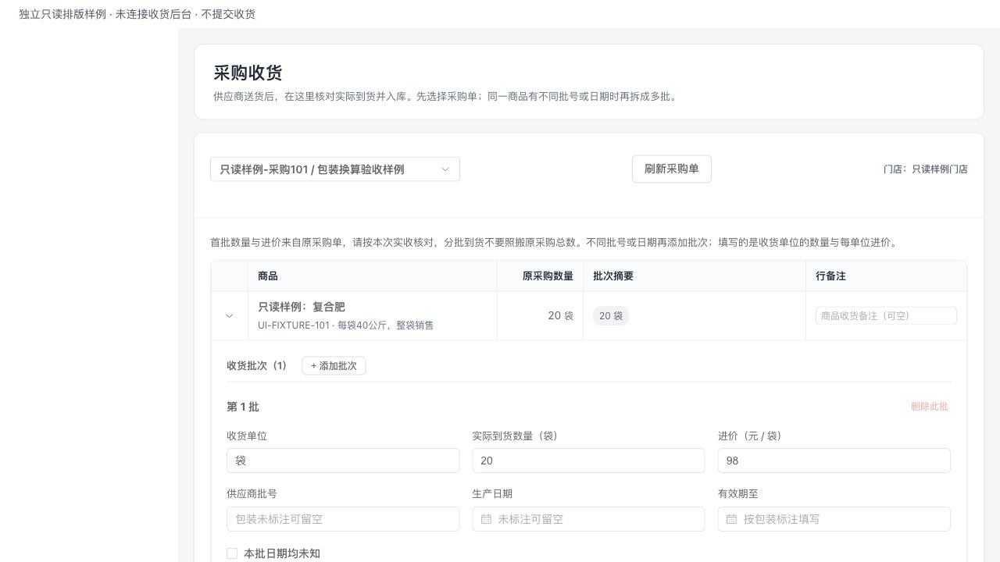
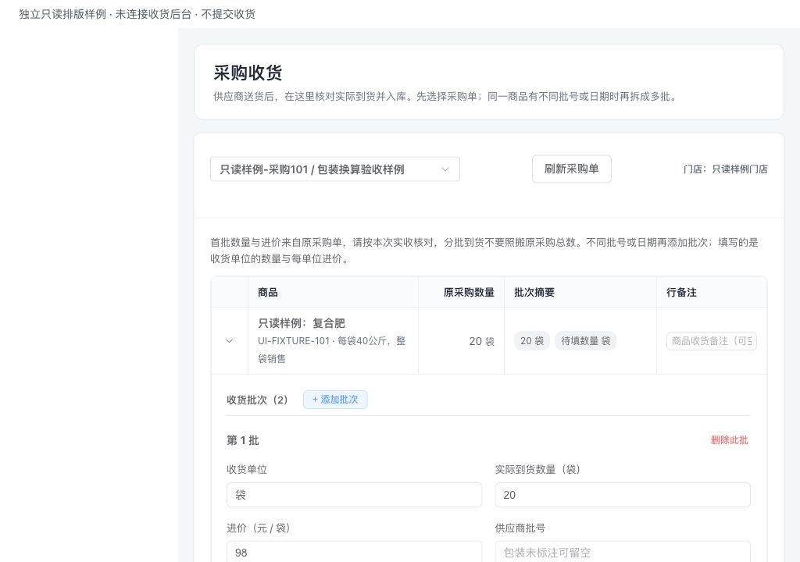
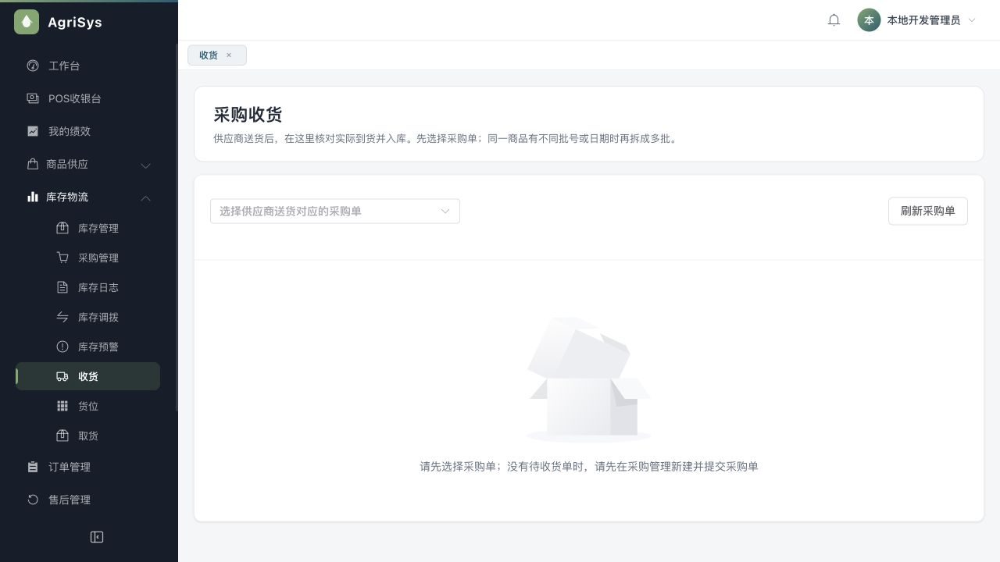

# 采购收货可靠性与录入体验验收

日期：2026-10-19；基线2edeec9。承接用户继续优化系统的授权，优先处理采购收货页。仅改前端及测试，没有Java、表、字段、迁移、业务模式或新依赖。

## 问题与结果

| 问题 | 修复 |
| --- | --- |
| 切采购单后，旧详情可能覆盖新单；清空后旧请求仍可恢复行 | 详情请求序号、当前采购单和会话共同校验；取数前立即移除旧详情，旧成功、失败和finally均不能污染新查询。 |
| 已加载详情在换员工后仍可成为新请求 | 详情保存读取时的会话，创建请求前核对；未知请求也限定原会话和原采购单。独立复核发现此P2，补失败测试后修复。 |
| 加载失败看起来像没有采购单 | 列表、详情独立错误，提供原查询重试，失败不显示正常空态；不是待收货状态的采购单不能录入。 |
| 新增批次默认0.00000001成本，容易误收 | 新批次数量和进价留空，要求实际填写。首批只沿原采购单真实数量/价格预填；明确提示分批到货不能照搬原采购总数。 |
| 嵌套批次表挤在横向滚动中，数量与价格单位不直观 | 改为分组字段，默认展开，数量标明单位、进价标明元/单位；按宽度切三列/两列，保留批次添加删除、备注和日期。 |
| 控件6位自动舍入隐藏原输入 | 普通文本数量/进价先验证原文：正数、普通十进制、最多8位，拒绝Infinity、科学计数、超精度；转换数字会丢有效尾数的大值也拒绝。没有改变后端粒度规则或再建名称白名单。 |
| 提交中可以改内容、切单或再次点击 | 锁定编辑、切单与刷新，重复点击不再发第二请求；每次提交固定请求数据、原行、门店和打印选项快照。 |
| 连接中断后修改内容再提交，无法判断前次结果 | 结果未知保留原身份和内容，只可原请求重试。首次明确业务拒绝才解除锁定允许修正；未知请求重试即使再遭业务拒绝也不擅自当成前次未成功。 |

只知道有效期时可单填有效期，生产日期为空；两项都未知时勾选未知。打印从原请求商品、门店和标签类型取值，不从后来编辑推算。

## 验证证据

- 前端全回归：**199项通过，0失败、0跳过**，其中本轮收货可靠性新增11项。类型检查及Vite构建通过；既有Sass弃用、vendor包体积提示仍在。
- 修改前失败→修改后通过：A/B乱序、清空及旧会话响应、详情/列表错误、伪造成本默认值、提交守卫、旧成功清空另一单、未知请求身份、明确拒绝与未知拒绝区分。复核P2会话绑定及大值精度也各自先失败后通过。另补有效期单填、合法8位、打印快照正向验证。
- 一次独立限定复核：发现已加载详情换会话P2，已增加回归并修复；提出的基线大值Number精度限制也改为前端拒绝静默丢数，不宣称接口所有DECIMAL范围均能无损传输。
- 真实预览页仍能读取待收货列表，现有列表为空、无页面错误。为避免新增业务数据，录入排版用**独立只读组件样例**验证，组件复制自实际页面、只替换读接口/会话；收货函数只抛错，不连接后台，也没有点击提交。样例标识在截图顶部。
- 1280×720、按228px侧栏预留空间：表单内容根宽1046，批次字段宽921，scrollWidth=clientWidth；1024×720根宽790，字段宽665，两批均无水平溢出。实际总表体宽分别962/706，亦未横向溢出。
- 点击添加批次后新数量、进价为空，原行保持展开。视口已恢复；临时样例文件已删除，浏览器回到真实采购收货页。

## 数据、边界与下一步

没有在浏览器新建采购、确认收货、退款、开单或改库存，也未清库、补造成本或日期。后台运行包f2edf125d310及V132保持不动，3090/9080/6389继续使用。全后端与数据库测试未重跑，不将上轮717/37作为本轮新证据。本地提交，无推送或生产部署。

未知结果当前只能保留原请求重试或人工核对，后端尚无可自动返回原收货结果的安全重放查询；本轮不增加接口或持久结构，不把后续拒绝猜成原请求未落库。真实收货写入、实体打印机、扫码枪均未验。

后续继续按库存查询、盘点/调拨的错误态、单位说明和异步对象隔离顺序核对，不扩营销。项目验收与技能更新分开：用户同意更新Impeccable，但官方更新器未识别旧目录；临时目录取得官方包时，签名下载TLS中断/超时，严格证书校验的同发布包手动下载也超时。没有安装新技能或覆盖原目录；当前仍3.5.0，可待网络恢复后继续更新。

## 截图

以下两张为独立只读组件样例，不是新增的真实采购单。

