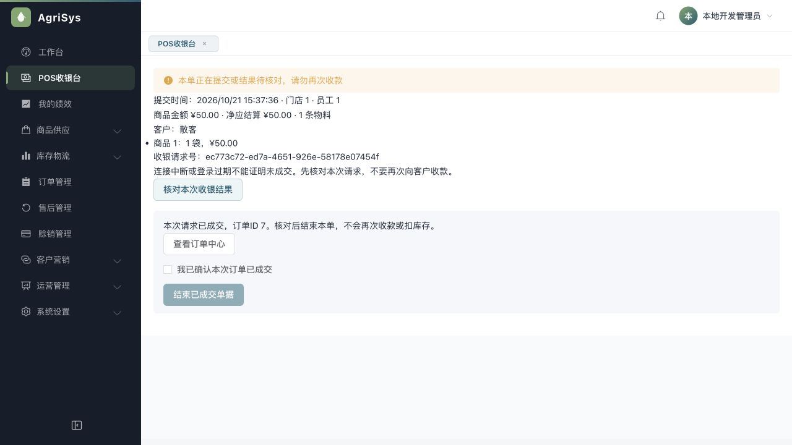
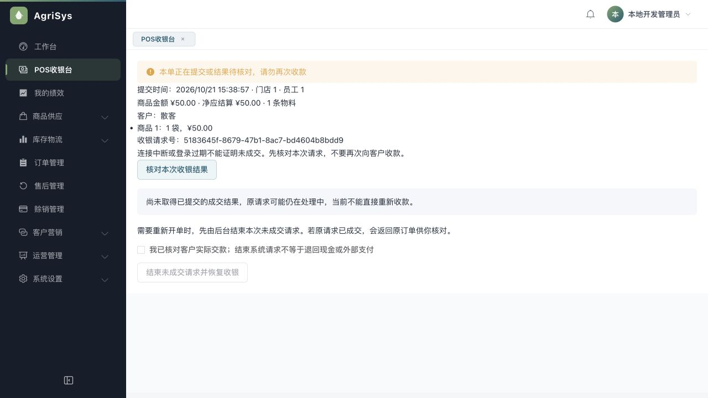
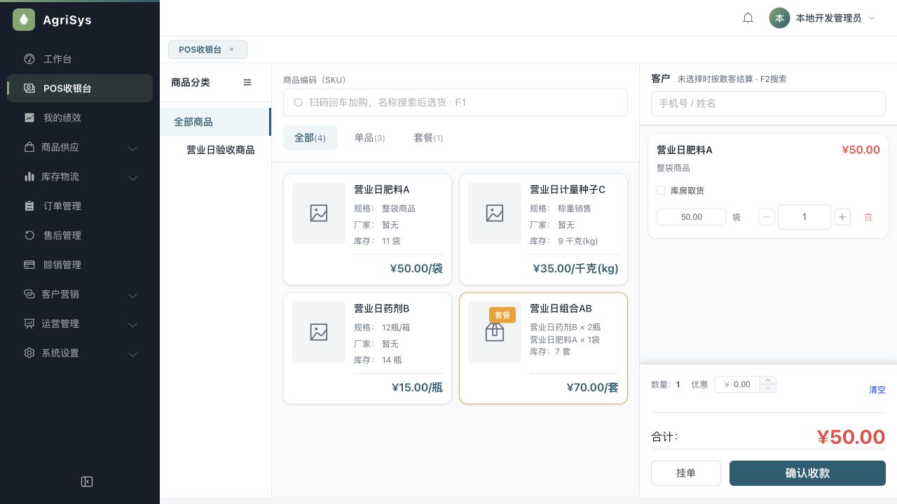

> 文档状态：历史审查/验收证据，仅对文内提交、环境和覆盖范围负责，不代表当前全系统完成度。现行入口见[统一文档中心](../current/README.md)。

# POS异常恢复验收

## 结论

新收银请求已具备“固定请求号→未知冻结→查原结果→确认已成交或建立取消屏障→恢复收银”的闭环。后台已成交但响应丢失时，不再靠商品与金额猜配订单；未取得成交结果时，不把“查不到”当未成交。后台结束请求后，迟到提交不能再开单。真实浏览器故障注入与59项只读对账通过。

本结论只覆盖当前新版本、新请求及下述验证。旧版没有请求号的冻结记录仍人工核对，未自动解冻；外部微信/支付宝真实资金通道未接入，测试为本地收款记账。没有宣称所有功能无缺陷。

## 修改影响与必要结构

- 收银台：发送前持久化安全UUID请求号与有限核对摘要；结果未知只提供核对、结束原请求、确认原成交等动作，不自动重发支付请求。明确业务错误也先取得后台取消结果再解除冻结，防止误把并发请求的一次拒绝当整单未成交。
- 后端：`PosSaleSubmissionService`协调原`createPOSOrder`，Controller仅鉴权与转发。请求号绑定真实员工与门店，保存内容SHA256；相同号改商品/金额/支付内容拒绝，已完成重放返回原订单。
- 新增V133一张`pos_sale_submission`请求结果表，包含请求号、员工/门店、摘要、状态、订单ID和时间。它不保存第二套金额/库存/支付事实，也不保存验证码明文或完整请求体。
- 新表必要性：失败或尚未到达的请求没有订单可关联，现有订单与库存流水不能承载持久取消屏障；不能用备注、Redis缓存或虚构零元订单代替。迁移仅创建表，不改旧业务数据。
- 请求行的唯一键与行锁先于原业务事务；成功结果、订单、支付、钱包及库存同Flex事务提交/回滚。取消遇到原成功返回COMPLETED；取消先提交则同号迟到请求拒绝。GET查不到只返回UNKNOWN。
- 不新增员工行锁，不改变原客户→账户→库存锁序。提交完成前核对实际订单归属，不一致整笔回滚。
- 钱包移除Controller的临时验证码Redis锁，避免同请求先被误拒绝；原钱包事务内验证码条件UPDATE保留，一码只能核销一次，不同请求复用验证码全部回滚。
- HTTP POS创建现在必填请求号；不提供无请求号绕过防重的创建分支。前后端须配套更新。内部既有业务方法仍是单一钱货创建实现，不新增库存写入口。
- 本机记录读取/删除失败或被替换时继续冻结；同员工重新登录保留待核对记录，旧员工响应不能清理新会话。

## 真实浏览器验收

环境仅3092/API9082/Redis6391，数据库`agri_day_20261020_24e59d07aa6c`。原3090、3091库/API保留。3092升级到V133，89份迁移成功、失败0。商品、销售和退货均通过浏览器，SQL只读核对。

故障由本机9083测试代理注入：只临时保留正在转发的请求于内存，不持久化请求体或令牌；故障开关文件不含业务内容。先完成原请求后丢弃响应，或截留提交、返回连接失败，再由测试操作放行原提交。Vite收到断开后返回网关错误，页面按结果未知冻结；不伪造后台成交结果。

| 场景 | 实际结果 |
| --- | --- |
| 正常对照单 | 订单6，A1袋、现金50；第一次代理配置未重新加载，故正常成交，明确不算故障通过 |
| 成交响应丢失 | 订单7，A1袋、现金50；后台完成，浏览器冻结；按原请求读取COMPLETED/订单7，确认后结束本单，无第二笔开单 |
| 原请求尚未到达 | 核对返回UNKNOWN，页面仍冻结，确认结束后后台保存CANCELLED，恢复收银 |
| 放行迟到原提交 | 返回10001“本次收银请求已结束，不能再次成交”；订单/收款/库存流水仍为7/7/20，未增加 |
| 原测试销售收尾 | 订单6、7各按原批次全退50，共退100，原订单状态8，请求仍保留原COMPLETED事实 |

丢失响应请求`ec773c72-ed7a-4651-926e-58178e07454f`绑定订单7；迟到取消请求`5183645f-8679-47b1-8ac7-bd4604b8bdd9`无订单。原5单对账51/51在追加操作前通过；追加后[59项只读SQL](sql/2026-10-21-pos-recovery-reconcile.sql)全部通过，不修改旧基线查询。

最终7单原净应结算772.50、退货297.50、净销售475；现金净留375+银行100，欠款0；库存A13/B14/C9，价值682，销售净成本280。追加销售全退后原净账保持不变，流水真实增长至22，没有删测试单或清库伪造基线。

故障代理已停止，3092配置恢复直连9082并重新启动。固定后端包`api-admin-recovery-da4cf5f306b6.jar`，SHA256 `da4cf5f306b68719cf17cca1424016b175d1dce152d43ec9f8b7ede5465ed030`，API PID58584，正常前端PID74228。没有更新原3090/3091后端及原开发库迁移；验证和体验本轮功能使用3092。

## 自动验证与审查

| 检查 | 结果 |
| --- | --- |
| 后端全量verify/打包 | 814项：806通过，8条件跳过，0失败/错误 |
| 真实MySQL完整业务E2E | 另实跑2/2通过，0跳过；全迁移至V133，唯一测试库自动清理 |
| 前端全部回归 | 247/247通过，0跳过 |
| 前端类型/生产构建 | 通过，保留既有大包体积提醒 |
| 3092只读对账 | 59/59通过 |
| 独立限定复核 | 钱包前置Redis锁P1已关闭，存储异常与归属回滚遗漏已补齐，复核未发现剩余具体P0/P1/P2 |

验证包含：相同请求并发返回同订单、取消与成交竞争、取消后迟到请求、失败回滚、改请求内容、跨员工/门店拒绝、钱包同请求并发只扣一次及不同请求复用验证码回滚。原赊销开单与退货的稳定并发测试保留，曾暴露新增员工X锁死锁，撤销额外锁后通过，没有用自动重试或放宽断言掩盖。

H2真实事务测试覆盖结果重放、取消屏障、失败后取消、身份隔离及实际订单归属不一致时请求和模拟业务写入共同回滚。HTTP测试覆盖当前登录员工身份以及钱包请求进入持久协调器。前端测试覆盖请求号先存后发、未找到不解冻、取消竞争返回成交、旧会话响应、存储读写失败和被替换记录、明确错误仍须取消屏障。

关键补修保留红绿：原不存在协调器、HTTP入口及恢复动作先失败；钱包请求在旧Redis前置锁下返回错误而非42，补修后通过；错误被误解冻及本机替换记录被误清除先失败，守卫补齐后通过。测试用存储替身同步改为真实Map行为，没有为通过测试移除产品保护。

全量条件跳过8项包含另实跑的Retail2项，其余6项本轮未实跑。浏览器本轮真实测试两类网络故障；登录重新进入与旧会话返回由确定性组件回归覆盖，没有另造一次真实登录过期故障。完整日志、只读结果、故障代理脚本和固定JAR在ignored scratch `.superpowers/sdd/2026-10-21-POS异常恢复/scratch/`。

## 使用与回退边界

- 已成交：核对原请求、核对原订单后确认结束，不再次收款。
- UNKNOWN：仍不能重收；需要放弃原提交时确认实际交款，再让后台建立取消屏障。结束系统请求不代表现金已退或外部支付已退。
- 旧无请求号记录、记录损坏、权限变更或身份所属门店变化：不猜配、不自动解冻，保留人工核对。原localhost旧版冻结记录仍保留。
- 请求号与结果不因退款而删除或改为取消；COMPLETED描述原创建事实，不代表该订单以后不能退货。
- 表不自动清理，否则会失去迟到请求屏障。回退不能删除请求结果表或取消屏障，也不能让已发送新请求回到无请求号开单入口。若需回退，应先暂停新收银、核对全部待处理请求，再使用配套前后端；本轮未执行回退或正式部署。

## 页面证据

