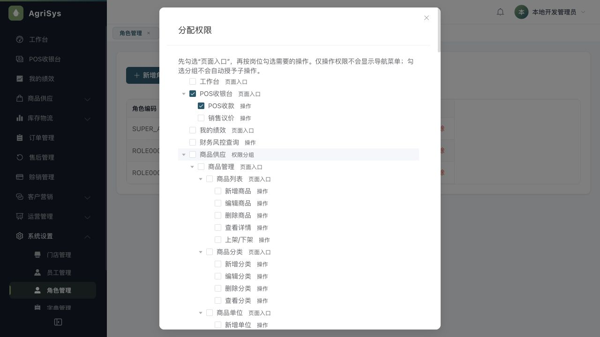
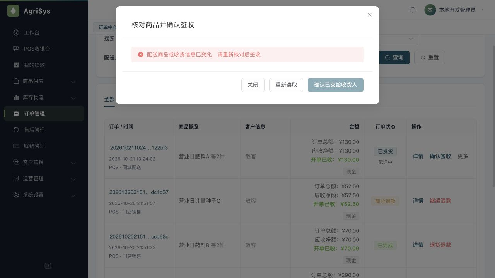
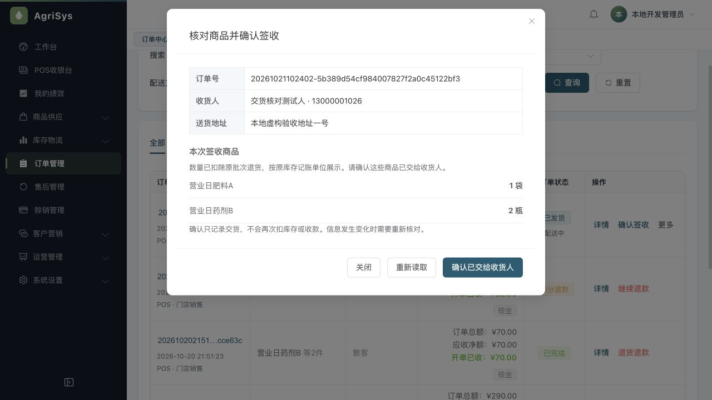
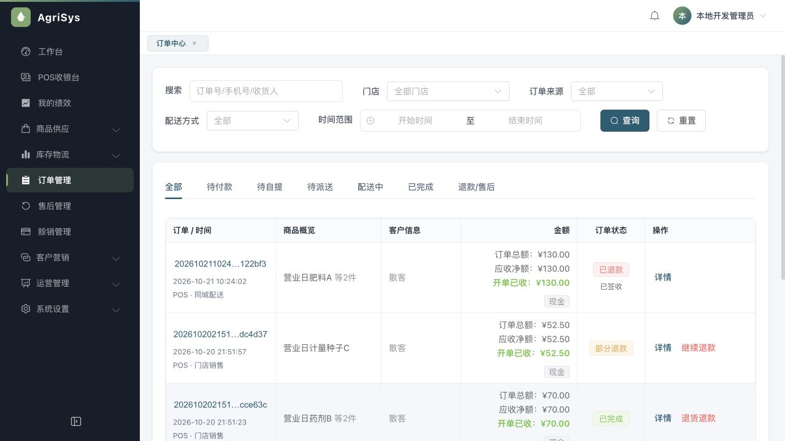

> 文档状态：历史审查/验收证据，仅对文内提交、环境和覆盖范围负责，不代表当前全系统完成度。现行入口见[统一文档中心](../current/README.md)。

# 授权与交货交互验收

## 结论与范围

完成上一轮营业日实操遗留的三项交互收口：权限树标明节点用途、无配送记录的POS单使用中性“门店销售”、人工签收展示实际剩余商品并校验弹窗内容是否变化。本轮没有新增表、字段、迁移或库存模式，没有变更角色授予关系；未扩展供应商应付款、收银交班功能。

真实浏览器在3092隔离环境完成追加销售、派送、弹窗期间部分退货、旧清单拒签、重读后签收、最终全退。51项只读对账通过。本结论限于以下覆盖，不代表所有功能、外部支付或正式上线均无缺陷。

## 修改与设计

- 权限分配树显示“页面入口”“仅操作权限，不显示菜单”“操作”“权限分组”。保留既有菜单ID、严格父子独立勾选、原始授权数据，避免删除旧ID破坏已有角色。本次实际打开并取消授权弹窗，未保存或扩大员工权限。
- POS无配送关系的历史单显示“门店销售”，不猜测实际当场/库房交付。明确配送类型仍按真实关系显示，未知线上交货方式继续提示核对。
- 签收弹窗显示订单号、收货人、电话、地址、剩余商品及单位。数量来自合法原SALE分配减同分配正数RETURN；单位来自原收货批次的持久化基准单位，缺失不猜当前商品单位。
- 后端详情返回核对摘要，新弹窗提交该摘要。原订单锁和实际READ_COMMITTED事务内重新核对数量、商品名、单位、收货信息和配送状态；变化则要求重读。签收仅记交付，不重复扣库存或收款，部分退款状态9保留。摘要不持久化，不成为第二套业务事实来源。
- 旧无请求体及`{}`调用继续原签收契约，仍有原锁和合法剩余数量守卫；仅新版携带摘要的调用校验所见内容。显式空白摘要拒绝。此兼容边界也适用于旧客户端，不宣称所有旧调用都具备弹窗内容绑定。
- 关闭、切订单、员工变化使旧读取及旧提交响应失效；撤权不能提交，加载/失败/无有效单位均不能确认。

## 真实页面联动

环境：网页3092、API9082、Redis6391，库`agri_day_20261020_24e59d07aa6c`，V132/88份迁移。原3090、3091数据库与API保留。后台浏览器实际点击输入，业务数据没有用SQL代写。

追加订单ID5，编号`20261021102402-5b389d54cf984007827f2a0c45122bf3`，A2袋+B2瓶，现金130元，虚构收货信息，库管作为配送员。

| 操作 | 实际结果 |
| --- | --- |
| 派单后打开签收弹窗 | 显示A2袋、B2瓶及虚构收货信息 |
| 另一标签页退A1袋 | 原批次回库1袋，退现金50元，订单部分退款9 |
| 保持旧签收弹窗并提交 | 明确拒绝“配送商品或收货信息已变化，请重新核对后签收” |
| 重读弹窗 | 显示A1袋、B2瓶，无横向滚动条 |
| 确认剩余交付 | 配送3→4，订单仍9；库存流水16、收款5、售后3均未增加 |
| 最终退回其余A1+B2 | 再退80元；订单8、原签收事实4保留，两次退款合计130，原收款累计已退130 |

最终5单原净应结算672.50，已完成退货197.50，净成交475；现金净留375+银行100，欠款0。库存A13袋/B14瓶/C9千克，价值682；销售净成本280。原营业日净账不变，原始销售、退款和流水计数按追加真实测试事实增长，没有清理记录伪造基线。

原45项基线在追加操作前全部通过。追加后采用[51项只读SQL](sql/2026-10-21-handover-reconcile.sql)，明确增加的单数、金额、分配与回库数；未改旧营业日核对SQL。

## 自动验证与复核

| 验证 | 结果 |
| --- | --- |
| 后端全量verify及打包 | 807项，799通过、8条件跳过，0失败/错误 |
| 真实MySQL RetailFactChainEndToEndTest | 另实跑2/2通过，0跳过；唯一一次性测试库，测试自动清理 |
| 前端全部测试 | 241/241通过，0跳过 |
| 前端类型与生产构建 | 通过；保留既有大包体积提醒 |
| 数据库只读核对 | 51/51通过 |
| 独立限定代码复核 | 首轮发现空对象兼容P2，补修后复查关闭；未发现剩余具体P0/P1/P2 |

新增测试包含：真实SQL执行的多批次余量、非法来源与缺失单位；原锁内摘要变化拒签；HTTP无体/空对象兼容与空白摘要拒绝；前端旧读取隔离、权限撤销、POST挂起后切换订单/员工的旧成功/失败响应及防重复提交。空对象HTTP用例先复现旧服务重载仅调用1次而非2次，补修后通过。

全量verify的8个条件用例含本轮另外实跑的Retail2项，其余6项没有本轮实跑，不把条件跳过算通过。报告证据及原始日志位于ignored scratch `.superpowers/sdd/2026-10-21-授权与交货交互/scratch/`，不提交环境凭据。

## 运行快照、限制与后续

3092使用固定构建`api-admin-handover-330bd1cfadce.jar`，SHA256 `330bd1cfadce1b341e698ede24a4250ddca49ede518bb49c45e06a68c0f566ed`，API9082 PID65546。前端使用当前源码；本地提交，不推送、不部署正式环境。回滚可恢复上一构建及对应前端提交，无数据库迁移需要回滚。

更新9082使旧登录失效，旧localhost会话一次收银请求未落单，但POS按未知结果规则保留冻结记录；只读核对当时仍只有原4单。没有删除该记录或强制解冻，改用127.0.0.1独立会话完成追加验收。此记录仍需人工核对处理；本轮没有实现未知结果工单处置机制，也不把“数据库没有找到”设计为自动重收依据。

后续优先明确供应商付款记录和收银交班的实际门店需求，再决定是否需要补充现有流程；未授权新增复杂财务子系统。

## 页面证据

