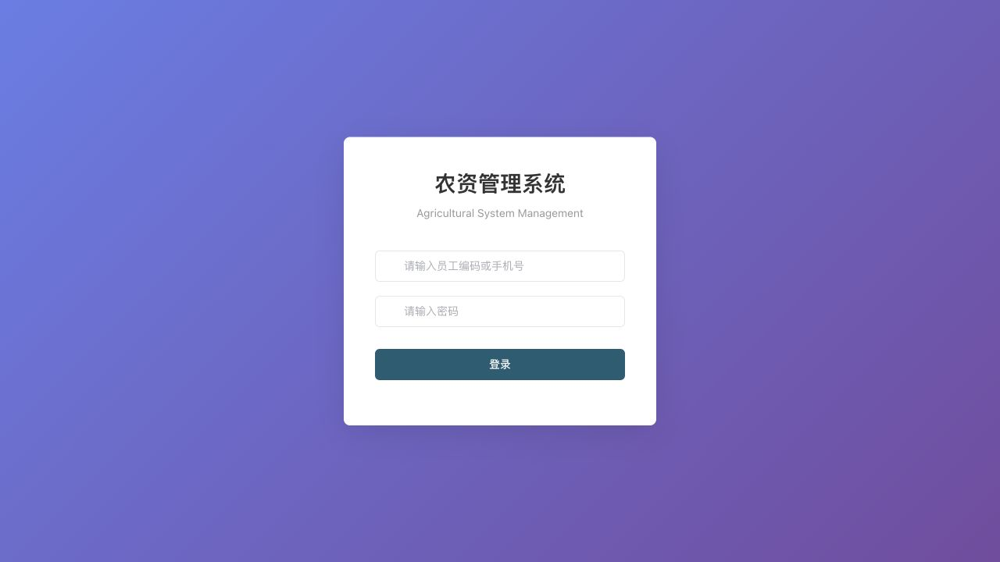
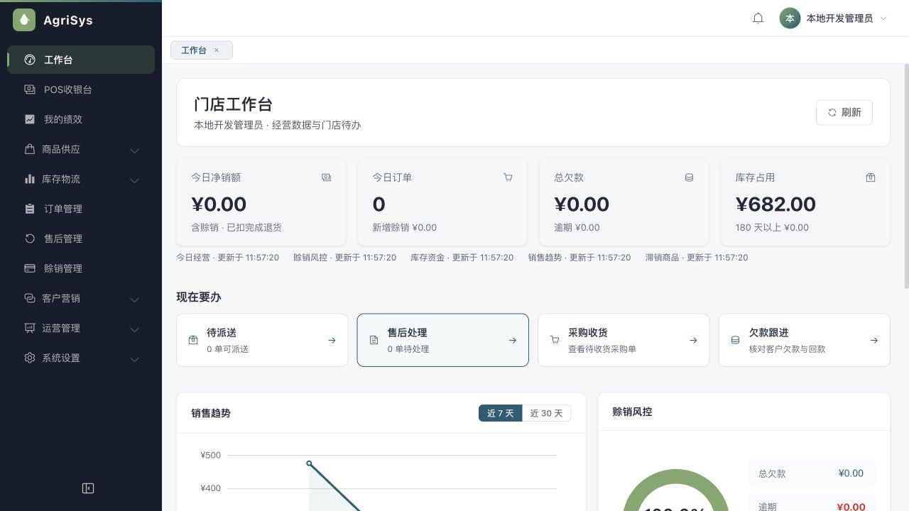
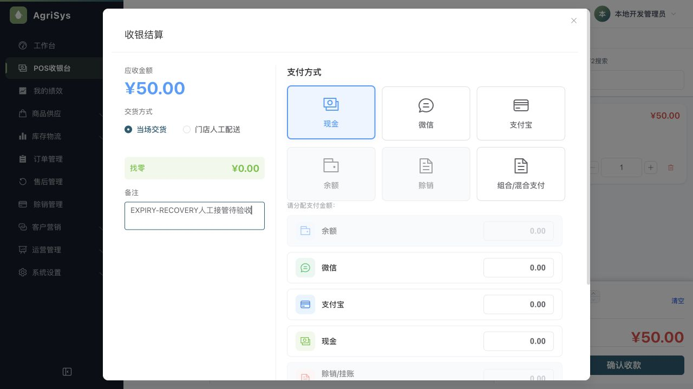

> 文档状态：历史审查/验收证据，仅对文内提交、环境和覆盖范围负责，不代表当前全系统完成度。现行入口见[统一文档中心](../current/README.md)。

# 剩余条件与会话补充验收

## 2026-10-23接管收尾

用户反馈页面已过期或无法点击。只读核对仍为8订单、8收款、23移动流水及4请求记录；最后订单8为50元、状态6，对应COMPLETED请求不变。专用故障草稿没有新增成交，lost标志未消费。没有代用户提交收款、退款或删除测试事实。

已将故障标志恢复normal，停止9083代理，撤销300秒参数；使用原包正常启动9082（PID42460）、3092（PID42464），前端直连9082。实际确认9082/3092开放、9083关闭、后端命令无短会话参数，浏览器重新登录进入工作台成功。原3090/3091不变。完整待核对收银单跨登录恢复仍记未完成，不能把正常订单8与单独登录测试拼接为通过。

以下临时接管配置和PID仅作历史记录，已被本节恢复状态替代。

## 人工接管续验（进行中）

用户于13:45:16手动完成订单8，50元现金、A1袋，请求`5cc7eda8-2b3c-4735-908f-7cd094848272`已COMPLETED。当时尚未启用故障，页面正常清空购物车，不算完整异常恢复用例。保留测试事实，不删除或补造。

约13:48:54重新登录300秒测试会话，准备另一笔A1袋50元现金草稿，备注“EXPIRY-RECOVERY丢响应后过期验收”。仅3092经9083代理转发9082，单次lost等待人工最终点击；API18866、前端18869、代理18868。尚未确认人工点击，不能判通过。若已过期，先核对未成交再重新准备，不换号重收未知结果；收尾恢复正常会话及直连。

现场发现现金结算仍显示混合支付区：`CheckoutDialog.vue`的mixed-panel使用v-else跟随wallet-preview条件，应后续收紧为明确混合模式条件。尚未修复或验证。

## 当前结果

上轮剩余6项条件测试已实跑通过。开启mysql.it与authority.mysql.it后的全量verify最终814/814通过，失败0、错误0、跳过0。修复一处仅在两套真实MySQL测试同进程连续执行时暴露的静态环境污染；没有修改生产权限、业务或数据库结构。3092只读对账59/59通过，原订单7/收款7/库存流水22/请求记录3均不变。

真实浏览器已验证60秒会话自然失效返回登录页，随后正常重新登录成功。完整“已有待核对收银单→登录失效→重新登录恢复原单”的新浏览器操作尚未完成：最终确认收款被自动审批拒绝，必须用户接管，不能把本轮登录验证与上轮收银恢复拼接成一次完整实操。

## 剩余6项逐项结果

| 原条件用例 | 结果 |
| --- | --- |
| MySQL V119—V124迁移及生成列、防重字段 | 通过 |
| 移动流水append-only触发器与CHECK约束 | 通过 |
| 同店默认后仓唯一约束 | 通过 |
| 请求防重唯一键、NULL共存与冲突回滚 | 通过 |
| SELECT FOR UPDATE实际InnoDB行锁串行化 | 通过 |
| 员工创建等待管理员锁期间目标角色停用，锁后拒绝创建 | 通过；实际隔离READ_COMMITTED，真实LOCK WAIT，未留员工或角色关联 |

第一组独立执行库存MySQL5项与权限HTTP39项，44/44通过、0跳过。随后开启全部条件运行整仓verify，暴露测试隔离问题，补修后重新全量814/814通过。此结果覆盖同轮真实MySQL Retail2项，不再把它们重复计入814之外。

## 全量失败与修复

修前命令：`mvn verify -Dmysql.it=true -Dauthority.mysql.it=true`。

错误发生在RetailFactChainEndToEndTest的后台并发退货线程：`NotWebContextException`，调用链进入DataScopeConfig租户工厂和CurrentUser读取HttpServletRequest。权限HTTP套与业务E2E使用不同Spring配置，但Sa-Token、Flex TenantManager和CurrentUser依赖进程级静态状态，复用测试JVM时环境可串到下一测试类；分组单跑不会触发。

仅修改`api-admin/pom.xml`的Surefire `reuseForks=false`，让管理端各测试类拥有独立JVM。没有取消生产租户过滤、修改CurrentUser、放宽业务断言或用异常重试掩盖。相同全量命令修后通过，耗时约34秒。其他模块保持原执行配置。

## 实际浏览器与数据边界

- 仅3092/API9082/Redis6391隔离环境，库`agri_day_20261020_24e59d07aa6c`；原3090/3091与开发库未改动。
- 复用固定构建`da4cf5f306b68719cf17cca1424016b175d1dce152d43ec9f8b7ede5465ed030`。仅运行参数临时增加`--sa-token.timeout=60`，未改应用配置文件、系统时钟或数据库日期。
- 登录后实际进入工作台/收银页；约114秒后观察到已回登录页，期间未执行登出。随后取消短会话参数，恢复正常配置，真实页面重新登录并进入工作台成功。
- 拟用于完整恢复链的收款提交被自动审批拒绝，原理由包含：“即使是本地测试数据，也必须由用户接管浏览器完成确认。”拒绝后没有改用接口、SQL或脚本创建交易，也没有改浏览器业务状态造待核对记录。
- 无新增销售、收款、出入库或POS请求记录。59项原对账通过：净销售475、现金净留375、银行100、欠款0、库存A13/B14/C9、价值682。
- 60秒会话配置与故障代理均已撤销。当前正常API PID60211、前端PID64583，前端直连9082。未清空Redis或浏览器记录。
- 保留一份待用户接管的未提交草稿：A1袋、现金记账50元、当场交货，备注`EXPIRY-RECOVERY人工接管待验收`。它不是订单，当前没有对应请求号或钱货流水。需要用户接管后再安排故障注入与最终点击；当前无故障代理运行。

## 已验证 / 尚未验证 / 已知边界

| 状态 | 项目 |
| --- | --- |
| 已验证 | 两类MySQL条件同时开启的814项全量回归，无跳过 |
| 已验证 | 原59项业务及请求结果对账，无新增钱货 |
| 已验证 | 实际短会话自然失效及随后正常重新登录 |
| 尚未验证 | 本轮完整“待核对收银单+登录失效+重登恢复”整段浏览器联动，需人工最终点击 |
| 已知边界 | 旧无请求号冻结记录不能自动推断未成交；仍人工核对 |
| 已知边界 | 新功能只在3092配套验收；旧预览/API及开发库版本尚未统一 |
| 已知边界 | 微信/支付宝真实资金通道和正式上线不在本轮验证范围 |

当前唯一代码修改是测试执行配置。没有由本轮证实的新业务缺陷；这不代表未检查功能均无缺陷。原始日志、失败栈、测试结果和只读对账保存在ignored scratch `.superpowers/sdd/2026-10-22-补充验收/scratch/`。

## 证据

