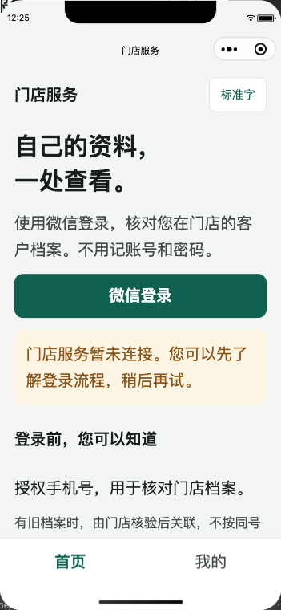
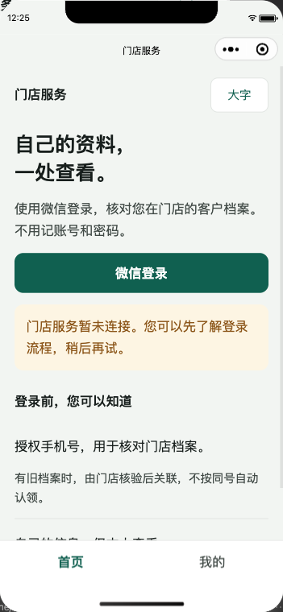
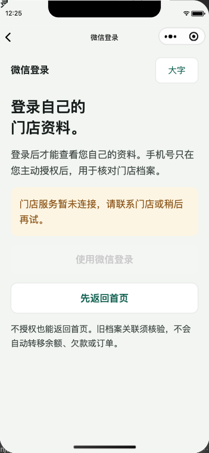
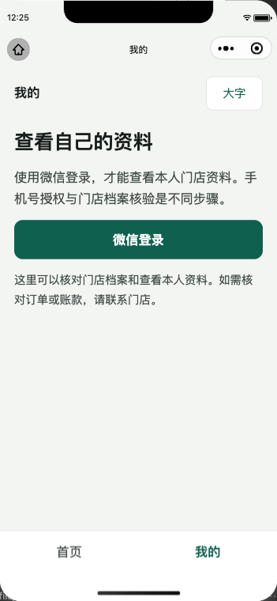
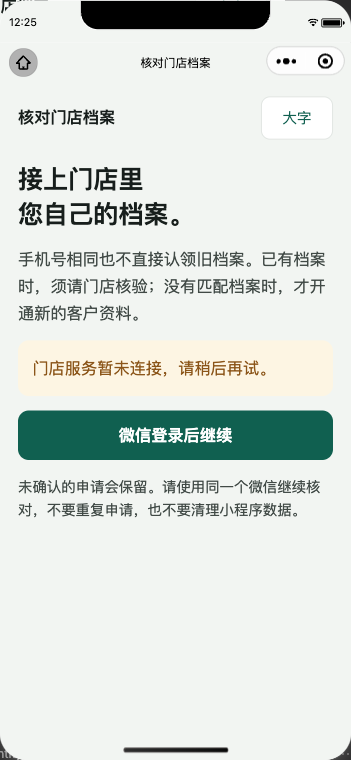

# 客户端C0工程、身份与原申请恢复

日期：2026-11-10；源码基线e6b6c96，本批提交号见Git。**C0四页工程已建立，不等于客户服务MVP或完整小程序完成。独立审查服务仍是额度错误，无审查结果，不合master、不部署。**

## 本批真实能力

- `mini-customer/`：沿员工已锁uni-app/Vue3/TypeScript版本，新增锁文件、test/type-check/build:mp-weixin及dev:mp-weixin。实际离线缓存`npm ci --offline --ignore-scripts`安装成功，未复制node_modules或升级依赖。
- 四页：首页、微信登录、本人资料、档案核验。首页游客不调用登录、不建客户；当前底部只首页/我的，大字正文18/22px、导航64px与安全区。农技咨询、公开内容、目录、订单、钱包和AI尚未接客户端，没有假内容、0元资金或空商城冒充完成。
- `customer-session`：与员工会话类型分开，令牌/微信code/phoneCode只在私有内存及当前请求中；页面拿脱敏快照。固定epoch、原凭据和最新读取代次；隐藏旧登录、旧401、旧手机号结果、旧本人资料不能影响新登录。普通资料读取核当前客户ID，失败清客户会话并要求重登。
- `transport`：只发送当前客户身份白名单路径，拒绝员工入口/任意URL/查询/非法header，固定配置源站、10秒超时与脱敏错误。生产仅HTTPS；开发仅合法内网/回环HTTP。空源站在取得微信code前阻止登录。生产manifest urlCheck=true，AppID留空，不含AppSecret。
- `customer-enrollment`：原安全UUID先存读回，默认姓名由原后端处理；本机只留版本和原号，按实际微信AppID+源站隔离。没实际AppID不写申请。UNKNOWN不换号，待核验保留，合法完整终态才清原槽；失败/损坏/替换/删后核对失败冻结。重登须服务端同微信主体核原申请，不把本机号当归属证明。
- 原申请CREATED/LINKED/REJECTED结束原临时证明，即使页面隐藏也由服务层清理并返回新epoch；现有正式客户查历史申请不被退出。申请成功仍须新微信登录，结果本身不授CUST身份或旧账。

没有后端/DDL/权限/业务数据修改，继续共用V143—V146身份地基和原V145申请事实，不新增客户镜像、钱包或模式。

## 失败后修正与验收

| 检查 | 证据与结果 |
|---|---|
| 客户会话测试 | 8项初始RED（模块不存在）后实现；再实际复现手机号回复可延长原期限，补原截止一致校验；当前9项 |
| 原申请恢复 | 6项初始RED后实现；再实际复现页面离开后终态未结束临时证明，改服务层清理；当前7项 |
| 前端源站 | 3项初始RED后实现，非法源站/生产HTTP/越界路径/header及原网络错误拒绝 |
| 真实Vue setup生命周期 | 最初6项RED；另2项复现旧失败污染新会话页面，修复后通过；使用实际compileScript/TypeScript执行源setup，非模板替身 |
| 真实路由 | pages.json移除字号过小的原生tabBar后，原switchTab真实RED；改注册普通页面reLaunch，测试按真实页面配置校验入口 |
| 最终共享包 | 101项全过，包含本批16项会话/申请测试；TypeScript实际编译 |
| 客户工程 | 11项全过，vue-tsc无错，生产微信build DONE |
| 员工/管理回归 | 135/301项全过；不扩大权限，不因手机入口重建后台业务 |

命令：`npm --prefix packages/mobile-contracts test`、`npm --prefix mini-customer test`、`npm --prefix mini-customer run type-check`、`npm --prefix mini-customer run build:mp-weixin`、员工/管理各`npm --prefix <目录> test`。后端源码未改，本批不重复完整Maven；前一批171报告1114项的证据不冒充本批真实微信授权。

脱敏[自动验证摘要](assets/2026-11-10-customer-c0/verification-summary.json)与[生产产物SHA256](assets/2026-11-10-customer-c0/compiled-files-sha256.json)随本批保存；临时预览与最终生产产物逐文件比对无差异。客户依赖锁树与员工端精确相同，仅项目名称不同。

## 实际微信模拟器范围

使用本机已登录微信开发者工具、现有miniprogram-automator和独立临时工程`/private/tmp/agri-customer-c0-preview-e6b6c96`。仅临时配置用户提供的小程序测试AppID，源代码AppID保持空；服务源站为空，没有真实微信/手机号授权或业务请求。网络校验保持开启。

实际渲染四页、点击首页进入登录、点击首页/我的底部按钮双向跳转、点击字号按钮切换18/22px，并从真实微信存储读到切换值。最终截图与连接后监听统计见[模拟器摘要](assets/2026-11-10-customer-c0/simulator-summary.json)及下方图片。临时工程project设置urlCheck=true，private配置未覆盖为false。关闭本轮临时工程/自动化连接；没有停止原服务或升级原库。

早期工具尝试分别遇启动时页面元数据未就绪、组件选择器未穿过边界及重复reLaunch后自动化查询超时。这些尝试不计通过；等待真实页面栈、用公开XPath定位实际按钮、按真实wx页面动作巡检后才取得四页证据。源站为空的页面渲染不能证明已联后台，更不能证明微信手机号能力可用。工具退出前清本轮字号偏好；模拟器可保留进程内字号，证据用切换前/后命名，不把保留值误称冷启动默认值。

## 仍开放的工作

1. 独立审查无结果，待恢复后整体补审；本开发分支不合master、不称发布就绪。
2. 真实平台登录/手机号授权、匹配AppID/合法域名与后台联动、同机换微信查询原申请、真机前后台/弱网/杀进程及320宽大字未验；C01/C02不能整体关闭。
3. C1真实公开门店、已审核知识和商品只读，C2人工咨询/回访，C3受限AI，以及后续客户交易仍待。完整客户停用恢复管理、解绑改号/合并与治理审计也待。
4. 本批是前端工程进展，员工16页仍须按实际岗位/设备完成联动验收，整个两端目标保持进行中。
