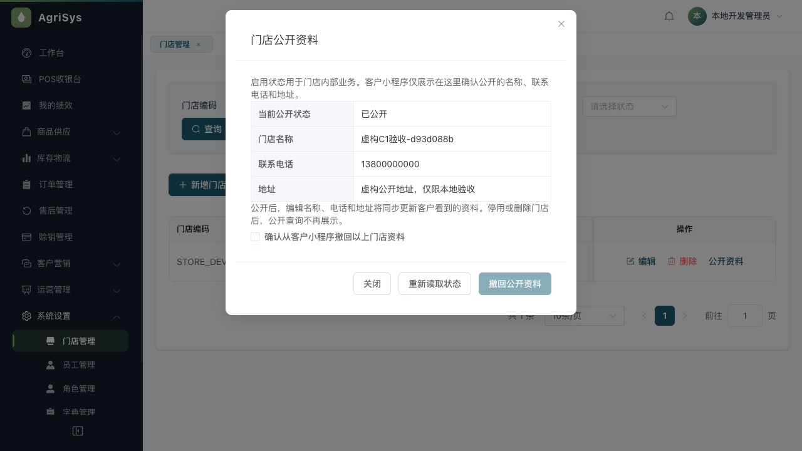

# 客户端门店公开与商品查询（C1-A）

日期2026-11-10；基线1f758d2。本批源码与自动验证已完成；实际共享客户端HTTP与后台公开/撤回联动已补验，范围见下文。独立代码审查发现1项P2，已按失败测试修复；不合master、不部署原环境，不将本批标成完整C1或客户端交付完成。

## 已实现

- 客户端由4页增至6页，增加商品列表/详情，首页读取公开门店，支持主动拨号、复制地址、关键词搜索与有界分页。公开请求不带客户/临时登录凭据，进入首页不建档。
- GET `/api/public/stores`、`/api/public/catalog/products`、`/api/public/catalog/products/{productId}?unit=...`采用专用白名单、20项游标与no-store。商品必须已上架、启用、未删除；不返回内部成本、最低价、会员私价、备注、员工或库存货位。
- 销售单位与直接基准系数复用原ProductUnitService；普通零售参考价只走ProductPricingService，选中单位与报价单位逐次核对，不以最低价或前端乘法兜底。未知配置显示待门店确认，不补0、不承诺库存或可下单。详情末次复核公开资料，读取中下架或变化拒绝旧结果。
- V147只给既有store新增client_visible（默认0）与client_publication_version（默认1），新增真实store:publish菜单，无新表、无自动角色授权。普通Store实体不映射这两个字段，旧整对象保存不会覆盖公开状态。
- 后台原门店页新增公开预览/设置弹窗，store:view与store:publish同时有效，实际在职员工与启用角色重核，普通员工只本店。公开需核对名称/电话/地址，原行锁、资料指纹、公开版本CAS与现有操作日志同Flex事务。提交结果未知只重读当前状态，不自动重发或声称原请求成功。

编辑已公开门店的基本资料会同步改变公开内容，后台已说明；停用/删除后公开读口排除。客户端进入/刷新重新取数，已加载内容不是实时推送撤回，不承诺抹去已经被看见的资料。

## 自动证据

| 范围 | 结果 |
|---|---|
| Java17完整mysql/authority clean verify | 175份报告、1135项，失败/错误/跳过0，报告门禁通过 |
| 随机MySQL门店发布测试 | 实际V147默认私有/无自动授权、JDBC与MyBatis同Flex连接/READ-COMMITTED、审计失败整笔回滚、并发只一版本一日志、旧Store快照不覆盖标志、公开/撤回与商品字面搜索同源 |
| 真实权限HTTP | 迁移后缺权限拒绝；只有publish仍拒绝；真实角色API授view+publish可读，撤权立即拒绝 |
| 公开HTTP边界 | 匿名及无效token可读取公开接口，额外customerId不改变公开普通报价上下文；白名单字段与原有私有接口守卫分开 |
| 共享/客户/管理/员工 | 审查修复后106 / 15 / 304 / 135项均过，客户类型/微信生产构建、管理类型/生产构建通过 |

先观察失败再实现查询/服务/契约/页面；另复现“选择箱却接受另一合法单位瓶的报价”，后端已补选中单位一致守卫。第一次HTTP测试因本机Mockito进程插桩限制未启动，授权环境重跑通过，未放宽产品权限。首轮源码检查的星号导入及测试Long字面量错误也已修正，不作为业务失败或成功证据。

自动统计见[验证摘要](assets/2026-11-10-client-public/verification-summary.json)。命令与工程入口沿10号手册；本批没有原运行数据库升级。

## 实际独立环境联动

随机库`agri_public_c1_fa3470c7ae6249258e2a09f044ea0c36`实际执行103条迁移至V147；本轮管理9094、客户9095、页面3104、Redis6404，均仅本机。禁调度/客户开发登录，微信配置为空。只初始化虚构门店/开发管理员和两件虚构商品，无收款或订单操作。

已实际验证：

1. 初次门店不公开，匿名门店列表为空；两件商品草稿均不显示，只经真实商品API上架的一件进入公开列表。
2. 新权限不会自动授管理员，首次公开预览返回10004；通过真实角色管理API向本随机库测试管理员明确追加view/publish并保留原授权，原token立即可读。
3. 浏览器实际登录独立页面→门店→公开预览；未勾确认时按钮禁用；核对并点击后真实后端返回已公开，勾选清空。1280页面无横向溢出，见下方截图。

首次未完成：真实共享客户端HTTP脚本被自动审批额度错误中止，明确返回“操作未执行，非不安全判定”；当时没有换路径执行同一动作。浏览器随后丢失，原轮次撤回联动未验。以下恢复记录覆盖这两个缺口，不倒改首次执行结果。真实微信手机号/安卓/iPhone、C1-B知识发布与老板审核内容仍未完成。

2026-11-10 16:34读取本机监听，9094/9095/3104/6404均无监听，旧进程句柄已不存在；浏览器会话记录已关闭。这是当时的实际观察，不声称本轮已手工执行所有停止命令。随机库保留虚构结果，原库未清理。私有恢复材料在`/private/tmp/agri-public-c1-live-d93d088b`，fixture包含测试令牌，不可复制入Git或外部记忆。

### 16:45之后恢复联动

确认四端口空闲后恢复同一随机库和专用服务，启动日志确认当前迁移147。正常重新申请自动审批后，原只读HTTP脚本获准执行并成功，没有绕过原审批。页面首次恢复误用了未被工程消费的`API_BASE_URL`，登录未成功；确认默认8080无监听后，改用工程真实读取的`VITE_API_BASE_URL=http://127.0.0.1:9094`重启临时页面，随后实际登录成功。此为临时验收配置修正，未改产品源码或连接原业务服务。

- 通过实际`createPublicCatalog`及真实9095 HTTP查询公开门店、商品列表、同商品箱/瓶详情。门店1条、公开商品1条、草稿仍隐藏；1箱12瓶，原普通报价120.00元/箱和10.00元/瓶，未带登录凭据，白名单核对无内部成本/最低价/会员私价等。见[实际客户端返回](assets/2026-11-10-client-public/actual-public-client.json)。这是共享客户端实际HTTP，不是微信平台`uni.request`或真实手机网络验收。
- 真实浏览器登录3104后台，公开预览显示已公开，未勾选时撤回按钮禁用；勾选后点击“撤回公开资料”，显示未公开且确认勾选清空。随后实际共享客户端重新GET，门店rows为空、nextAfter为空。见[撤回结果](assets/2026-11-10-client-public/actual-store-withdrawal.json)及下图。
- 随机库只读核对公开版本3，两条专用审计分别为公开/撤回；订单、钱包流水、库存移动、客户钱包表记录均保持测试前0。见[原业务事实核对](assets/2026-11-10-client-public/actual-business-facts.json)。这是空测试集的条数核对，不冒充有资金存量守恒专项。
- 已关闭本次浏览器会话，并实际停止四个专用服务；端口复核结果记入验证摘要。测试库保留虚构数据，最终门店未公开。未改源工程域名校验或AppID，也没有执行真实微信登录/手机号授权。

## 独立审查与修复

独立只读审查覆盖本批V147、后端发布/公开查询/普通报价、同Flex连接和角色实时读取、后台弹窗、客户端两页及共享网络/解码边界。未发现确定P0/P1；发现1项P2：地址沿后台textarea允许换行，但客户端通用文本解码拒绝换行，导致同页任一家合法多行地址使整页门店读取失败。审查者以当前真实共享构建产物和两家门店输入独立复现。

修复保持后台原地址与客户端显示/复制一致：仅地址允许CR/LF，其他控制字符、空白内容、长度及name/phone单行约束保持。新增共享测试先实际失败`PUBLIC_RESPONSE_INVALID`（5项中4过1失败），再加最小专用地址解码后共享106项全过；新增真实Vue首页setup→共享解码→两店展示数据→复制原文测试，客户端15项全过，仍为游客、不调用登录。员工135项、客户类型和生产微信构建再次通过。此页测试的平台HTTP与剪贴板为替身，不冒充微信实际渲染/系统剪贴板或多行地址真实后台联动。

审查只有上述1项确定问题，没有另行隐瞒的延后轻微项；修复由失败到通过的测试验证，没有把原作者自检称为第二次独立审查。C0旧批次的独立审查欠项不因本次C1-A审查自动关闭；真实微信/手机与性能验收也不在只读审查结论内。

## 下一步

保存本批开发检查点。继续C1-B正式知识版本、审核/撤稿和真实老板SOP；不得由模型编造首批农业知识。当前仓库没有既有知识业务表或发布模块，按07号手册实施时须单独说明最小版本存储、发布/撤回状态、适用范围及审计；不把商品说明或系统操作日志当作正式知识版本。真实微信/手机验收仍开放，两端整体目标保持进行中。
