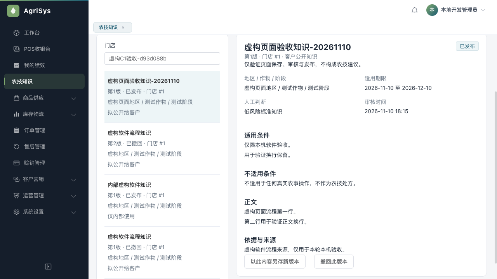
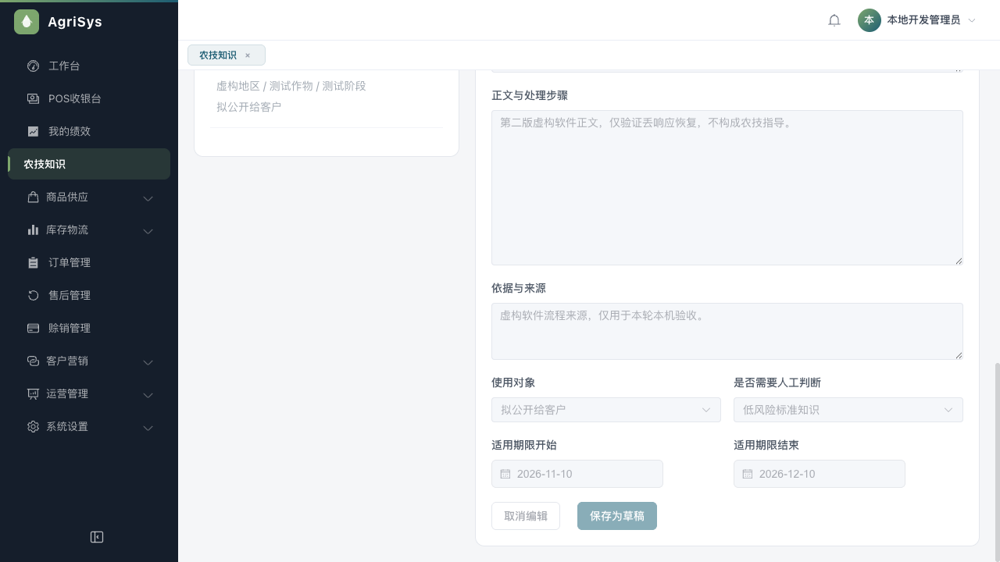
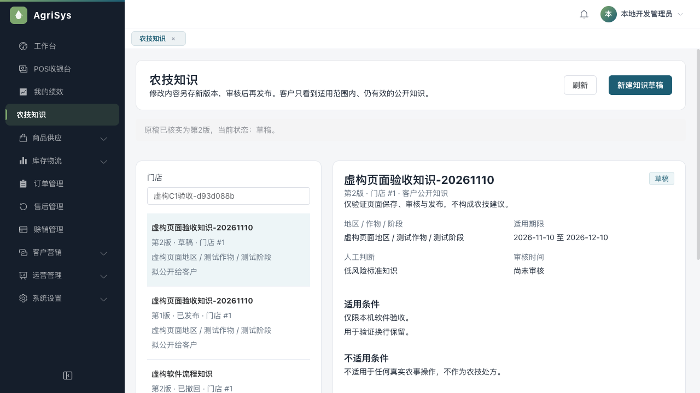
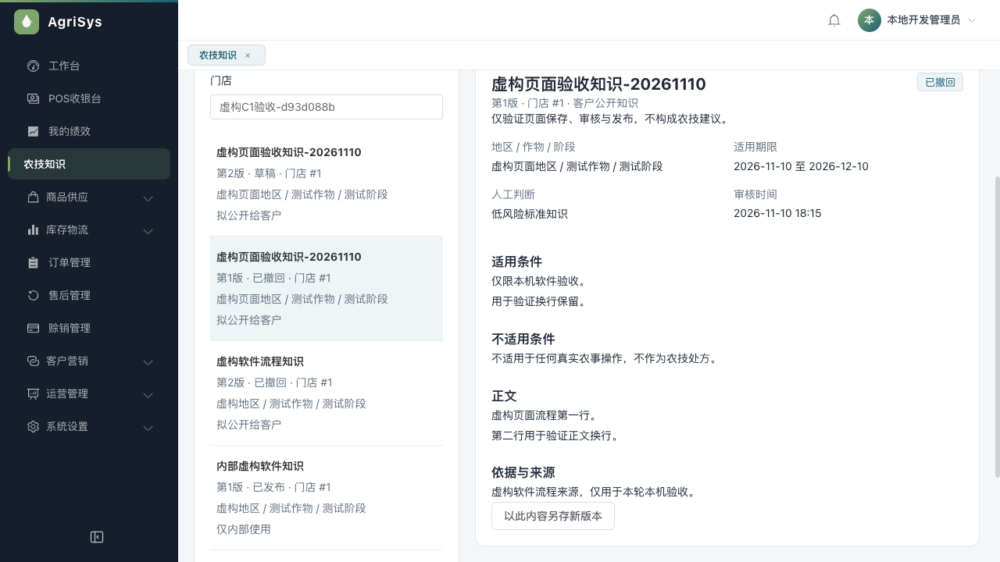

# 可选资料页面与原稿恢复验收

2026-11-10，基线e01339a。实现[14号任务3/4](../current/14-农技知识版本与发布实施计划.md)的页面与恢复工程，不代表原生手机或AI完成。用户在本轮指出人工录入负担后，方向改为AI自动检索/追问与人工接力，取消老板先写20条SOP的门槛；现有资料功能为低频可选，不继续扩文章运营。完整纠偏见[07末尾](../current/07-客户端设计与实施手册.md#2026-11-10产品纠偏ai自动查答为主店内资料为可选)。

## 实现范围

- 后台/agronomy/knowledge真实路由与4项权限：版本列表、详情、来源/范围/期限、另存草稿、审核/发布/撤回确认。普通员工仅本店；管理员且有store:list才读跨店选项，降级/换店/权限/会话变化失效旧响应。沿原14px和公共样式，无新主题。
- 新GET `/{logicalKey}/latest`只读且核真实本人门店，编辑旧正文前核实际最新版本，不改表或旧迁移。服务测试及真实权限HTTP覆盖未授权拒绝、当前员工不借参数替换。
- 创建原稿按真实API源站+员工+UUID分槽存完整内容并读回，再发原请求。结果未知不换号，损坏、合法异稿替换、读写删失败继续冻结；每次后续请求和清理均核原会话/原槽。多页面交错保留各自原稿，完成当前只清当前槽，再逐一恢复其他原稿。
- 结束旧稿等待需用户明确确认，先核实际最新版本高于原expectedLatest形成单调追加屏障，再查本人原号；原号CREATED优先核原完整内容，UNKNOWN单独不能结束等待。审核/发布/撤回未知须先读当前事实，关闭重开不能重发。
- 客户新增可选资料列表/详情，8页工程；真实公开组合中主动选择地区/作物/阶段，不猜农情；关键词/有界分页、纯文本、适用/不适用条件、依据与审核日期、大字开关、回首页联系门店。旧范围/旧页/旧版本响应失效，阅读不创建账号，不带身份令牌。
- 首页最终保留商品查询和联系门店，可选资料为次要入口；不因已做文章工具就把它当成AI主入口，也不展示未接通的假AI按钮。尚未接模型、联网搜索或完整咨询队列。

## 审查发现与修复

独立只读审查覆盖后台API/恢复器/SFC、共享解码/客户页面/transport与路由，未独立运行整套测试或实操。

1. **P1整分钟时间：**后端LocalDateTime.toString可省略零秒，原解码强制HH:mm:ss，一条合法记录可使整页失败。后台/共享两个测试先实际失败，再接受合法HH:mm、HH:mm:ss及秒小数；无效日期/时分秒仍拒绝。实际随机库将本次虚构审核时间设为整分钟，真实后台重读和共享HTTP返回`2026-11-10T18:15`均通过，不改生产格式或原业务数据。
2. **P2合法替换稿：**原请求A等待时，本机槽被结构合法B替换，页面catch重新restore可接管B。真实SFC用合法B先失败，再改每UUID独立槽及内存原快照钉住、槽名与请求号一致；catch保留A并冻结。多页面首次准备交错测试保留两个原稿，只清已核实的当前槽，避免覆盖另一原稿。该多页面/替换验证是SFC与存储替身，不冒充两个真实浏览器标签的完整实操。

原作者另在真实SFC先复现并修正保存后列表不刷新、未知弹窗关闭重开可重复提交、普通员工有store:list时出现越店选项。修复均由失败到通过测试证明；没有把作者自检称为修复后第二次独审，没有另行延后已发现的重要缺陷。

## 自动验证

| 范围 | 最终证据 |
|---|---|
| Java17完整mysql/authority clean verify | 178报告1156项，失败/错误/跳过0；新增latest服务/权限测试在内，报告门禁通过 |
| 共享契约 | 110项过，包含精确知识范围/版本/白名单/整分钟时间 |
| 管理端 | 320项过，含恢复器8、API2、真实SFC6；vue-tsc/Vite生产构建过 |
| 客户端 | 19项、类型、微信生产构建过，真实pages.json包含8页 |
| 员工端 | 135项回归过；员工本轮无功能改动 |

后台初版构建模板回调隐式any已改显式关闭方法；两处新测试夹具先因UUID注入/加载函数名错误失败，已修夹具后再观察对应真实产品失败，不将这些装配错误冒充产品回归。构建仍有既有Sass弃用和大chunk提示，不称零警告。

## 实际后台与共享客户端联动

使用既有拥有的随机库`agri_public_c1_fa3470c7ae6249258e2a09f044ea0c36`及本机后台9094/客户9095/页面3104/Redis6404，均匹配本轮后端包；V148不改、不新增迁移。只给虚构管理员原角色临时追加4项菜单并保留旧授权，结束已通过实际角色API恢复。

1. 真实后台登录并从页面新建“虚构页面验收知识-20261110”，填写虚构地区/作物/阶段、软件验收正文/来源和日期，明确选公开/低风险。页面保存为第1版DRAFT，原稿槽清空，列表刷新，无横向溢出。
2. 实际审核弹窗未勾选时确认禁用；填写原因、核对勾选后审核。仅将这条测试记录的审核时间设为整分钟作受控边界夹具，后台重新进入仍可读并显示18:15。
3. 实际页面发布。实际`createPublicKnowledge`通过HTTP匿名查询到一条同组同版、同正文、同适用范围、整分钟审核时间；内部字段不返回。见[发布前](assets/2026-11-10-knowledge-ui/actual-client-before-publish.json)、[已发布](assets/2026-11-10-knowledge-ui/actual-client-published.json)。这不是微信uni.request或真实手机网络。
4. 临时故障转发代理9098仅对当前组第2版保存成功响应丢弃一次，其他白名单请求透传原服务。页面从第1版“另存新版本”→改虚构正文→点击保存；真实服务已保存第2版，页面显示待核对、保留原UUID/正文，新建按钮禁用。刷新仍恢复同一原稿，点击“核对原保存”后GET原号CREATED，准确找回第2版，槽清空，没有新POST。原第1版仍公开且正文不变，见[新草稿时](assets/2026-11-10-knowledge-ui/actual-client-new-draft.json)。
5. 实际选择第1版，填写撤回原因并确认；后台显示已撤回，共享客户端公开列表为空，见[撤回后](assets/2026-11-10-knowledge-ui/actual-client-withdrawn.json)。第2版仍私有DRAFT，历史保留。
6. 只读核对两版、原请求一致、一次新版本及一次创建业务审计、共5条预期业务动作，原钱货4表条数均不变。通用AOP对noCache和保存handler各记一次，原始日志2条不能当2次POST；排除空参数noCache后实际保存handler只有1次。首计数脚本因此停下，核源码/同线程日志后修正计数，未修改业务服务。见[事实核对](assets/2026-11-10-knowledge-ui/actual-business-facts.json)。条数是空集核对，不冒充存量资金守恒。

五个临时服务已实际停止；收尾为恢复测试授权曾仅短暂重启后台/Redis，恢复核对后再次停止，最终9094/9095/9098/3104/6404均无监听，浏览器会话关闭。原库/原角色/原服务未动。私有令牌与故障脚本留临时目录，不入Git或外部记忆。

## 产品纠偏与后续

用户质疑“为何手录、不是用AI/网上资料吗”后，已明确人工资料工具不作为主线、不要求老板先交20条文章；本批代码保留作可选经验复用，首页不突出“先读知识”。下一步转AI必要追问、受控联网检索/引用与人工接力；不能用本批文章工程替代这个目标。仅核实了官方资料候选入口，没有执行批量采集或付费模型调用。

原生微信模拟器/安卓/iPhone、低端屏、大字真实渲染、真实双标签交错等本轮未执行；C0治理、实际咨询/AI/交易和发布门槛仍开放。资料页代码/自动和实际后台/共享HTTP通过，不等于AI可用或整体客户端完成。
