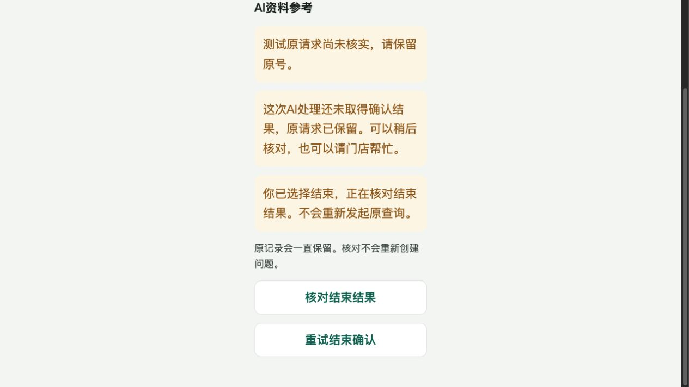
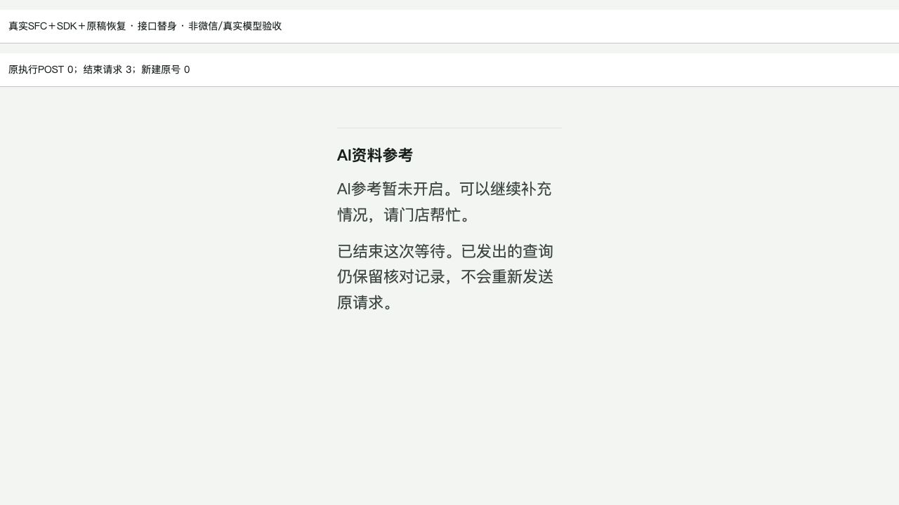

# AI跨设备发现与持久结束验收

2026-11-11；基线75a73e1ee3caabb190ea0c0b102d2d21cf9b37ea。对应[15号4.3c](../current/15-农技提问与人工接力实施计划.md)，整个小程序目标仍在进行。

## 修复问题

此前没有本机key就无法找到AI结果，未知/无请求业务拒绝又可能长期冻结。本批服务器latest直接找原记录；显式结束对未建请求落持久ASSISTANT_CANCEL屏障，未派出释放，已派出只结束等待并保留原费用预占/执行/usage。原问题与原收据不改，晚草案不再展示或派生人工动作。

V152只在原entry加assistant_closed_at nullable列和CHECK；原outcome晚结果会覆盖、steps是付费阶段，不应拿它们伪装用户结束。无新表，旧149—151逐字保持，只有自动随机测试库执行。原开发库、原预览及此前人工隔离库不升级。

## 自动验证

- 新方法缺失实际编译RED后实现；最初41项协调器通过。补迟到cancel盖真实结果、未来版本可造屏障两反例，43项中2失败后修；真实请求优先、未来版本拒绝，最终43项H2过。
- MySQL19项通过，新增真实Flex READ_COMMITTED关闭与晚usage/下一阶段不派、四轮end/submit并发同UUID只有一行、未派屏障零调用、结束/取消事实写后抛错全回滚、非法关闭QUESTION被DB CHECK拒绝。没有真实供应商请求。
- 最终后端：2026-11-11 22:16:13+08:00 Java17 mysql/authority cleanverify BUILD SUCCESS，186报告1335项失败0/错误0/跳过0，报告门禁通过。初次受限Mockito进程附加失败不算产品RED，获准后真实执行；测试随机库均依原夹具清理。
- 一次fresh只读审查发现P2：结束意图未在请求前持久化，双请求都未到服务器时重建页retry会重发原执行。真实复现原POST预期1实际2；新增ENDING、恢复/retry只end后修。审查没有运行测试，不重复派审。
- 自测又补结束已发送失败仍显示“继续等待”的确认框，真实true/false断言失败后在提交结束时收起该框，只保留核对结束。最终共享149、客户40、员工141及双端类型/客户微信构建收口见机器摘要。后端验证与前端修复分开，不复用旧SDK结果冒称最终通过。

## 内置浏览器交互

使用生产CaseAssistant SFC、真实SDK/恢复模块与接口替身，浏览器click映射uni tap，记录放测试sessionStorage；不是原生uni.request/微信存储，也不是完整JAR＋SQL联调。

1. 新设备无本机稿时从替身latest发现原UNKNOWN，采用同原号；原执行POST0、新建UUID0。
2. 点击结束打开明确说明，点继续等待后结束请求仍0。
3. 再确认结束显示CLOSED，重复核对走同一结束身份，原执行POST仍0。
4. 故障用例：第一次end模拟到达前网络失败，界面显示ENDING且仅“核对结束结果/重试结束确认”；刷新重建后只重放end，最终已结束，累计结束请求3（首次失败、原号恢复、完成后核对），原执行POST0、新建UUID0。

临时3106仅回环静态/组件测试服务已Ctrl-C退出，浏览器完成摘要已记录。接口替身计数不等于真实供应商计费记录；数据库原子性由上述真实MySQL测试单独证明。

## 未完成

首次AI优先创建、员工/后台AI视图、最终隔离真实SDK/HTTP/SQL综合联调、供应商语义质量/实际费用、官网默认JDK信任链、原生微信/安卓/iPhone仍待。默认模型开关保持关闭，未调用真实DeepSeek/Search或产生费用；已结束未知的原最大预占是核对记录，不是假称已退费或供应商账单已对平。

机器摘要、源码与图像SHA见[verification-summary](assets/2026-11-11-ai-end-discovery/verification-summary.json)。最终后端日志为`/private/tmp/agri-ai-end-latest-full.log`；前端为`agri-ai-end-contracts-final.log`和`agri-ai-end-customer-final2.log`及对应类型/构建日志。
