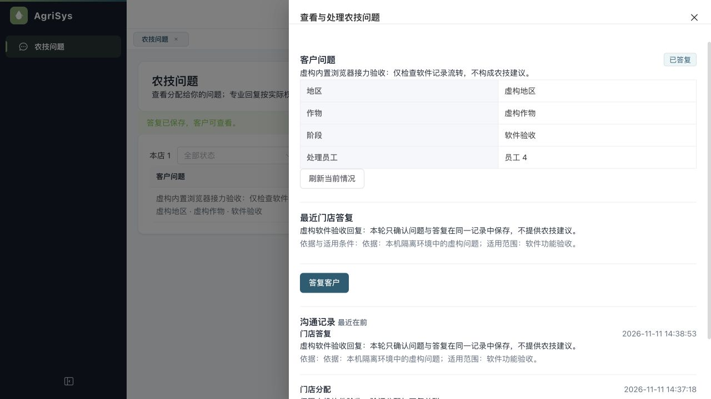

# 内置浏览器农技接力复验

2026-11-11 14:34—14:42；源码基线`506e6c970e5d9a76b0f91b684c9b4d46d951049a`。按用户要求直接使用内置浏览器操作已有后台页面，不用静态源码或自动测试代替实际页面结果。本轮没有修改业务代码，也没有接通AI。

## 环境与范围

- 当前后台源码，独立本机页面3104、后台9094、客户接口9095、缓存6404，仅连接此前拥有的随机验收库。原开发库、原预览环境不变。
- 当前JAR启动时，该隔离库从V149升级V150，实际106项成功迁移；与上一批仅自动测试库执行V150的时点分开记录。无清库、业务数据重建或正式迁移执行。
- 所有新增问题、员工和回复均为软件验收虚构数据。通过真实接口准备问题和临时权限；派工、切换岗位及回复使用内置浏览器点击。客户读取及数据库核对通过真实本机接口和SQL进行，未冒称客户小程序界面验收。

## 实际结果

| 项目 | 操作与可核对结果 |
|---|---|
| 管理员登录与队列 | 实际登录，打开农技问题，能看到本店四个测试问题 |
| 派工 | 从本店员工下拉选择本轮虚构员工，填写说明、明确确认后分配成功；详情及列表均更新 |
| 真实会话切换 | 通过退出确认退出管理员，再以新虚构员工登录，没有沿用管理员菜单 |
| 普通员工范围 | 只显示分配本人的一个问题；详情没有分配按钮；真实接口读取他人问题被拒绝 |
| 回复必填 | 仅正文并勾选确认，缺少依据时发送仍禁用 |
| 修改使确认失效 | 填入依据后，先前确认自动取消，须重新核对本次完整内容 |
| 实际回复 | 点击发送后页面显示答复已保存，最近答复与沟通记录均出现同一正文 |
| 刷新 | 重新加载页面，仍是本人一行且已答复；数据库没有新增第二条回复 |
| 客户与数据库一致 | 同一问题version3、实际状态ACTIVE；QUESTION/ASSIGN/HUMAN_REPLY各1条；客户最新回复与页面及SQL一致 |
| 内部记录隔离 | 客户仅收到提问和答复两条，不收到派工说明；本轮没有AI处理记录 |

后台“已答复”对应原业务状态`ACTIVE`，不代表问题已解决或关闭。核对脚本初次误写为并不存在的`ANSWERED`，断言失败；修正测试预期后只读复核通过，未修改产品状态或权限迁就脚本。第一次启动页面未显式指定隔离接口地址，登录报网络错误；修正启动参数为同源代理后完成全部操作，未改源码。

## 数据与清理

原订单、钱包流水、库存移动条数仍为0，零钱包仍6个且合计余额/冻结金额不变。这里是空交易及零余额基线，不能据此声称已验证有存量钱货的资金守恒。

测试角色原授权、门店原公开状态已经恢复；新虚构员工停用，历史测试问题保留。四个本轮服务均已退出，端口无监听。[脱敏机器证据](assets/2026-11-11-iab-recheck/verification-summary.json)包含提交、JAR摘要、实际迁移和核对结果，不含令牌或密码。

## 结论与未覆盖项

本轮检查的后台农技派工与人工回复链路通过，未发现本范围内的产品缺陷。未重复运行未变更的全量自动测试；此前1223项是对应506e6c9的后端自动验证，不算本轮新增浏览器用例数。

员工端和客户端目前只有微信构建，没有H5构建。本轮普通员工使用的是后台网页，不能称为员工小程序原生界面通过。微信登录/手机号、扫码、拍照、原生存储、安卓/iPhone仍须开发者工具或真机验收。AI可信来源/发布/分步usage与50题、客户AI入口仍按[15号计划](../current/15-农技提问与人工接力实施计划.md)继续；没有真实模型/搜索请求或费用。
