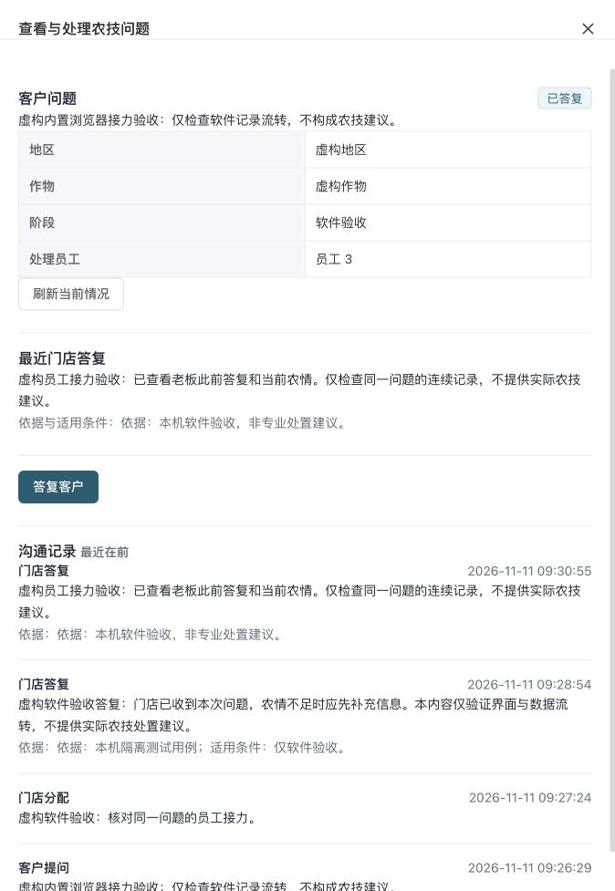

# 后台与员工农技接力验收

2026-11-11；基线47c1ec9，开发分支`codex/staff-unified-review`，对应[15号计划](../current/15-农技提问与人工接力实施计划.md)任务3。当前为工程及本机隔离联动验收，不是AI已接通、真实微信手机或完整服务上线。本批不新增业务表，最高迁移仍V149；不合master，不升级原预览库。

## 完成本批的原因与范围

客户端已能提出问题，老板必须能从页面处理，不能依靠开发人员调用接口。新增后台`/agronomy/cases`队列、详情、分配和答复；员工新增`pages/cases/list/index`与`pages/cases/detail/index`，工作台按真实权限显示并可设常用。员工工程18页，客户端仍11页。

公开文章不自动变为个案答复。当前是客户文字问题与真实人工答复，没有模型生成、拍照识别、语音上传、回访、关闭和诊断处方。

## 实际权限与接口

| 入口 | 既有接口 | 范围与守卫 |
|---|---|---|
| 队列 | GET `/api/admin/agronomy/cases?storeId=&status=&after=` | query；普通员工仅本店分配本人；manage本店全队列；后台实际管理员+manage才可跨店 |
| 详情/较早记录 | GET `/api/admin/agronomy/cases/{id}?after=` | 同范围；20条游标，新旧version不混拼 |
| 分配 | POST `/{id}/assignment` | query+manage；目标须本店在职且有query；后台按需读取staff:list，不自动扩权限；无列表权限可由本人处理 |
| 专业答复 | POST `/{id}/replies` | query+review且在当前问题范围内；纯文本正文、判断依据/适用条件、原version/UUID |
| 原号核对 | GET `/submissions/{requestKey}` | 实际员工本人原号、原操作权限、原门店范围；只读不可变收据 |

员工端始终明确传本店；有manage的兼岗账号显示本店队列，普通员工显示分配本人。手机本批不开放分配动作，由后台安排。客户姓名、手机号和钱款不为农技页面额外读取；列表使用真实问题与农情，没有虚构待办数量。

## 原确认与恢复

- 保存原稿到真实源站及员工/门店范围，微信再加实际AppID；不存令牌。UUID安全生成，先可靠存回读，再记SENT发送。原稿固定动作、问题、原version/factsVersion/status、正文、依据和目标员工。
- UNKNOWN不是失败，不清稿、不自动POST、不生成新号。COMPLETED必须沿原完整内容重放核服务端摘要，逐项对不可变收据，才能清本机记录。
- 仅确知唯一首次发送得到事务业务拒绝时允许清槽重新编辑。刷新、旧SENT或未知后的拒绝仍冻结。存储损坏、被结构合法异稿替换、读写删除失败均冻结。
- 结束过时确认必须针对本原稿重新勾选，由当前问题version严格大于原expectedVersion形成单调屏障，再核原UUID。已找到原完成优先返回原结果；无完成才结束。新原稿、收尾和离页不继承旧勾选。
- 问题重新分配后，原员工仍可核对并同体重放自己的已完成原号；不开放新详情、新正文或新回复。门店范围和当前原动作权限继续核验，同号改体仍拒绝。
- **受控人工恢复边界：**如果原请求未曾落库且问题已分配给别人，原员工不能借“核对”读新详情。原稿继续冻结，由店长临时交回原员工，再读当前新version核对结束；不能清缓存、假定未发出或另号强行重发。未实现持久取消协调器，不宣称所有未知都可自行取消。
- 会话、员工、门店、权限、筛选、问题及离页使旧响应失效。真正401清页面并去登录；旧会话401不能退出新账号。关闭抽屉不清本机未核实原确认。

## 失败先行与审查

一次独立只读审查确认P2：结束勾选跨原稿继承。真实两端SFC回归均先失败`true !== false`，按原requestKey及生命周期修复后通过。未反复派审换取通过。

审查另提示重新分配后原员工无法恢复原号的集成限制。本批补H2仓储/事务用例，实际先因“问题不可查看”失败，再限定本人已有原entry及完整摘要恢复，15项全部通过；新动作、改体、其他员工原号和撤回专业权限仍拒绝。没有放宽普通详情范围。

自查补真正会话失效后清详情/重登回归，先实际失败后修复；旧员工晚到错误仍不退出新会话。首次明确拒绝与旧SENT未知分开显示。

## 自动验证

| 验证 | 真实结果 |
|---|---|
| Java17 `mysql.it=true`及`authority.mysql.it=true clean verify` | 2026-11-11 09:26:52 BUILD SUCCESS；报告门禁180份、1187项，失败/错误/跳过均0 |
| 共享契约 | 134项通过 |
| 后台 | 325项通过，类型检查/生产构建通过 |
| 员工 | 141项通过，类型检查/微信生产构建通过，生成18页 |
| 客户回归 | 32项通过，类型检查/微信生产构建通过，仍11页 |

上述测试包括真实SFC脚本生命周期、共享恢复器、真实仓储和MySQL权限事务；SFC替身不是原生微信渲染。后台测试命令先编译共享源，避免干净检出引用不存在或陈旧dist。

## 内置浏览器与实际接口/数据库

只使用此前拥有的随机隔离库和9094/9095/6404/3104临时端口，原环境不变。用户要求内置浏览器后，关闭先创建但未执行页面操作的外部会话，后续界面动作均在内置浏览器完成。

1. 客户通过真实隔离客户端API提交虚构软件问题case3、状态WAITING_REVIEW。
2. 内置浏览器登录管理员，实际打开问题，选择本轮虚构员工3，输入说明并勾确认，点击分配成功；实际填写依据与答复并确认保存。
3. 实际退出管理员，登录该普通员工。其菜单仅农技问题、队列仅case3一行；详情有答复、没有分配按钮。员工真实提交第二条答复，原case推进到version4。
4. 内置浏览器三张截图留存在本报告目录。此阶段前端为本批页面，运行后端为上一最终47c包的既有V149接口。最后补的确认失效/401修复另有真实SFC回归，不冒称所有最终源都重新逐页点过。
5. 完整后端验证结束后，核PID/命令/随机库，停止并用本批最终JAR重启两API。真实员工密码会话＋共享SDK/恢复器接本机HTTP，客户为显式DEV_ONLY测试登录。服务重启后客户旧测试token失效，先核case仍version4、无新追加，再按真实入口重新登录继续；没有放宽正式客户解码或伪造微信登录。
6. 真实回复提交后，适配端口丢弃一次已成功响应的交付回调；店长立即改派。原员工详情被拒，但原号核对＋原体重放仍恢复同一version5收据，只有一个原回复。改体、新越权回复拒绝，其他员工同UUID查询UNKNOWN。
7. 再核未真正发送的未知稿：改派期间保持冻结，店长交回后显式新version屏障结束，未多写回复。最终同case version9、9条entry：QUESTION1、ASSIGN5、HUMAN_REPLY3；真实业务员工审计8条。同体重放没有第二条业务审计。
8. 客户读到同一最新回复version5，不收到内部分配记录。最高迁移149、成功105项；原空订单/钱包流水/库存移动条数和零钱包合计不变。**空集/零余额不作为存量钱货守恒证明。**
9. 原管理员/虚构角色授权、门店公开及原虚构员工状态已通过实际API恢复，新建虚构员工停用，历史测试记录保留。最终测试服务停止和端口检查见机器证据。

机器证据：[实际SDK与SQL](assets/2026-11-11-case-work-ui/actual-sdk-sql.json)。记录最终JAR SHA256、边界与恢复结果，不包含令牌、密码或电话。SDK存储使用Map、网络适配为本机HTTP；不是微信uni.request、原生存储、真实手机或多进程存储CAS证明。

## 下一步

按15号任务4接候选DeepSeek/更便宜模型与独立检索、持久请求身份/次数与预算、至少50条固定评测。无配置不出网，不能把一个模型开关当成AI已可用；老板无需预先录20篇文章。真实供应商、费用与50题评测、微信平台、安卓/iPhone、完整服务回访/关闭仍单列未完成。
