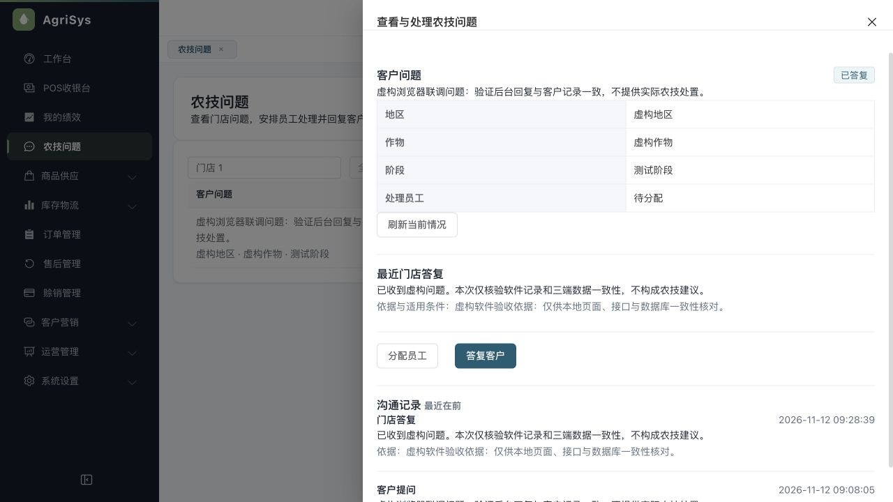

# 内置浏览器真实后台联调

2026-11-12，源码与后端产物基线 `5f866e489fae189ff922cc5feaa8c2d16a783d09`。回应用户“用内置浏览器测试”的要求，实际操作后台网页，连接真实 Java 服务和 MySQL，不使用页面或业务接口替身。

## 环境与操作

新建随机独立验收库，当前产物实际执行108项迁移至V152；仅初始化本地虚构管理员、门店和一个虚构客户。独立后台9096、客户接口9097、页面3107、缓存6406。通过真实接口准备虚构问题和测试授权，浏览器完成登录、查看问题、填写答复、确认发送、刷新和重开详情。

| 验证项 | 实际结果 |
|---|---|
| 原客户问题 | 创建后WAITING_REVIEW，version1 |
| 依据必填 | 只有答复正文并勾确认时，发送按钮仍禁用 |
| 改稿重确认 | 填写依据后，之前的确认勾选自动清除 |
| 实际发送 | 重新确认后点击发送，页面显示答复已保存 |
| 刷新持久性 | 刷新、重新打开同一问题，仍显示相同答复 |
| 客户接口/SQL | 同一问题ACTIVE、version2；客户可见提问和答复各一条，latestReply与页面一致；数据库HUMAN_REPLY只有1条 |
| AI未配置 | capability实际返回enabled=false、DISABLED；latest为空，没有AI处理行或供应商调用 |
| 钱货基线 | order、wallet_transaction、inventory_movement前后均0；只证明本轮没有新增钱货，不能外推存量资金守恒 |

## 范围与清理

本轮没有修改业务代码，不升级原开发库或预览环境。四个自有临时服务已经停止，端口均无监听；保留独立虚构验收库供追溯。见[机器证据](assets/2026-11-12-iab-real/verification-summary.json)。

准备环境时曾因页面接口地址未显式指定而登录网络失败，改为同源代理后完成；测试脚本也修正了客户业务code与响应码的区分，以及SQL列名type。这些是验收准备错误，没有修改产品迁就测试。

这次是后台网页实操，客户侧是实际HTTP读取，尚非客户或员工小程序原生UI验收。原工程没有H5构建入口，不能将后台普通员工页面或组件预览称为原生小程序。微信授权、手机号、相机扫码、原生存储和Android/iPhone须另测；真实模型质量、费用、首次AI优先分流和员工/后台AI视图也仍未完成。
