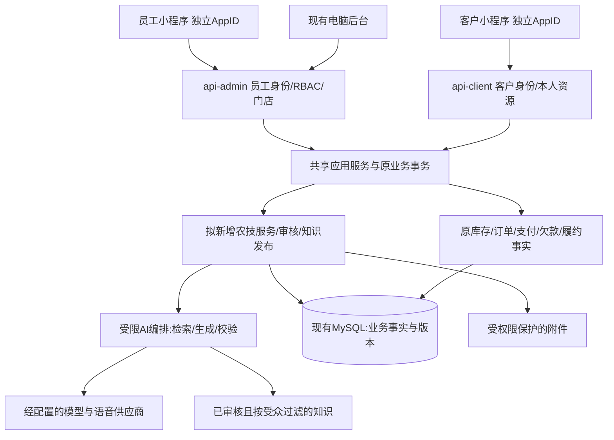

> 文档状态：历史阶段设计/计划，非当前全量事实；按文件日期和提交阅读。被覆盖部分以[统一文档中心](../../current/README.md)为准；未覆盖且仍有效的规则须对照当前代码确认，不直接执行旧迁移/模式切换。

# 双端共享数据、AI助手与实施验收

> 历史设计/计划（2026-10-29快照），保留追溯。当前范围、实现状态、接口与实施验收请读[V2.0设计与实施手册](../../current/07-客户端设计与实施手册.md)；本文“未创建/拟新增/未开放”等描述不得直接当作当前事实。

日期：2026-10-29。状态：设计与实施合同稿，未创建小程序工程、农技新表或外部AI资源。本文的数值是首期建议配置/验收目标，非用户确认的商业承诺。

## 1. 统一架构

不新增小程序专属库存、订单或客户库。不引入微服务、自动交易智能体、多智能体互相决策或让模型连接数据库。员工/客户端Controller只处理身份、输入及响应，规则与事务集中在共享应用服务。

AI是服务入口的一部分：查公开知识、帮助采集、解释标准SOP、整理待人工审核内容。它不是另一套权威业务来源。钱货仍由现有领域/应用服务、数据库约束和锁完成。

## 2. 复用与真实缺口

| 现有结构 | 可复用 | 不能假装已有 |
|---|---|---|
| customer / customer_identity | 客户主档、微信登录与停用 | 多AppID身份关联语义、本人农技档案与隐私同意 |
| staff / role / menu | 员工身份、门店、权限、停用实时生效 | 配送员仅本人任务的资源范围及培训流程 |
| order、item、delivery、payment、intent | 订单、原物料、履约和钱货事实 | 真微信网关、平台发货、快递全链及外部资金异常处理 |
| 收货批次/余额/移动、POS请求表 | 唯一库存账、防重和结果恢复 | 手机离线交易或通用请求结果协议 |
| CustomerFollowUpController/Service | 现有复购提醒入口，可保留业务用途 | 当前按购买量推测的复购日不是生育期、农情、农药用量或真实农技回访证据 |
| 订单/操作日志 | 交易审计 | 不能滥用备注、绩效日志或售后单存知识/咨询 |

## 3. 最小农技数据模型提案

这些是设计中的新业务事实，现有订单/客户备注无法表达多人接力、审核、版本及本人访问范围，确需独立结构。**本轮不执行DDL。** 每一阶段实现前解释字段、约束、迁移、回滚和更简单方案，经审查再新增；不得照文档一次性建所有未来表。

| 拟新增 | 主要字段与约束 | 为什么需要/更简单方案 |
|---|---|---|
| agronomy_case | id、store_id、customer_id、创建actor、request_key/hash、status、version、作物/具体品种/地区/棚露地/阶段/症状等typed facts、负责员工、需老板标记、next_followup_at | 一次问题的事实和协同状态；仅聊天记录不能可靠查询待办与归属。第一期就需要 |
| agronomy_case_entry | case_id、entry_type、actor、request_key/hash、body、受限附件引用、visibility、引用版本、AI/人工来源、审核关联、时间 | 追加采集/问答/审核/回访/更正与AI请求状态，保留原过程；不能覆盖原话。第一期就需要 |
| agronomy_knowledge_revision | logical_key、revision、status、audience、作物/地区/阶段/适用限制、正文、原始来源、审核者/时间、effective_from/until、content_hash | 老板确认过什么、当时引用哪版可追溯。单Markdown目录可以做短期内容试稿，正式后台发布须保存版本 |
| agronomy_crop_profile | customer_id、store_id、种植季、作物/具体品种/棚露地、地区、本人确认阶段/日期、提醒选择及更新时间 | 支持同一客户多作物多季节。可以在首个咨询版本推迟，用本次case facts；启用“我的作物”和持续提醒时再建 |

关键索引建议：`uniq_case_actor_request(actor_type,actor_id,request_key)`；`idx_case_store_status_due(store_id,status,next_followup_at)`；`idx_case_customer_created(customer_id,created_at)`；`uniq_case_entry_request(case_id,actor_type,actor_id,request_key)`；`uniq_knowledge_revision(logical_key,revision)`。actor不可由请求体指定，同key改摘要拒绝。

知识发布在logical_key对应记录锁下更新状态，保证同受众/适用范围的当前版本选择可重复；旧正文不可覆盖，撤回只改发布状态并留记录。实现前通过真实MySQL并发发布用例确定约束方案，不靠前端防双点。引用保留revision及hash，撤回立即阻止新回答引用；历史回答加失效标记，而非篡改旧记录。

附件存对象存储，数据库只存文件ID、所属case、媒体类型、hash、大小及经授权用途；防止把任意URL当上传来源。精确地块位置非默认必填。JSON facts须有固定schema及schemaVersion，不把订单/库存或无限业务字段塞进自由JSON。

培训初期复用知识与脱敏案例，不先建学习平台。若以后确需保存考试/上岗考核，另提staff_learning_attempt，不能拿staff_performance提成事实冒充学习记录。

## 4. 农技服务状态与协作

主状态：`COLLECTING、WAITING_REVIEW、ACTIVE、FOLLOW_UP、CLOSED`，另有`CANCELLED`。AI完成一次回复不等于case关闭。必须区分两条服务路径，不能让所有问题最终仍等老板逐单处理：

| 触发条件 | 允许的转换/操作者 | 关闭条件 |
|---|---|---|
| 资料充分，命中当前公开且适用的低风险标准知识，不含具体用药/混配/剂量或诊断结论 | COLLECTING→ACTIVE；后端按发布知识的适用规则执行，AI只负责解释；记录知识版本和自助来源，不标老板逐单审核 | 农户明确“问题解决/不用继续”才CLOSED；需要回访则FOLLOW_UP |
| 员工核实并直接发送完全适用的已发布标准答复 | COLLECTING→ACTIVE；需`agronomy:case:standard-reply`，不允许借此发送任意改写的专业方案 | 农户确认或员工在实际联系后记明结果；不得仅因已发送就关闭 |
| 资料不足、知识不适用/冲突、具体药剂/混配/剂量、药害或复杂诊断 | 保留COLLECTING补资料；资料齐后WAITING_REVIEW，只有具备review权限的老板/经真实授权农技人员审批后ACTIVE | 同样按反馈/回访关闭；AI不能自行解除人工审核要求 |
| 农户要求人工、答复后症状加重或老板主动介入 | ACTIVE/FOLLOW_UP→WAITING_REVIEW；追加理由和原答复引用 | 人工处理后恢复ACTIVE或明确终止 |

持续无回应的case可按经老板设置的期限标记CLOSED且reason=NO_RESPONSE，不计入“已解决”；不凭AI判断算有效帮助。农户对同一问题再次补充，可将CLOSED→COLLECTING并保留原记录；不同作物/新问题新建case。取消单不静默恢复。所有转换仍按版本校验。

状态变更由服务端按当前version比较更新；不一致返回明确冲突，前端重读并让人判断。每次转换都写entry，时间、操作者、原因和原版本一起保存。取消不删除历史；误操作可由具备权限者追加更正，不能覆盖原农户描述。

人工承接：首期只提供“营业/可联系时间”和**待人工确认的服务意向**，不是实时锁定预约。农户提交日期/地点意向写case entry，显示“已收到，尚未约定成功”；老板明确回复具体时间后才显示“已约定”，改期/取消均追加双方可见记录，不自动扣名额或收费。暂不建设预约容量表和抢号系统，也不能显示实际上未维护的“剩余3个名额”。队列按急迫程度、资料完整性和提交时间排序，不按消费额把一般农技问题全部排后。突发药害等显示及时联系门店/当地农技服务，不等待AI“自信答复”。

### 农技角色与资源矩阵

下列为拟新增权限代码，实施时通过既有角色授权独立配置，不因为是员工自动授予：

| 能力 | 客户 | 库管/配送 | 普通销售 | 农技助理 | 老板/授权农技审核者 |
|---|---|---|---|---|---|
| 读私有case/附件 | 本人 | 无 | 仅本店明确分配给本人且有read权限 | 同左 | 有`agronomy:case:manage`时本店；跨店需已有门店范围且显式允许 |
| 采集/回访/补资料 | 本人追加 | 无 | 分配case且有`agronomy:case:intake` | 同左 | 本店manage范围 |
| 发送已审核低风险标准答复 | 无员工权限 | 无 | 需单独standard-reply且分配范围 | 同左 | 同样校验知识适用性 |
| 发布个案专业建议/审核高风险 | 无 | 无 | 默认无 | 默认无 | `agronomy:case:review`且本店manage范围 |
| 分配、关闭、重开 | 本人请求/反馈，规则控制 | 无 | 默认无管理操作 | 自己分配case可记录真实回访结果；关闭规则由服务控制 | manage范围，原因必填 |
| 学习SOP/脱敏案例 | 仅公开内容 | 单独learning权限 | 同左 | 同左 | 同左；学习权限不包含原客户case |
| 发布知识/改受众 | 无 | 无 | 无 | 仅整理草稿 | 独立`agronomy:knowledge:publish`权限 |

公开知识不含内部培训标记、员工备注或原顾客身份；AI检索在SQL/检索索引层先施加受众与资源过滤，不能先检索全店资料再靠提示词“不要泄露”。

## 5. AI流程与可执行边界

### 单次请求

1. 服务端确认真实身份、case归属、可见受众和限额，记录actor绑定的请求身份。
2. 校验照片/语音文件归属；录音转写后由用户确认关键实体及数值。照片用于描述症状，不当作确定病因证据。
3. 将已确认的作物、地区、阶段作为检索硬过滤。未知则追问，不先生成一篇通用药方。
4. 从已发布且有效的相应受众知识中检索；无匹配、冲突、过期或超范围则拒答/转人工。
5. 将最少必要事实及允许的知识片段交模型；默认不发送客户姓名、电话、地址、钱包、订单明细、精确地块或其他顾客案例原文。
6. 生成结构化候选：`summary,knownFacts,missingFacts,nextSteps,citationIds,requiresHumanReview`。
7. 后端检验字段、引用真实性/可见性/版本、关键数值和风险分类；未通过则不把半截流式答案展示为建议。
8. 保存输出版本、模型及提示版本、引用hash、风险理由和人工接力状态，再返回可展示内容。模型置信度不是诊断准确率。

首期对最终建议采用“生成完校验后再显示”，等待过程给进度与继续补资料入口；语音转写和普通逐字解释可以分段展示，但不能流出尚未审核的药剂/混配内容。

### 能做什么

| 类别 | 客户端 | 员工端 |
|---|---|---|
| 资料采集 | 追问、转写、补图提示 | 检查缺项、总结待审核材料 |
| 已审核知识 | 本人适用的公开知识与通俗解释 | 内部SOP和已授权脱敏案例 |
| 具体药剂、混配、用量、疑似药害/多原因症状 | 不自主形成处方；显示需人工判断并收集资料 | 可整理有来源草稿，仅老板/授权农技审核后发送 |
| 商品 | 解释真实规格和适用条件；展示后端报价卡 | 查真实商品和库存摘要，不编价格 |
| 钱货操作 | 引导用户打开原业务页面 | 只准备草稿与解释流程，最终仍走原权限/预览/确认/防重 |
| 培训 | 不开放内部培训 | 根据当前SOP解释、练习、模拟采集；不能自行授予角色 |

首期只开放有限只读工具，如`getVisibleKnowledge(query,facts)`、`getOwnCase(caseId)`、`getCatalogQuote(productId,unit,quantity)`。后端从真实actor注入权限与customerId/storeId，模型不能传可信身份。禁止任意SQL、shell、HTTP抓取、订单写入、退款工具和外部自动发消息。

提示注入来自照片文字、语音和检索文档都按不可信内容处理；其中“忽略规则、查看其他客户、直接扣库”等不是系统指令。模型输出的URL、引用和商品ID都需服务端白名单核验，不执行生成代码。

### 老板知识如何进入系统

老板口述/旧资料→员工整理草稿→标注来源和适用条件→老板审核→发布版本→实际使用与回访→另行审核修订。公开/内部受众必须明确，不因AI认为有价值自动发布。农户同意公开个案与接受服务分开，同意可撤回；撤回后停止新检索与公开分享，保留必要私有服务记录。

初期优先整理10—20个高频问题作为试点内容数量建议；先从老板选定的1—2个作物场景验证，不预编东北所有作物的用药答案。没有资料时助手应说不知道，不能依赖模型常识补齐当地知识。

## 6. 模型、语音、成本与降级

不自训大模型。先用可替换的ModelGateway接口对接已核实可用于该服务的供应商；模型、区域、数据保留和成本经实际测试后选择，不在文档伪造已购买资源。可用知识检索增强，但“带知识库”不自动保证事实正确；DCloud负责小程序壳，现有Java后端负责身份与编排，不以uniCloud重建业务。

首期内部试点建议：每客户每天最多10个AI请求、每请求最多3张压缩图、单段录音60秒；这是可调整保护值，不是商业套餐。超限仍可看知识、查看原服务或预约人工，不能要求付费才能查看已有答复。服务端计数，客户端限制仅作提示。图片上传失败不扣成功次数，重复同requestKey不重复入队或重复计费意图。

设置每店日预算与并发上限、模型请求超时30秒。超时保留原请求状态；只可查询/重取原结果，不默认重启另一付费调用。AI不产生交易，停机或预算满时降级为已发布知识和人工队列，业务收货/销售继续可用。

录音、照片向外部AI传输前需清楚说明用途、供应商处理及可替代方式并取得相应授权；用户选择不使用AI仍可提交给人工。项目Mirror工作记录授权不等于授权上传顾客资料。正式配置确定前，不调用真实顾客材料做外部模型测试。

## 7. 共享接口与数据合同（拟新增）

| HTTP/范围 | 请求/响应要点 | 服务边界 |
|---|---|---|
| POST /api/client/agronomy/cases | requestKey、已确认facts、附件ID；返回id/status/version | 身份取登录态，本人创建；同key同摘要重放 |
| GET /api/client/agronomy/cases/{id} | 本人服务时间线、公开答复、当前能力 | 不返回内部草稿或其他客户 |
| POST /api/client/agronomy/cases/{id}/entries | requestKey、expectedVersion、补充/反馈及附件 | 追加，不允许客户伪造人工答复 |
| POST /api/client/agronomy/cases/{id}/assistant-requests | requestKey、已确认facts版本 | 返回请求状态及经校验结果；未就绪查询原key |
| GET /api/admin/agronomy/cases | 当前门店/分配范围、status、分页 | 员工不能从客户端参数扩范围 |
| POST /api/admin/agronomy/cases/{id}/actions | requestKey、expectedVersion、action、entry | 权限及状态机；答复、回访、分配分别校验 |
| GET /api/admin/agronomy/learning | 已授权的SOP、脱敏案例 | 不等同全部客户咨询库 |
| POST /api/admin/agronomy/knowledge/{key}/publish | expectedVersion、目标revision | 独立发布权限，审阅与并发保护 |
| GET /api/public/agronomy/knowledge/{key} | 仅当前公开有效版 | 无登录可读，不暴露内部版本和私有附件 |

移动端状态统一：`DRAFT、SUBMITTING、VERIFYING、COMPLETED、REJECTED`；本地缓存带actor/store及schema版本，旧响应不污染新会话。返回业务状态和原请求ID，不只返回“success”。金额统一整数分或明确decimal字符串，数量按后台精度/原销售系数验证；客户端不推导资金分配。

错误合同建议：未登录→重新认证并保留原请求；无权限/停用→停止并隔离身份；版本冲突→重读后确认；业务拒绝→显示可修正原因；网络/5xx/空成功结果→VERIFYING；结果未知→继续原请求核对。不能用全局重试器自动重发所有POST。

## 8. 价格、库存、支付与身份的发布门槛

两端读写复用现有唯一账本与事务；MyBatis/JDBC沿实际Flex连接，锁序不能因“手机请求”而改变。退款回原分配、提货不重扣、报价后端权威及原请求恢复等AGENTS约束全部继续有效。

客户线上支付实施必须补：创建订单请求幂等、正式平台支付参数、签名/通知解密与验签、订单/商户/AppID/金额/币种绑定、主动查单、意图超时与关单、已付但缺货的资金事实保存及退款、退款请求防重及结果查询、账单对账、平台发货管理。当前兼容shared-secret回调不是微信平台验签；客户端主动确认入口继续关闭，不能靠小程序回调来记到账。已收到的外部支付事实不能因履约事务失败整体丢弃；具体状态及迁移属于支付实施前的专门审查项。

员工端与客户端token不互用；两个AppID的OpenID在后端按明确AppID命名空间解析。第一期只配置一个客户AppID，员工沿原员工身份；以后支持多个客户AppID需先改CustomerIdentity的范围，不能直接复用当前未带AppID的唯一值当多端统一身份。

### 老客户首次进入的安全认领

当前微信登录新OpenID会新建客户，因此小程序上线前必须补认领，不能宣称现状已经自动连上线下账。第一期在首次登录后、产生任何订单/钱包/咨询等私有事实前提供“我是店里老顾客/先作为新顾客使用”。公开知识始终可看，不要求认领。

认领由后端验证微信官方手机号能力或已接通的短信挑战证明当前持有；客户端自报手机号无效。**当前持有手机号不能证明历史账户归属**，手机号可能录错、共用或被回收。首期所有老档认领均增加门店人工核验，尤其旧档有订单、钱包、欠款或私有服务时；由具备独立`customer:identity:claim`权限的老板核对历史归属证据，不能仅凭同手机号、昵称或用户报出余额放行。没有可靠归属证明则不绑定，不泄露旧档细节。以后如确需自动认领，须先有可信的历史已验证身份和明确低风险范围，另行设计，首期不实现。

人工核验批准后，再核对当前临时档无任何业务事实、无另一冲突微信绑定，在服务端锁定身份及稳定顺序的客户记录，将本次微信身份明确绑定到原客户ID，保留旧订单/钱包/库存关联不搬账。切换后重新签发会话、刷新当前客户，旧会话立即失效；不把临时档删掉冒充从未存在，留操作审计。员工整理材料可协助，不能自行批准自己的认领请求。

多档同手机号、手机号已变更、已有其他绑定、当前新档已产生任意私有事实/余额时均不自动合并；显示“联系门店核实”，由老板经线下核验后走受审计处理。认领未完成只可见当前身份已拥有的资料，不泄露旧档余额、订单、姓名来帮助猜身份。未接通可靠手机号验证前，不开放自动认领，以门店人工核验为替代；不能使用开发登录作为正式验证。

具体实施采用一次绑定命令与同事务的`customer_identity_claim_log`审计提案，理由及字段见[客户端实施计划C0](../plans/2026-10-29-客户小程序与农技AI实施计划.md)。该日志保存身份变更证据，不是第二客户或资金来源；无审计能力时不实施认领，不先绑后补日志。本轮不建此表。

## 9. 代码落点与实施顺序

可执行任务分解另见[员工实施计划](../plans/2026-10-29-员工小程序实施计划.md)与[客户端/AI实施计划](../plans/2026-10-29-客户小程序与农技AI实施计划.md)。计划中的新工程、表、脚本和接口全部仍为拟实施，不能计入当前完成度。

| 阶段 | 建议代码位置/交付 | 完成标准 |
|---|---|---|
| T0 后台收尾 | CheckoutDialog、客户端支付DTO/Controller/OrderApplicationService及回归 | 已定位缺陷红绿；全量验证；未验边界独立列出 |
| T1 技术验证 | 临时Uni-app微信体验项目，随后保留最小mini-staff、mini-customer | 真机扫码/录音/导航/弱网验证；确定依赖版本，不带生产凭据 |
| T2 员工收货交付 | mini-staff及api-admin移动聚合，原服务复用 | 最小权限、原请求防重、退货竞争、SQL钱货不重复 |
| T3 知识与服务事实 | core-domain/agronomy、core-application/agronomy、core-infrastructure/agronomy及受控迁移；admin-web审核页 | 至少3条经老板审核内容，case状态和版本、隐私和附件权限通过 |
| T4 双端AI | application/agronomy/assistant，ModelGateway端口、供应商adapter、两端采集/解释页 | 本文AI测试集通过，未知/越权/无依据不输出正式建议 |
| T5 客户选购支付 | api-client catalog/本人订单与正式payment adapter，mini-customer | 真支付/退款/发货及异常对账闭环；无资质不开放相关货品 |
| T6 服务试点 | 大庆本地少量农户与东三省快递样例分别试用 | 有效服务、老板耗时、回访及净收益可观察，按证据改进 |

每阶段先列失败用例，再实现，验证通过后本地中文提交；不自动推送/上线。新迁移使用当时最新Flyway版本，不预占V134，避免与并行工作冲突。变更前私有备份、在新建随机库验证；农技记录可停写回退，不能回滚删除订单/钱货事实。新表、外部供应商、正式账号、生产配置分别审查，不通过一次设计批量授予所有权限。

建议节奏按能力分三个月：第1月后台收尾、真机验证、员工收货/交付和老板知识采集；第2月知识审核、客户服务闭环、受限AI与培训；第3月具备资质后的客户交易/支付和小范围运营验证。若支付资质未就绪，第3月继续服务试点，不假上线商城；这不是工期承诺。

## 10. 验收集与可观测性

业务：重复/迟到请求、跨手机电脑同请求、存储失效、身份变更、原单部分退货/全退、整件/计量单位、跨店IDOR、后台撤权、实际Flex事务回滚。每个用例保留真实UI、HTTP与只读数据库证据，mock只能证明边界。

AI至少50个版本化评测样例，先由老板提供/审核标准答案：普通知识、缺作物/地区/阶段、棚内不同作物、模糊图、多原因黄叶、方言数字、单位含糊、具体剂量/混配、标签冲突、过期撤回知识、提示注入、跨客户/员工内部资料请求、照片含身份信息、供应商超时/预算满。验收目标：越权和危险自动处方0例放行；引用存在且可见100%；不足资料不编造；普通答复实用性由老板逐例确认。数字仅为验收目标，不是模型准确率或服务效果宣称。

记录traceId、原requestKey、actor范围、知识/提示/模型版本、延迟、token/费用元数据、拒答与转人工原因、人工修改、回访结果。日志不记录密码、验证码、完整照片、客户电话或整段私有会话。错误集中按可恢复性展示，模型故障不能被当成农户操作错误。

候选知识/服务数据保留期建议：临时未提交媒体24小时；AI转写原录音在确认后7日内清理；服务记录及必要审计由真实业务和适用义务确定，不在此杜撰统一法定年限。实际删除策略需可查询、可申请，并处理对象存储与检索索引同步；交易法定留存与AI可撤回公开用途分开。

## 11. 外部资料和未确定项

- [阿里云官方RAG知识库文档](https://help.aliyun.com/zh/model-studio/rag-knowledge-base)说明文档检索机制，可供实现参考；不是本项目已选供应商或已配置知识库。
- [网信办2026年3—4月公告](https://www.cac.gov.cn/2026-05/13/c_1780413225190669.htm)说明API调用已备案模型的应用/功能由地方网信部门开展登记；[早期公示说明](https://www.cac.gov.cn/2024-04/02/c_1713729983803145.htm)涉及模型名称及备案信息公示。具体服务适用范围、登记与生成内容标识按实际方案及届时规则核对，不认为供应商备案自动覆盖小程序。
- 待实际准备：真实经营主体与AppID、支付资质和平台可售类目、首批硬件型号、老板认可的首个作物场景与知识样本、能承担的服务时段、模型数据处理授权。未知不阻止写设计与验证通用代码，但会阻止对应真实服务开放。
