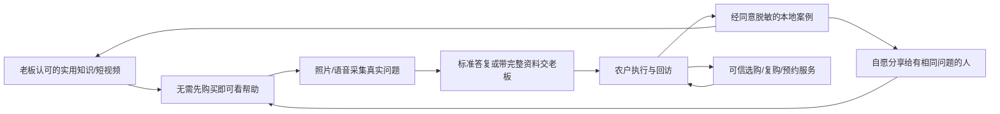

# 员工端、客户端与农技助手：调研及总体决策

日期：2026-10-29。状态：设计稿，非已上线产品。文中“建议、拟新增、验收目标”均不代表已实现。

## 1. 真实经营约束

用户本轮确认：门店主要在黑龙江大庆，服务大田、大棚、水稻、玉米等东北常见作物；短视频也带来东三省外地客户，部分种子等小件通过快递交付。目前只有老板能够承担农技判断及下田回访；扩张受标准培训缺失、人员难招聘和难稳定限制。新增要求是在小程序内嵌AI助手。

因此产品目标同时包括：农户更容易获得可靠帮助；把老板经验沉淀为可审核、可培训、可交接的服务资料；员工高效执行；钱货数据与现有后台一致。不能用更多咨询量压垮老板，也不能把AI正确率、增产或销量增长当成既定结果。

本轮交付范围：后台已定位缺陷修复、两端详细设计、共享数据与AI设计、实施和验收文档。未要求立即上线两个小程序；不在设计阶段自动注册账号、购买模型服务、上传真实顾客材料或新建业务表。

## 2. 小程序代码核查

| 检查范围 | 本轮证据 | 结论 |
|---|---|---|
| 当前检出 | 分支`codex/store-mvp-closure-20261013`，核查时HEAD `bb01f98` | 有admin-web，没有完整小程序工程 |
| 本地分支与其他worktree对应分支 | closure、master、task4-fix、task5、setup-run-agri-system、review-architecture-pricing-commission | 各引用树未发现小程序工程标志 |
| 远端 | `git ls-remote --heads --tags origin`及`git fetch --prune origin`成功 | 仅master，无可见标签；最新为`c6e5b7222e8a3ada5f6d1e6c05331a80cf72aeb6` |
| 远端文件 | `git ls-tree -r origin/master`共879文件 | 未发现小程序工程 |
| 可达历史 | 本地与获取的远端引用共105个可达提交；扫描所有改动路径 | 未发现pages.json、manifest.json、app.json、project.config.json、wxml/wxss/uvue；admin-web之外未见Vue页面 |
| 旧设计 | `docs/archive/2025/FRONTEND_GENERATION_RULES.md`明确写Uni-app Vue3 + TypeScript | 用户记得的Uni-app有文档依据，但本仓库无对应实现证据 |

此结论不覆盖其他未提供的远端仓库、已被远端删除且本地不可达的提交、Git之外的旧备份。未合并、推送或切换远端代码；远端master也不等于当前已修复分支。

复查方法：查询远端全部heads/tags；fetch；对每个引用执行ls-tree；用`git log --all --format= --name-only`核查曾存在后删除的工程。不能只搜索当前目录就断言远端也没有。

## 3. 两端如何划分

建议两个独立微信AppID、两个前端构建，复用同一后台业务服务与数据库：

- **员工端：** 今日任务、查库存/扫码收货、销售与交付、回访采集、培训及内部助手。员工身份、门店及RBAC由服务端决定。
- **客户端：** 问农技、我的作物/服务记录、可信选购与订单。只展示公开知识及本人资料。
- **电脑后台：** 商品与价格、采购及钱货管理、角色授权、农技知识发布、复杂咨询审批与运营统计。

理由：员工和农户的任务、信息密度、权限及发布节奏不同。单一小程序靠“切员工身份”隐藏页面不能构成权限隔离。两个AppID有额外认证、审核和维护成本，但不需要两套库存、两套客户或微服务。

第一期员工仍使用现有员工账号登录，不能扫码就自动获得员工角色。客户通过微信身份进入；跨AppID的OpenID不能直接当同一个人，员工与客户也不能因同手机号自动合并。以后若做微信免密绑定，须先核验现有员工身份、保存AppID范围内的明确关联，另行设计迁移。

## 4. 成熟服务模式：借鉴什么

以下来自官方公开介绍或政府发布的历史案例，并非本轮实际登录这些App进行体验测评；不验证其宣传效果或目前经营盈利。

| 参照 | 能确认的机制 | 借鉴到本项目 | 不照搬的部分 |
|---|---|---|---|
| MAP / MAP智农 [S1][S2] | 种植方案、农事信息和线上线下农技服务连接 | 按作物和阶段提供有依据的服务，保留实际回访结果 | 遥感平台、大型农艺师网络、全产业链投资 |
| Plantix [S3] | 照片提问、知识库及专家社区，另有企业服务 | 从具体种植问题进入，给出可追溯知识和人工接力 | 不能照搬全球模型结论到大庆，也不声称拍一张照片即可确诊 |
| 丰信农业历史社会化服务案例 [S4] | 标准技术方案和线下服务队伍配合 | 把老板经验变成采集表、SOP和带教案例 | 不开展重资产全程托管、保底收益或全国加盟 |
| 中国农技推广 [S5] | 农技问答、服务记录、专家经验分享 | 可检索的真实问题与处理经过，服务能力有证据 | 不虚构专家团队、公办背书或随时人工在线 |
| 惠农网 [S6] | 实名/经营资质、店铺信息与交易服务 | 实体门店、供应来源、订单及售后承诺透明 | 不建设多商户撮合平台和复杂排名收费体系 |

**商业定位建议：大庆本地有实体店、有人负责、能持续跟踪的种植服务入口。** 货品不是唯一价值。农户买的是适合当地作物的明确选择、可找到人的服务、真实产品来源及问题发生后的跟进；外地客户获得适用地域说明、真实规格、快递与售后服务，不承诺本地同等线下服务。

## 5. 留存与新增客源如何形成循环

循环成立的前提是有效帮助和履约，而不是签到、裂变任务和满屏优惠券。案例须保留失败和不确定结果，不能只收集“用了就增产”的故事。不以分享、下单或关注换取诊断答案，不设计多级返佣。短视频平台内的承接遵守该平台当时允许的工具，不假设可随意外链引流。

首期免费提供已发布基础知识与问题采集。复杂人工服务有名额和明确时间；测土、下田等若收费，应先明确真实能力、内容、地域及报价，不能先卖无限咨询会员。收益评估扣除货品成本、运费、退货、人工服务时间和AI费用。

衡量建议：首次获得有效帮助比例、问题采集完整率、老板每单处理分钟数、按期回访率、农户确认有帮助率、季节性回访/复购、同意分享案例带来的有效新咨询。指标是待验证假设，不以下载量/注册量替代收益。不把农忙季使用节奏套成每天签到。

## 6. 原生微信与Uni-app取舍

| 维度 | 原生微信小程序 | Uni-app Vue3编译到微信 |
|---|---|---|
| 普通拍照扫码 | 直接使用微信API | `uni.scanCode`支持微信，同样受微信相机及机型能力限制 [S7] |
| 连续扫码 | 原生camera扫码事件 | camera的scanCode模式支持微信 [S8]，仍须做同码去重、确认与页面生命周期 |
| 配送导航 | 微信位置/地图接口 | 可调用对应平台接口；不等于获得后台持续定位能力 |
| 开发维护 | 平台行为直接、调试层少；需新写原生组件 | 复用团队Vue/TS经验、两端共享纯TS库；不能直接搬Element Plus和浏览器DOM组件 |
| 多平台 | 后续原生App另写 | 可扩App，但兼容性、硬件和权限仍逐平台验证 |
| 性能与稳定性 | 更容易直接定位微信平台问题 | 需控制框架/组件体积与条件编译；不能把跨端等同于一次编写免测试 |

**本轮技术建议：两个独立Uni-app Vue3 + TypeScript工程，优先只交付微信端；共享纯TS接口类型、请求恢复与格式化库，不共享混杂权限的大页面。** 不引入uni-app x、uniCloud或第二业务库。依据是现有Vue3/TS经验、旧选型和普通扫码/配送需求，不是已完成真机跑分。

最终选型前做小型技术验证：低端安卓及iPhone各一台，普通条码与内部批次码、拒绝相机、连续同码、后台再回来、弱网、送货导航及录音上传。测扫码成功率、重复记入次数、首屏和包体；目标由两端文档列出。若仓库需工业PDA高频扫描或专用打印机，先取得设备型号/SDK，再决定原生桥接或独立App，不能提前保证小程序满足。

## 7. 微信申请：操作不难，营业准备不能省略

申请账号与经营上线是两件事。建议由实际门店经营主体持有AppID及支付商户号，老板控制管理员，开发人员只获得必要开发权限。

| 环节 | 应准备的内容 | 本轮确认/限制 |
|---|---|---|
| 注册 | 未占用邮箱、主体及管理员材料；员工和客户两个AppID分别申请 | 腾讯官方有注册及认证指引 [S9][S10]；本轮不代注册 |
| 主体与认证 | 按真实执照选择企业或个体工商户，不以个人账号绕过经营资质 | 微信支付支持个体工商户、企业等主体；需认证及商户号与AppID绑定 [S11] |
| 费用与周期 | 认证、年审、服务费及审核周期按实际后台显示预算 | 公开教程收费表述有新旧差异，不承诺“两端固定多少钱/几天通过” |
| 备案与域名 | 平台备案、合法域名、HTTPS、隐私声明、服务器及上传域名 | 工信部通知明确先备案后开展业务；材料齐全准确后的办理期不是项目总工期 [S12] |
| 类目与货品 | 真实经营范围、种子/农药等实际品类资质，审核时核对当期规则 | 小程序通过审核不等于所有农资均可网售。限制使用农药等有明确互联网经营限制 [S13] |
| 交易履约 | 真支付、平台通知验签/查单、退款、差错对账、发货管理 | 微信支付官方接入指引要求交易类履约能力 [S11]；当前仓库未完成这些平台接入 |
| AI公开服务 | 供应商、适用备案/登记、公示及生成内容标识要求 | 上线前按实际服务形态确认，不宣称调用任意API即可免除义务 [S14] |

员工端不收客户线上款时可先做任务与扫码，不必等客户支付联调完才进行开发体验。真实支付未就绪前，客户端不能展示可完成的“微信支付”或把意图当到账。

## 8. 文档入口与范围

- [员工端详细设计与实现](2026-10-29-员工端小程序设计与实现.md)
- [客户端详细设计与增长服务](2026-10-29-客户端小程序设计与实现.md)
- [共享数据、AI助手及实施验收](2026-10-29-共享数据与AI助手实现.md)
- 后台缺陷、未验项目及上线依赖见`docs/reviews/2026-10-29-后台收尾与小程序前置核查.md`。

## 9. 资料来源

查询日均为2026-10-29。仅将公开资料支持的功能当事实，选型、经营与指标为本项目建议。

- S1：[MAP农服业务](https://www.syngentagroup.cn/yewubankuai/MAP-digital-agriculture/index.html)
- S2：[MAP智农与线下农技服务](https://www.syngentagroup.cn/media/stories/238.html)
- S3：[Plantix官方功能介绍](https://plantix.net/en/)
- S4：[农业农村部社会化服务典型案例，丰信农业，历史资料](https://www.moa.gov.cn/gk/tzgg_1/tfw/201909/P020190918545772342839.pdf)
- S5：[农业农村部：中国农技推广问答服务](https://kjs.moa.gov.cn/gzdt/202003/t20200330_6340132.htm)
- S6：[惠农网用户服务协议](https://www.cnhnb.com/clause/service/)
- S7：[DCloud uni.scanCode](https://uniapp.dcloud.net.cn/api/system/barcode)
- S8：[DCloud camera组件](https://uniapp.dcloud.net.cn/component/camera.html)
- S9：[腾讯客服：小程序注册流程](https://kf.qq.com/faq/170109iQBJ3Q170109JbQfiu.html)
- S10：[腾讯客服：小程序认证入口](https://kf.qq.com/faq/170109by2mQB170109zUFfqe.html)
- S11：[微信支付：小程序接入准备，页面更新2026-10-16](https://pay.wechatpay.cn/doc/v3/merchant/4015459512)
- S12：[工信部：APP备案通知](https://www.miit.gov.cn/zwgk/zcwj/wjfb/tz/art/2023/art_920db564162e4312916a01bed6540ad8.html)
- S13：[农业农村部：2025规章修改说明，互联网农药经营要求](https://fgs.moa.gov.cn/flfg/202508/t20250801_6476253.htm)
- S14：[网信办：2026年3—4月备案和API调用应用登记公告](https://www.cac.gov.cn/2026-05/13/c_1780413225190669.htm)及[公示说明](https://www.cac.gov.cn/2024-04/02/c_1713729983803145.htm)
- S15：[中华人民共和国种子法，第三十八条等](https://www.mee.gov.cn/ywgz/fgbz/fl/202303/t20230314_1019530.shtml)：不再分装包装种子等情形仍有备案要求，不能把种子小件可快递等同于无需任何经营核查。

微信开发者部分文档本次抓取失败，不能声称已查清所有类目、权限或最新收费细则。申请时以实际主体的公众平台审核及官方最新要求为准。
