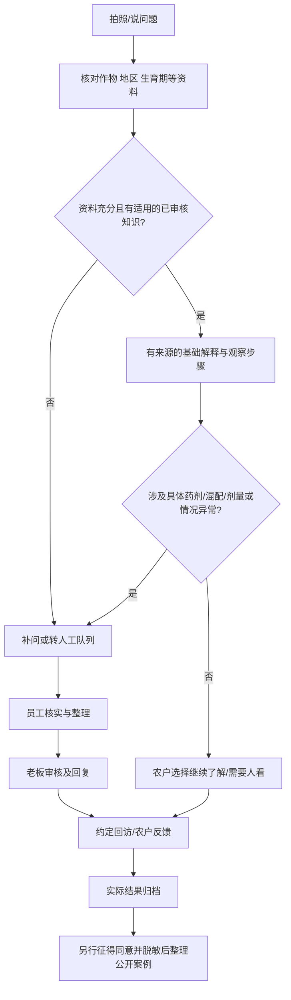

> 文档状态：历史阶段设计/计划，非当前全量事实；按文件日期和提交阅读。被覆盖部分以[统一文档中心](../../current/README.md)为准；未覆盖且仍有效的规则须对照当前代码确认，不直接执行旧迁移/模式切换。

# 客户端小程序详细设计与实现文档

> 历史设计/计划（2026-10-29快照），保留追溯。当前范围、实现状态、接口与实施验收请读[V2.0设计与实施手册](../../current/07-客户端设计与实施手册.md)；本文“未创建/拟新增/未开放”等描述不得直接当作当前事实。

日期：2026-10-29。状态：设计稿，未实施、未获真机/真实支付验收。与[总体决策](2026-10-29-双端小程序-调研与总体决策.md)、[共享数据及AI](2026-10-29-共享数据与AI助手实现.md)一起阅读。

## 1. 农户为什么来，而不是直接去大平台

定位：**身边能持续帮我种好这一季的农技服务助手。** 不与淘宝、京东比较SKU数量、流量或补贴。可信差异来自真实实体店、懂本地作物的人、问题处理过程和售后责任，而不是声称产品更神奇或保证增产。

农户可先解决问题、了解方法，即使暂不买货也可看公开内容。不把每次提问都变成商品推销。适宜的产品在确定需求、适用地域及使用条件后才出现；页面区分农技解释与商品推荐，显示零售价格、规格及服务内容，不把“老板推荐”当作产品登记或效果证明。

服务分两类，前台用自然语言说明：

- **大庆本地：** 线上答疑、预约门店、条件允许时的下田或配送。范围由老板维护真实区域与可预约时段，不能仅按省份推断。
- **东三省外地：** 线上资料和咨询、适宜小件的快递、实际可提供的售后。商品种类、品种适宜区、运输条件需核对，不因为在东北就默认都适用，不承诺上门。

此差异是服务区域，不新增两套商品/库存/订单模式。若跨店履约尚未确定，明确选择履约门店，不自动从任何门店拼库存。

## 2. 简单的信息架构

底部三个入口：**帮我种、买农资、我的**。首次默认“帮我种”，而不是促销首页。首页主按钮“拍照问一问”，旁边“说一说问题”；“打电话找店里”可见但展示营业/回复时间。

| 页面/拟路由 | 农户看到的内容 | 主动作与状态 |
|---|---|---|
| pages/home/index | 当前选择的作物、已审核应时提醒、我的待补资料/回复 | 拍照/语音提问；未选作物仍可看，不强制填档案 |
| pages/ask/index | 照片/语音、作物、地区与几个简短追问 | 确认“这是我的情况”；上传/转写失败可重试 |
| pages/case/detail | 已采集资料、AI解释、人工回复、回访和状态 | 补照片/看看回复/反馈变化，不把草稿标成结论 |
| pages/knowledge/detail | 图文/语音、适用作物区域、来源、审核时间 | 听一听/收藏/自愿分享公开卡片 |
| pages/crops/index | 已确认的作物及种植季、近期待办 | 改作物/标记实际情况；过季后不继续发提醒 |
| pages/catalog/index | 可信商品、常购、作物筛选 | 搜索/问是否适合；不能仅按AI生成词自动下单 |
| pages/product/detail | 规格、单位、品种适宜信息、货品来源、履约及售后 | 选规格/数量，未具备网售条件明确不可下单 |
| pages/checkout/index | 商品、数量单位、履约门店、总价、运费、地址 | 确认订单，报价变更必须再次确认 |
| pages/orders/index | 本人订单，待付/待交付/已完成/售后 | 查看订单或核对支付结果，不因没查到就再付 |
| pages/order/detail | 实际付款、待履约、物流/自提、售后记录 | 提货码/确认收货/申请售后按真实能力显示 |
| pages/profile/index | 实体门店、自己的作物和服务、订单、隐私与帮助 | 一键找到服务记录；无复杂会员成长任务 |

“我的作物”是轻量服务偏好，初期不用用户画地块、填坐标、亩数、土壤指标才能提问。出现相应问题再追问必要信息；“大棚”需继续确认具体作物，不能当作作物名称。

## 3. 适老、低识字与低学习成本

默认正文18逻辑像素，主按钮和金额更大，支持系统放大及应用内字号；最小可点区域48×48逻辑像素。布局令牌继承现有品牌色，但手机字号独立适配，不照搬电脑14px正文。参考工信部适老化设计原则，最终以真机和目标农户任务验证为准：[官方规范](https://www.miit.gov.cn/jgsj/xgj/gzdt/art/2021/art_eddf498ded1b44829644bf20d28c9f6f.html)。

- 一页只问一个或一组紧密相关问题，按钮写“拍叶片近照”“再拍整株”，不写“上传病害多模态样本”。
- “按住说”旁保留“点一下开始录音”和文字输入，不把长按手势当唯一入口；录音可播放、删掉重录。
- 转写后让用户核对地区、作物名、数字和单位。方言或“二两/一壶/一桶”等不能自动换算为药剂剂量。
- 照片不清给示意图和补拍按钮，不能只弹“识别失败”；需要现场判断时说明为什么。
- 每次解释先给三行“目前知道什么、还缺什么、下一步怎么做”，展开才看来源和完整过程。
- 图标配文字；错误、完成、未联网不用红绿区分。不要轮播抢焦点、弹多次授权、强制领券、复杂级联筛选。
- 相机/麦克风/定位在用户点击对应动作时说明并申请；拒绝后有手动选择地区、电话或文字兜底。精确定位不作为浏览或基础问答前提。
- 重要提示可点“听一遍”，由用户触发，不自动大声播放；语音和文字含义一致。播放失败不阻断阅读。
- 金额提交前完整展示“共几件、什么单位、应付多少、送哪里”；不能用看不懂的计价系数或隐藏运费。

首轮可用性验收建议招募5位目标农户，其中至少3位50岁以上；记录独立完成率、帮助次数、误点和用时。样本只用于发现问题，不作为全体农户无障碍认证。付款测试由人确认，不能让测试脚本偷偷提交。

## 4. 农技咨询流程：AI与老板怎样接力

没有把握时答复“照片还不足以判断，先补整株和发生范围”，不编一个确定病名。高风险问题仅提供资料收集和需要观察的事实，不自动输出具体药剂剂量。人工发送的建议也需保留依据、适用条件和审核者，不能凭AI挂一个“老板审核”标记。

当人工排满：展示“已排队、可补资料、营业/可联系时间”，可读基础知识；不承诺几分钟必回。首期“预约”只是服务意向，明确显示“尚未约定成功”；老板回复并约定时间后才确认，不显示虚构剩余名额。已审核的低风险普通知识可以自助解释，由农户确认是否解决，不必每单再等老板，详细转换见共享文档。AI不可把不同农户的个案合并成一份公开材料。

## 5. 信任怎样建立并持续验证

| 信任来源 | 应有展示 | 不可替代的真实工作 |
|---|---|---|
| 找得到人 | 实体店、真实电话、营业时间、服务地域 | 店铺和负责人信息核实，不能伪造专家资质 |
| 解释有依据 | 公开来源、审核日期、适用作物/区域/条件 | 老板审核知识，旧版本撤回后停止引用 |
| 建议有反馈 | 真实回访经过、不同结果及限制 | 记录是否执行、天气和其他措施，不只记录成功 |
| 商品可追溯 | 原厂规格、登记/审定信息、批次与来源 | 入库及供应商资料真实；不能用内部二维码证明正品 |
| 售后可找 | 清晰运输、退换及投诉入口 | 与后台原订单/资金/库存事实衔接 |

不承诺增产百分比、不假称政府或大企业合作。展示种植前后对比需说明时间、条件、是否有对照、结果是否由农户自报；广告与真实可验证结果分开。公开案例必须脱敏，分享卡不带电话、详细地块位置或订单号。

## 6. 留存、新客与运营流程

### 农季服务比打卡更有意义

根据用户确认的作物、生育期及地区，展示少量适用提醒；水稻、玉米和棚内蔬菜不用同一套日历。采用审核模板，日期只是提示，不能按日历自动判断生育期或默认用药。用户一键表示“我家还没到这一步”，修正后续提醒。

只在明确需要时邀请订阅，例如问题已有人工回复或预约到期；不依赖用户每次都授权订阅，也不把订阅次数当无限推送许可。拒绝通知仍可在小程序查看完整记录。权限/模板/类目正式可用性应在微信开发者后台核对，不能由页面按钮假装平台支持。

### 短视频承接

一条已审核作物问题视频→对应公开知识页→农户确认自己是否同地区同情况→提问或收藏→回访。用内容ID和允许的渠道参数衡量来源，不读取通讯录或抓取外部粉丝资料。视频不直接承诺“买此药解决所有黄叶”。

### 口碑与知识积累

解决一个实际问题→形成可复用但注明边界的案例→员工学会采集与处理相似问题→老板处理的重复问题减少→服务更多农户。自愿分享公开卡片帮助相似需求的人进入，不设置分享解锁、拼团诊断、多级佣金或强制拉群。

首期不开发社区广场、UGC直播、排行榜和复杂积分。开放社区还需要持续审核与人员投入，当前老板单人无法支撑。不把现有积分商城当留存的核心。

### 能否赚钱与老板能否承接

按周观察：有效服务数、老板实际分钟数、复杂问题排队时间、回访完成率、同意分享带来且获得有效帮助的新客、季节复购及服务后净毛利。AI预算按“请求量×单次模型/语音成本+人工分钟成本+运维”估算，先小样本实测，不编市场转化率。服务可免费与商品收益结合；未来收费下田/测土等须明示能力、价格、名额与范围，不先卖无限年卡。

## 7. 下单与后台一致性

- 客户身份从登录态取得，客户端不传可信customerId；订单、售后、钱包只可访问本人。
- 商品主档和可售单位、报价、库存及适用限制由后端返回。客户端只管理选购意图，不计算会员价、套餐分摊、退款或批次。
- 下单创建待支付订单，支付预览不扣钱包/核销券/出库；支付成功只以经过验签与查单核验的平台结果推进。客户端显示支付成功不能直接完成资金或库存。
- 回到前台先查原订单/支付意图结果。超时、取消支付界面或网络错误均不证明未扣钱；未知状态不能自动新下单或重付。
- 当前客户下单没有交付级请求幂等证据，需在客户端上线前补创建订单请求身份；不能借用员工POS身份，也不新增第二可写订单表。
- 库存暂按支付时正式锁定与校验的既有策略：支付前不承诺保留。真实平台已付但最后库存不足时，必须进入“待处理/退款”且有可追踪记录，不能丢掉已付款或擅自替换批次。此为支付上线门槛，不能靠前端提示解决。
- 自提、人工配送和快递按实际订单关系展示。种子快递需明确运费、地区、规格和品种适宜信息；未有可信快递信息时不假造物流节点。

## 8. API缺口与实施拆分

新增目录建议`mini-customer/`。以下`拟新增`合同进入API设计后方可实现，不代表当前已有：

| 任务 | 现有基础 | 拟新增/补齐与验证 |
|---|---|---|
| C1 公共知识和门店入口 | 门店/商品档案、无客户小程序UI | 公开只读知识/店铺DTO；无登录也能阅读；内部资料不泄露 |
| C2 登录、作物及提问 | `/auth/client/login/wechat`、CustomerIdentity | 授权后身份映射；作物偏好；照片/语音采集；不信任自报手机号合并钱包 |
| C3 服务记录与提醒 | 无完整农技服务事实模型 | `GET/POST /api/client/agronomy/cases`、本人详情/追加；去重、权限、通知与人工接力 |
| C4 可信选购 | 定价服务、订单创建/详情 | 客户可售商品列表/详情、后台报价、地址、本人订单分页、履约报价；单位/套餐一致 |
| C5 微信支付与退款 | 预览/意图/回调兼容入口，尚非平台接入 | 真网关、验签、查单、补偿、缺货退款、发货管理、对账；关闭客户端自确认 |
| C6 服务内容运营与反馈 | 现有员工/客户资料 | 老板审核发布、同意公开/撤回、来源统计及效果反馈；非社区 |

建议接口路径：`GET /api/client/catalog/products`、`GET /api/client/catalog/products/{id}`、`POST /api/client/catalog/quotes`、`GET /api/client/orders`。所有分页有上限；公开商品DTO不得含采购成本、内部利润、员工提成和私有货位。购物车首期是本机草稿，结算时重新报价，避免为同步购物车先建表。

地址首期随订单保存明确快照，若需“常用地址”再新增专用存储，不把当前客户地址覆盖历史订单地址。老客户认领按共享文档增加门店历史归属核验，**当前手机号验证码也不足以自动开放旧钱包、欠款和订单**；不按名称或手机号文本猜余额归属。种子商品上架需核对真实许可/备案、标签及适宜信息，不把“不再分装包装种子”误认为免除全部义务：[种子法](https://www.mee.gov.cn/ywgz/fgbz/fl/202303/t20230314_1019530.shtml)。

## 9. 验收清单

1. 新农户不登录、不授权定位也能读公开知识；拒绝麦克风仍可提问。
2. 大字模式、弱网和两类手机上完成拍照/录音/核对/查看回复；中断后草稿不变成已提交。
3. 水稻/玉米/棚内具体作物、不同地区及未知生育期分别过滤知识；不按图片武断确诊。
4. 任何模型输出的引用ID必须真实存在、已发布、适用且为当前可见版本；撤稿立即停止新引用。
5. 老板未审核的AI草稿不出现在人工答复位；排满时真实排队且可退出，不能虚假保证。
6. A客户不能用B的caseId/orderId/附件URL读私有资料；分享卡无身份敏感信息。
7. 手机下单→电脑查看原单→库管出库/交付→客户查状态→退货→原批次及资金对账，逐步核对；未接真支付则C5不能判通过。
8. 重复支付通知、客户取消界面但平台成功、付款后缺货、退款丢响应均有可恢复的原单结果。
9. 未启用会员/钱包/优惠券时仍能完成基本服务，不用复杂促销配置阻挡初次使用。
10. 目标农户任务测试记录误点/帮助/用时，至少一轮改进复测。用户愿意回来及商业效果必须实际试点观察，不由代码测试证明。

## 10. 首期范围与后续

首期先交付可信店铺/已审核知识、照片/语音采集、本人服务记录、员工接力和简单商品查询；随后补齐下单支付履约闭环。两端共享农技服务模型，不能先做漂亮聊天窗却没有人处理问题。留存和增长作为试点假设验证，不为未来全国平台提前建设复杂社区、分销、遥感或招聘系统。
